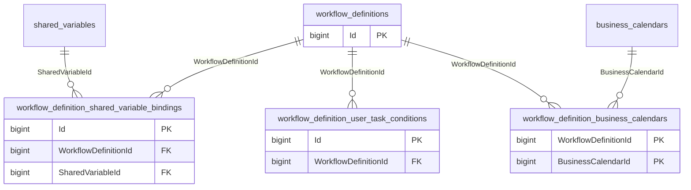
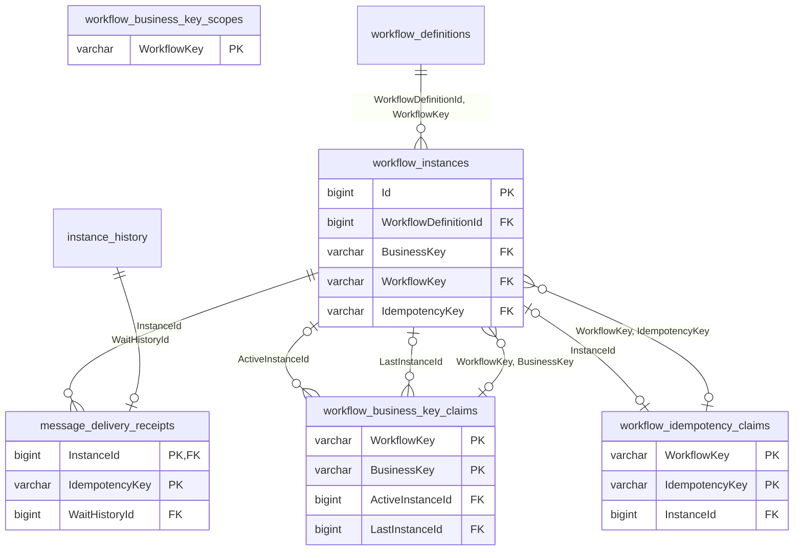
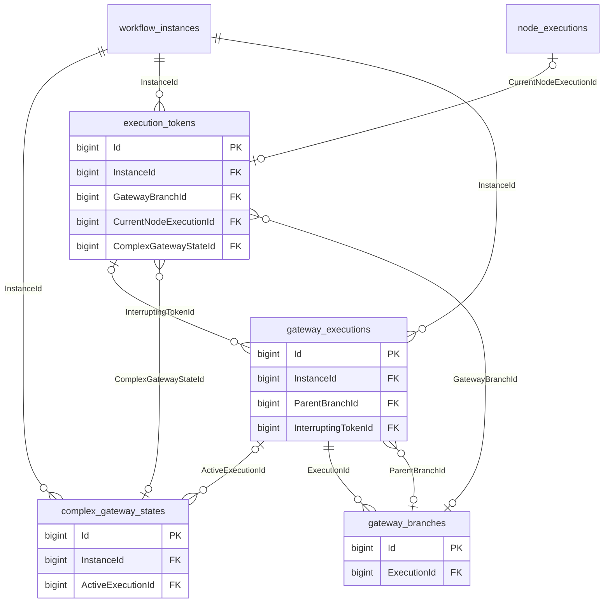
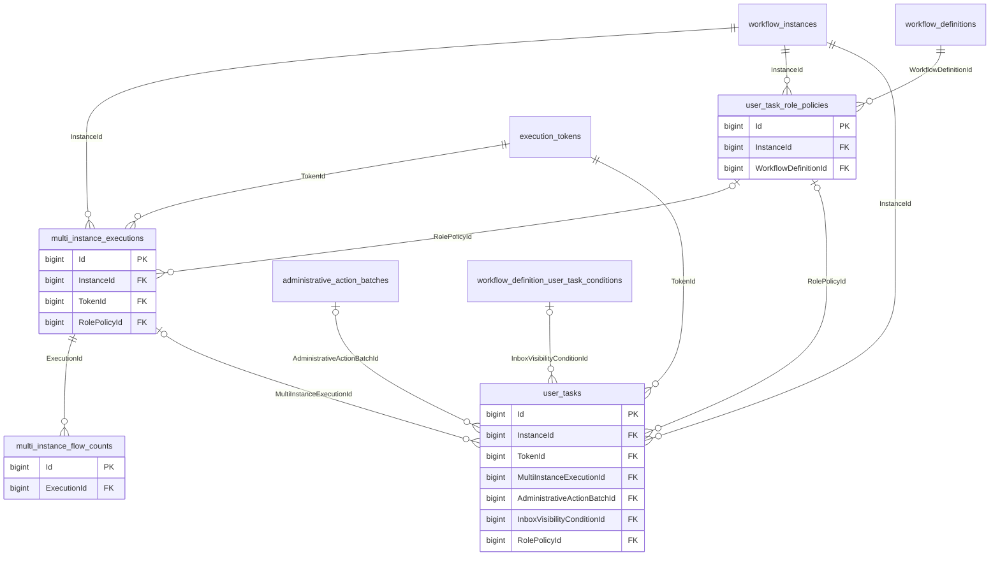
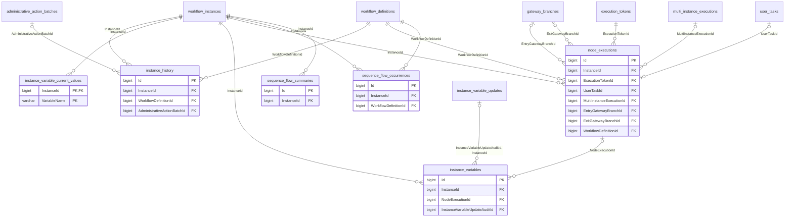
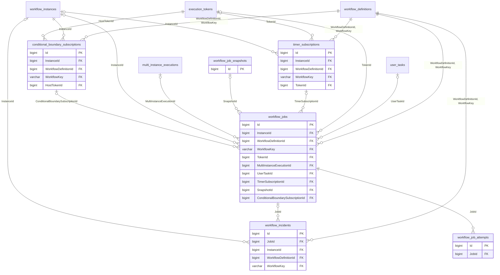
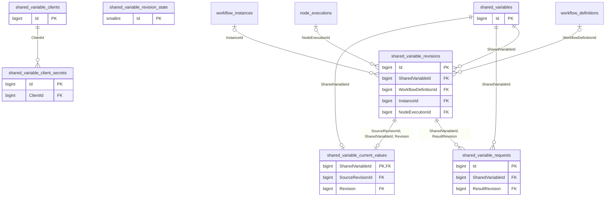
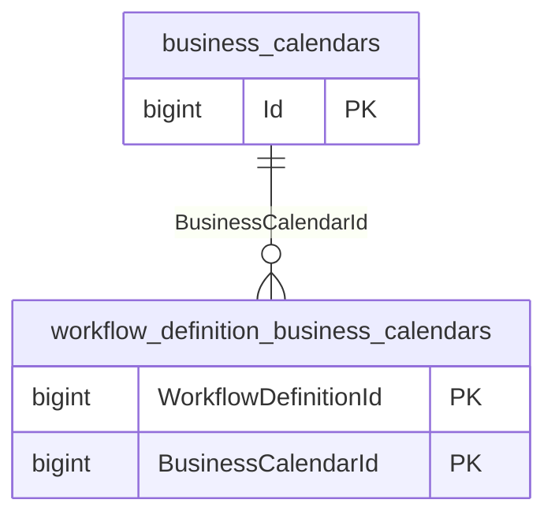
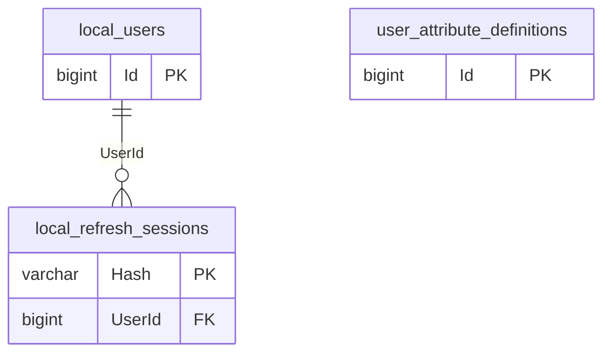

# Database schema reference

Flowbit stores everything in one PostgreSQL schema, `flowbit`. This page describes every table in that schema: what it is for, its key columns, and its keys, uniqueness rules, and relationships. Each area that has foreign keys includes an entity-relationship diagram.

Table names below omit the `flowbit.` qualifier. The page reflects the current migrations: the source of truth is the EF Core model in [`AppDbContext.cs`](../Flowbit/src/Flowbit.Infrastructure/Data/AppDbContext.cs), its [migrations](../Flowbit/src/Flowbit.Infrastructure/Data/Migrations/), and the raw SQL objects those migrations create. For feature behavior, see the [runtime reference](../Flowbit/README.md); for migration and upgrade procedures, see [deployment and operations](deployment.md#database-migrations).

> [!IMPORTANT]
> Treat these tables as internal engine state. Integrate through the [HTTP API](api-guide.md): direct writes bypass transactions, authorization, subscriptions, and audit, as the [developer guide](developer-guide.md#choose-the-integration-boundary) explains.

## Contents

- [Conventions](#conventions)
- [Table map](#table-map)
- [How the areas connect](#how-the-areas-connect)
- [Workflow definitions](#workflow-definitions)
- [Instances and start identity](#instances-and-start-identity)
- [Execution positions and gateways](#execution-positions-and-gateways)
- [User tasks and multi-instance work](#user-tasks-and-multi-instance-work)
- [Variables, history, and flow evidence](#variables-history-and-flow-evidence)
- [Durable jobs, timers, and subscriptions](#durable-jobs-timers-and-subscriptions)
- [Administrative operations](#administrative-operations)
- [Shared variables](#shared-variables)
- [Delegation](#delegation)
- [Settings](#settings)
- [Business calendars](#business-calendars)
- [Retention](#retention)
- [Local identity](#local-identity)
- [Database objects outside tables](#database-objects-outside-tables)
- [Inspect a live database](#inspect-a-live-database)
- [Keeping this page current](#keeping-this-page-current)

## Conventions

- **Schema.** All 55 tables, the EF `__EFMigrationsHistory` table, sequences, triggers, and functions live in `flowbit`. The `citext` extension, used for case-insensitive keys and user names, is installed in `public`.
- **Identifiers.** Most tables use a `bigint` identity `Id`. Natural or composite primary keys are called out per table.
- **Authored IDs are not foreign keys.** `NodeId`, `FlowId`, `SequenceFlowId`, `SourceNodeId`, `GatewayNodeId`, and similar integer columns refer to elements inside `workflow_definitions.Definition` JSON. Read them together with the row's `WorkflowDefinitionId`.
- **Snapshots.** Runtime rows copy what they need from the definition (node names, types, external IDs, roles, conditions) when they are created, so open work keeps the rules it started with. Only an audited version change updates them.
- **Types.** Timestamps are `timestamp with time zone` (UTC). Structured values are `jsonb`, and role lists are `text[]`. Status columns are short strings constrained by `CHECK` constraints.
- **Exact-match keys.** Business keys, idempotency keys, and machine client IDs use the `C` collation, so they compare exactly and case-sensitively.
- **Delete rules.** Foreign keys list their `ON DELETE` rule. Most instance-owned tables cascade from `workflow_instances`; audit, version, and job references use `RESTRICT` or `SET NULL` so history cannot be orphaned silently. The application never deletes instances, and a definition version that instances reference cannot be deleted (`RESTRICT`). [Retention](#retention) prunes eligible history rows instead.

## Table map

| Table | Area | Purpose |
| --- | --- | --- |
| [`workflow_definitions`](#workflow_definitions) | [Workflow definitions](#workflow-definitions) | One immutable version of a workflow definition (the editor JSON). |
| [`workflow_definition_user_task_conditions`](#workflow_definition_user_task_conditions) | [Workflow definitions](#workflow-definitions) | Compiled, database-executable inbox visibility condition per definition version and user task. |
| [`workflow_definition_shared_variable_bindings`](#workflow_definition_shared_variable_bindings) | [Workflow definitions](#workflow-definitions) | Which shared-variable catalog entries a definition version binds, under which alias and access. |
| [`workflow_definition_business_calendars`](#workflow_definition_business_calendars) | [Workflow definitions](#workflow-definitions) | Which business calendars a definition version names in timers and user-task due dates. |
| [`workflow_instances`](#workflow_instances) | [Instances and start identity](#instances-and-start-identity) | One workflow instance and its lifecycle status. |
| [`workflow_business_key_scopes`](#workflow_business_key_scopes) | [Instances and start identity](#instances-and-start-identity) | Marks a workflow family that has enabled business keys. |
| [`workflow_business_key_claims`](#workflow_business_key_claims) | [Instances and start identity](#instances-and-start-identity) | Domain uniqueness claim for a business key within a workflow family. |
| [`workflow_idempotency_claims`](#workflow_idempotency_claims) | [Instances and start identity](#instances-and-start-identity) | Permanent transport idempotency reservation for keyed starts. |
| [`message_delivery_receipts`](#message_delivery_receipts) | [Instances and start identity](#instances-and-start-identity) | Permanent receipt for an idempotent intermediate message delivery. |
| [`execution_tokens`](#execution_tokens) | [Execution positions and gateways](#execution-positions-and-gateways) | Authoritative execution positions (BPMN tokens); several per instance. |
| [`gateway_executions`](#gateway_executions) | [Execution positions and gateways](#execution-positions-and-gateways) | One firing of a Parallel, Inclusive, or Complex gateway (split or merge). |
| [`gateway_branches`](#gateway_branches) | [Execution positions and gateways](#execution-positions-and-gateways) | One branch (selected outgoing flow) of a split gateway execution. |
| [`complex_gateway_states`](#complex_gateway_states) | [Execution positions and gateways](#execution-positions-and-gateways) | Persistent phase and cycle state of one Complex gateway node in an instance. |
| [`user_tasks`](#user_tasks) | [User tasks and multi-instance work](#user-tasks-and-multi-instance-work) | Human work items: one per user-task visit, or one per multi-instance child. |
| [`user_task_role_policies`](#user_task_role_policies) | [User tasks and multi-instance work](#user-tasks-and-multi-instance-work) | Immutable role snapshot captured when a task or multi-instance approval is entered. |
| [`multi_instance_executions`](#multi_instance_executions) | [User tasks and multi-instance work](#user-tasks-and-multi-instance-work) | Parent execution of a multi-instance user task. |
| [`multi_instance_flow_counts`](#multi_instance_flow_counts) | [User tasks and multi-instance work](#user-tasks-and-multi-instance-work) | Per-flow completed-item counts for one multi-instance execution. |
| [`instance_variables`](#instance_variables) | [Variables, history, and flow evidence](#variables-history-and-flow-evidence) | Append-only history of every instance-variable write. |
| [`instance_variable_current_values`](#instance_variable_current_values) | [Variables, history, and flow evidence](#variables-history-and-flow-evidence) | Trigger-maintained latest value per instance variable, used for search. |
| [`instance_history`](#instance_history) | [Variables, history, and flow evidence](#variables-history-and-flow-evidence) | Heterogeneous transition and audit log for an instance. |
| [`node_executions`](#node_executions) | [Variables, history, and flow evidence](#variables-history-and-flow-evidence) | Lifecycle ledger of every committed node visit since the cutover. |
| [`sequence_flow_occurrences`](#sequence_flow_occurrences) | [Variables, history, and flow evidence](#variables-history-and-flow-evidence) | Audit occurrence for each flow action or traversal (FlowInfo evidence). |
| [`sequence_flow_summaries`](#sequence_flow_summaries) | [Variables, history, and flow evidence](#variables-history-and-flow-evidence) | Fixed-size lifetime summary per instance and flow, read by FlowInfo. |
| [`workflow_jobs`](#workflow_jobs) | [Durable jobs, timers, and subscriptions](#durable-jobs-timers-and-subscriptions) | Durable work queue: async continuations, timers, conditional wakes, and administrative batches. |
| [`workflow_job_attempts`](#workflow_job_attempts) | [Durable jobs, timers, and subscriptions](#durable-jobs-timers-and-subscriptions) | One row per leased attempt of a durable job. |
| [`workflow_job_snapshots`](#workflow_job_snapshots) | [Durable jobs, timers, and subscriptions](#durable-jobs-timers-and-subscriptions) | Frozen variable, invocation, and version-fence inputs for a durable job. |
| [`workflow_incidents`](#workflow_incidents) | [Durable jobs, timers, and subscriptions](#durable-jobs-timers-and-subscriptions) | Operational incidents that need administrator action. |
| [`timer_subscriptions`](#timer_subscriptions) | [Durable jobs, timers, and subscriptions](#durable-jobs-timers-and-subscriptions) | Armed timers for timer start events, intermediate timer catches, and timer boundaries. |
| [`conditional_boundary_subscriptions`](#conditional_boundary_subscriptions) | [Durable jobs, timers, and subscriptions](#durable-jobs-timers-and-subscriptions) | Per-activation state of a conditional boundary event on its host. |
| [`administrative_action_batches`](#administrative_action_batches) | [Administrative operations](#administrative-operations) | An administrative action applied to a frozen population of execution positions. |
| [`administrative_action_batch_items`](#administrative_action_batch_items) | [Administrative operations](#administrative-operations) | One frozen execution position in an administrative action batch. |
| [`workflow_instance_version_changes`](#workflow_instance_version_changes) | [Administrative operations](#administrative-operations) | Immutable audit of each committed instance version change. |
| [`workflow_instance_version_change_batches`](#workflow_instance_version_change_batches) | [Administrative operations](#administrative-operations) | A batch that moves frozen running instances from one version to another. |
| [`workflow_instance_version_change_batch_items`](#workflow_instance_version_change_batch_items) | [Administrative operations](#administrative-operations) | One instance in a version-change batch. |
| [`instance_variable_updates`](#instance_variable_updates) | [Administrative operations](#administrative-operations) | Immutable audit of one administrative raw-JSON variable update. |
| [`instance_variable_update_batches`](#instance_variable_update_batches) | [Administrative operations](#administrative-operations) | A batch of administrative variable updates over a frozen instance selection. |
| [`instance_variable_update_batch_items`](#instance_variable_update_batch_items) | [Administrative operations](#administrative-operations) | One instance in a variable-update batch. |
| [`instance_variable_update_batch_jobs`](#instance_variable_update_batch_jobs) | [Administrative operations](#administrative-operations) | Links a variable-update batch to its per-definition prepare and execute jobs. |
| [`shared_variables`](#shared_variables) | [Shared variables](#shared-variables) | Shared-variable catalog entry and contract. |
| [`shared_variable_current_values`](#shared_variable_current_values) | [Shared variables](#shared-variables) | Current value projection for a shared variable (one-to-one with the catalog). |
| [`shared_variable_revisions`](#shared_variable_revisions) | [Shared variables](#shared-variables) | Immutable audit history of every shared-variable mutation. |
| [`shared_variable_revision_state`](#shared_variable_revision_state) | [Shared variables](#shared-variables) | Singleton revision-allocator state for shared variables. |
| [`shared_variable_requests`](#shared_variable_requests) | [Shared variables](#shared-variables) | Idempotency ledger for shared-variable HTTP mutations. |
| [`shared_variable_clients`](#shared_variable_clients) | [Shared variables](#shared-variables) | Machine API clients for the shared-variable API. |
| [`shared_variable_client_secrets`](#shared_variable_client_secrets) | [Shared variables](#shared-variables) | Hashed secret versions for a shared-variable API client. |
| [`user_delegations`](#user_delegations) | [Delegation](#delegation) | Standing grants that let a delegate act on a delegator's tasks. |
| [`workflow_delegation_policies`](#workflow_delegation_policies) | [Delegation](#delegation) | Per-workflow acceptance policy for new delegation grants. |
| [`engine_settings`](#engine_settings) | [Settings](#settings) | Deployment-wide string settings for the engine. |
| [`workflow_settings`](#workflow_settings) | [Settings](#settings) | Typed JSON settings exposed to workflow expressions as `setting.*`. |
| [`business_calendars`](#business_calendars) | [Business calendars](#business-calendars) | Named working weeks, holidays, and time zones that durations can count in. |
| [`retention_policies`](#retention_policies) | [Retention](#retention) | Retention period per history/audit category. |
| [`retention_coordinator`](#retention_coordinator) | [Retention](#retention) | Singleton lease and run state for retention cleanup. |
| [`local_users`](#local_users) | [Local identity](#local-identity) | Local-mode user directory. |
| [`user_attribute_definitions`](#user_attribute_definitions) | [Local identity](#local-identity) | Typed custom user fields for local users. |
| [`local_refresh_sessions`](#local_refresh_sessions) | [Local identity](#local-identity) | Rotating, hashed refresh-token sessions for local users. |

## How the areas connect

Two tables anchor almost everything else:

- `workflow_definitions` holds immutable versions. Instances, tasks, jobs, timers, node executions, flow evidence, and every audit table pin an exact version through `WorkflowDefinitionId`. Several of them also carry `WorkflowKey`, the cross-version family key.
- `workflow_instances` owns all runtime state. Tokens, gateway scopes, user tasks, multi-instance executions, variables, history, node executions, and flow evidence reference it, and most of those references cascade.

Inside an instance, `execution_tokens` is the hub. User tasks, multi-instance executions, node executions, timers, conditional subscriptions, jobs, and administrative batch items all reference the token they belong to. `gateway_executions` and `gateway_branches` form a scope tree that tokens attach to through `GatewayBranchId`.

Some relationships are deliberately two-way:

- `execution_tokens.CurrentNodeExecutionId` → `node_executions`, and `node_executions.ExecutionTokenId` → `execution_tokens`.
- `gateway_executions.ParentBranchId` → `gateway_branches`, and `gateway_branches.ExecutionId` → `gateway_executions`.
- `workflow_instances (WorkflowKey, IdempotencyKey)` → `workflow_idempotency_claims`, and `workflow_idempotency_claims.InstanceId` → `workflow_instances`. Business-key claims use the same pattern with `ActiveInstanceId` and `LastInstanceId`.

Some ID columns intentionally have **no foreign key**, either because the referenced row may be pruned or because the column correlates audit data:

| Column(s) | Refers to |
| --- | --- |
| `DelegationId` in `instance_history`, `instance_variables`, and `sequence_flow_occurrences`; `user_tasks.CompletionDelegationId`; `node_executions.TriggeredDelegationId` and `CompletedDelegationId`; `sequence_flow_summaries.LastActionDelegationId` and `LastTraversalDelegationId` | `user_delegations.Id` |
| `instance_history.TokenId`, `UserTaskId`, `MultiInstanceExecutionId`; the same columns in `sequence_flow_occurrences` | Runtime rows of the same instance |
| `execution_tokens.WaitingJobId`, `WaitingTimerSubscriptionId` | The job or timer a token waits for |
| `instance_variable_current_values.SourceVariableId` | `instance_variables.Id` |
| `workflow_incidents.OriginalJobId`, `instance_variable_update_batch_jobs.OriginalJobId`, `administrative_action_batch_items.TimerJobId` | `workflow_jobs.Id`, kept after the job is pruned |
| `shared_variable_revisions.RequestId` | `shared_variable_requests.RequestId` |
| `WorkflowKey` in `workflow_business_key_scopes`, `user_delegations`, `workflow_delegation_policies`, and batch headers | `workflow_definitions.WorkflowKey` (not unique, so it cannot be a foreign-key target) |
| `local_users.AttributesJson` keys | `user_attribute_definitions.Key` |

## Workflow definitions

Immutable definition versions and the per-version projections derived from them when a definition is saved.



### `workflow_definitions`

Each row is one immutable version of a workflow. `POST /api/workflows` creates version 1 and `PUT /api/workflows/{id}` always inserts a new row; existing rows are never rewritten. Every version of one workflow shares the same `WorkflowKey`, which is the stable cross-version identity used by instance search, business keys, idempotency, delegation, and task distribution.

| Column | Meaning |
| --- | --- |
| `Id` | Version row ID. This is the API's `workflowId`; instances, jobs, and audits pin the exact version through it. |
| `WorkflowKey` | Stable family key, stamped from the JSON model `id` on every save. |
| `Version` | Version number, unique within `WorkflowKey`. |
| `Name` | Display name copied from the definition. |
| `Definition` | The complete editor JSON as `jsonb` (GIN-indexed). Lanes, nodes, flows, and variables live here, not in separate tables. |
| `IsPublished` | Only published versions can start instances. |
| `IsDefault`, `DefaultActivatedAt`, `DefaultActivationId` | Marks the family's published default version and records when it became the default. Message starts and task distribution resolve the default. |

- **Primary key:** `Id`
- **References:** none
- **Referenced by:** [`administrative_action_batches`](#administrative_action_batches).`WorkflowDefinitionId`, [`administrative_action_batch_items`](#administrative_action_batch_items).`WorkflowDefinitionId`, [`conditional_boundary_subscriptions`](#conditional_boundary_subscriptions) (`WorkflowDefinitionId`, `WorkflowKey`), [`instance_history`](#instance_history).`WorkflowDefinitionId`, [`instance_variable_update_batch_items`](#instance_variable_update_batch_items).`CapturedWorkflowDefinitionId`, [`instance_variable_update_batch_jobs`](#instance_variable_update_batch_jobs).`WorkflowDefinitionId`, [`instance_variable_updates`](#instance_variable_updates).`WorkflowDefinitionId`, [`node_executions`](#node_executions).`WorkflowDefinitionId`, [`sequence_flow_occurrences`](#sequence_flow_occurrences).`WorkflowDefinitionId`, [`shared_variable_revisions`](#shared_variable_revisions).`WorkflowDefinitionId`, [`timer_subscriptions`](#timer_subscriptions) (`WorkflowDefinitionId`, `WorkflowKey`), [`user_task_role_policies`](#user_task_role_policies).`WorkflowDefinitionId`, [`workflow_definition_shared_variable_bindings`](#workflow_definition_shared_variable_bindings).`WorkflowDefinitionId`, [`workflow_definition_user_task_conditions`](#workflow_definition_user_task_conditions).`WorkflowDefinitionId`, [`workflow_incidents`](#workflow_incidents) (`WorkflowDefinitionId`, `WorkflowKey`), [`workflow_instances`](#workflow_instances) (`WorkflowDefinitionId`, `WorkflowKey`), [`workflow_instance_version_change_batches`](#workflow_instance_version_change_batches).`SourceWorkflowDefinitionId`, [`workflow_instance_version_change_batches`](#workflow_instance_version_change_batches).`TargetWorkflowDefinitionId`, [`workflow_instance_version_change_batch_items`](#workflow_instance_version_change_batch_items).`CapturedSourceWorkflowDefinitionId`, [`workflow_instance_version_changes`](#workflow_instance_version_changes).`SourceWorkflowDefinitionId`, [`workflow_instance_version_changes`](#workflow_instance_version_changes).`TargetWorkflowDefinitionId`, [`workflow_jobs`](#workflow_jobs) (`WorkflowDefinitionId`, `WorkflowKey`)
- **Unique:** (`Id`, `WorkflowKey`) (alternate key); (`WorkflowKey`, `Version`)

The alternate key `(Id, WorkflowKey)` is the target of the composite foreign keys from `workflow_instances`, `workflow_jobs`, `workflow_incidents`, `timer_subscriptions`, and `conditional_boundary_subscriptions`. It guarantees that a row's denormalized `WorkflowKey` always matches its exact version.

Node IDs and sequence-flow IDs stored in other tables (`NodeId`, `FlowId`, `SequenceFlowId`, and similar) are authored integers inside `Definition`. They are not foreign keys.

### `workflow_definition_user_task_conditions`

Holds the compiled form of a user task's `inboxVisibilityCondition`, one row per definition version and node. It is created when the definition is saved, and PostgreSQL evaluates it during inbox queries before count, ordering, and paging.

| Column | Meaning |
| --- | --- |
| `WorkflowDefinitionId`, `NodeId` | The owning version and user-task node; unique together. |
| `NodeName`, `NodeExternalId` | Node snapshot for diagnostics. |
| `ProgramJson`, `ProgramVersion` | The compiled expression program and its format version, evaluated by `flowbit.evaluate_inbox_visibility_condition`. |
| `VariableNames`, `ExternalReferences` | The instance variables and context values (claims, config, settings, `sys.*`) the program reads. |
| `SemanticFingerprint` | Identifies semantically equal programs across versions. |

- **Primary key:** `Id`
- **References:** `WorkflowDefinitionId` → [`workflow_definitions`](#workflow_definitions) (required, `CASCADE`)
- **Referenced by:** [`user_tasks`](#user_tasks).`InboxVisibilityConditionId`
- **Unique:** (`WorkflowDefinitionId`, `NodeId`)

A `BEFORE INSERT` trigger on `user_tasks` copies the matching row ID into `user_tasks.InboxVisibilityConditionId`. An open task therefore keeps its original rule even after the instance switches workflow versions.

### `workflow_definition_shared_variable_bindings`

Records each top-level `scope: "shared"` process variable of a definition version: its workflow-local alias, the catalog entry it binds, and the requested access.

| Column | Meaning |
| --- | --- |
| `WorkflowDefinitionId` | Owning version. Deleting the version deletes its bindings. |
| `Alias` | The workflow-local variable name; unique per version. |
| `SharedVariableId`, `SharedKey` | The bound catalog entry and its canonical key; one binding per entry per version. |
| `Access` | `read` or `readWrite`. |

- **Primary key:** `Id`
- **References:** `SharedVariableId` → [`shared_variables`](#shared_variables) (required, `RESTRICT`); `WorkflowDefinitionId` → [`workflow_definitions`](#workflow_definitions) (required, `CASCADE`)
- **Referenced by:** none
- **Unique:** (`WorkflowDefinitionId`, `Alias`); (`WorkflowDefinitionId`, `SharedVariableId`)

The `RESTRICT` reference to `shared_variables` prevents deleting a catalog entry while any definition version binds it.

### `workflow_definition_business_calendars`

Records each business calendar a definition version names in a timer's `calendar` or a user task's `dueDateCalendar`. Rows are written when the version is saved and again when it is published, with the calendar rows locked `FOR KEY SHARE`, so a concurrent calendar delete waits and then sees them.

| Column | Meaning |
| --- | --- |
| `WorkflowDefinitionId` | Owning version. Deleting the version deletes its rows. |
| `BusinessCalendarId` | The named calendar. |
| `CreatedAt` | When the row was written. |

- **Primary key:** (`WorkflowDefinitionId`, `BusinessCalendarId`)
- **References:** `BusinessCalendarId` → [`business_calendars`](#business_calendars) (required, `CASCADE`); `WorkflowDefinitionId` → [`workflow_definitions`](#workflow_definitions) (required, `CASCADE`)
- **Referenced by:** none
- **Unique:** the primary key; index on `BusinessCalendarId`

The API refuses to delete a calendar that a published version, a running instance, or an open job uses, counting through these rows. Deleting a calendar that only unpublished versions without open work use removes their rows; publishing such a version then fails until the calendar exists again.

## Instances and start identity

The instance row and the claim tables that make starts and message deliveries idempotent or unique.



### `workflow_instances`

One row per started instance. It owns lifecycle status and timestamps. It no longer stores the current step: execution position lives in `execution_tokens` and human work in `user_tasks`. Every runtime transition locks this row first (`SELECT ... FOR UPDATE`).

| Column | Meaning |
| --- | --- |
| `Id` | Instance ID used throughout the API. |
| `WorkflowDefinitionId`, `WorkflowKey` | The exact definition version the instance runs, plus its family key. Changed only by a version change, which is audited in `workflow_instance_version_changes`. |
| `Status` | `running`, `completed`, `faulted`, or `cancelled`. |
| `StartedBy` | Canonical actor that started the instance. |
| `BusinessKey`, `BusinessKeyUniqueness` | Optional domain key and its `active`/`all` uniqueness mode. Ownership is held in `workflow_business_key_claims`. |
| `IdempotencyKey` | Private transport idempotency key for keyed starts. Ownership is held in `workflow_idempotency_claims`. |
| `CreatedAt`, `UpdatedAt` | Child activity also touches `UpdatedAt` in the same transaction. |
| `FinishedAt` | Latest terminal transition; the retention age reference. |
| `HistoryPrunedAt` | Set when retention first deletes instance-owned history. It is allowed only on terminal instances and permanently blocks reactivation. |
| `LastReactivationTokenId` | Root token created by the most recent reactivation; null if the instance was never reactivated. Tokens from this ID onward belong to the current run, so it marks the run boundary after retention removes the `instanceReactivated` history row. The migration that added it filled it from the reactivation history still present. It is not a foreign key. |

- **Primary key:** `Id`
- **References:** (`WorkflowDefinitionId`, `WorkflowKey`) → [`workflow_definitions`](#workflow_definitions) (`Id`, `WorkflowKey`) (required, `RESTRICT`); (`WorkflowKey`, `BusinessKey`) → [`workflow_business_key_claims`](#workflow_business_key_claims) (optional, `RESTRICT`); (`WorkflowKey`, `IdempotencyKey`) → [`workflow_idempotency_claims`](#workflow_idempotency_claims) (optional, `RESTRICT`)
- **Referenced by:** [`administrative_action_batch_items`](#administrative_action_batch_items).`InstanceId`, [`complex_gateway_states`](#complex_gateway_states).`InstanceId`, [`conditional_boundary_subscriptions`](#conditional_boundary_subscriptions).`InstanceId`, [`execution_tokens`](#execution_tokens).`InstanceId`, [`gateway_executions`](#gateway_executions).`InstanceId`, [`instance_history`](#instance_history).`InstanceId`, [`instance_variable_current_values`](#instance_variable_current_values).`InstanceId`, [`instance_variables`](#instance_variables).`InstanceId`, [`instance_variable_update_batch_items`](#instance_variable_update_batch_items).`InstanceId`, [`instance_variable_updates`](#instance_variable_updates).`InstanceId`, [`message_delivery_receipts`](#message_delivery_receipts).`InstanceId`, [`multi_instance_executions`](#multi_instance_executions).`InstanceId`, [`node_executions`](#node_executions).`InstanceId`, [`sequence_flow_occurrences`](#sequence_flow_occurrences).`InstanceId`, [`sequence_flow_summaries`](#sequence_flow_summaries).`InstanceId`, [`shared_variable_revisions`](#shared_variable_revisions).`InstanceId`, [`timer_subscriptions`](#timer_subscriptions).`InstanceId`, [`user_task_role_policies`](#user_task_role_policies).`InstanceId`, [`user_tasks`](#user_tasks).`InstanceId`, [`workflow_business_key_claims`](#workflow_business_key_claims).`ActiveInstanceId`, [`workflow_business_key_claims`](#workflow_business_key_claims).`LastInstanceId`, [`workflow_idempotency_claims`](#workflow_idempotency_claims).`InstanceId`, [`workflow_incidents`](#workflow_incidents).`InstanceId`, [`workflow_instance_version_change_batch_items`](#workflow_instance_version_change_batch_items).`InstanceId`, [`workflow_instance_version_changes`](#workflow_instance_version_changes).`InstanceId`, [`workflow_jobs`](#workflow_jobs).`InstanceId`

### `workflow_business_key_scopes`

One row per workflow family whose published default version enabled business keys. The row is inserted the first time such a version becomes the published default, and it is never removed: from then on, a new version of that family must keep business keys.

| Column | Meaning |
| --- | --- |
| `WorkflowKey` | The workflow family (primary key). |
| `ActivatedAt` | When business keys were first enabled. |

- **Primary key:** `WorkflowKey`
- **References:** none
- **Referenced by:** none

There is no foreign key, because `WorkflowKey` is not unique in `workflow_definitions`.

### `workflow_business_key_claims`

Enforces business-key uniqueness across all versions of a workflow family. A start reserves `(WorkflowKey, BusinessKey)` under a row lock inside its transaction; a duplicate returns `409 business_key_conflict`.

| Column | Meaning |
| --- | --- |
| `WorkflowKey`, `BusinessKey` | Composite primary key. `BusinessKey` uses the `C` collation, so comparison is exact and case-sensitive. |
| `ActiveInstanceId` | Instance that currently holds the claim. In `active` mode it is released when that instance becomes terminal. |
| `LastInstanceId` | Most recent owner, kept after release. |
| `IsPermanent` | `true` for `all` uniqueness, where the key is never released. |

- **Primary key:** (`WorkflowKey`, `BusinessKey`)
- **References:** `ActiveInstanceId` → [`workflow_instances`](#workflow_instances) (optional, `RESTRICT`); `LastInstanceId` → [`workflow_instances`](#workflow_instances) (optional, `RESTRICT`)
- **Referenced by:** [`workflow_instances`](#workflow_instances) (`WorkflowKey`, `BusinessKey`)

`workflow_instances (WorkflowKey, BusinessKey)` references this table, while `ActiveInstanceId` and `LastInstanceId` point back at instances.

### `workflow_idempotency_claims`

Permanently reserves a start's transport idempotency key for a workflow family, across both start routes and all versions. A committed owner makes a retry return `409 idempotency_conflict` with the owner's `Location`. The claim is reserved before the business key and rolls back with a failed start.

| Column | Meaning |
| --- | --- |
| `WorkflowKey`, `IdempotencyKey` | Composite primary key; the key uses the `C` collation. |
| `InstanceId` | Owning instance (unique). It is nullable so the claim can be inserted before its instance in the same transaction. |
| `CreatedAt` | Reservation time. |

- **Primary key:** (`WorkflowKey`, `IdempotencyKey`)
- **References:** `InstanceId` → [`workflow_instances`](#workflow_instances) (optional, `RESTRICT`)
- **Referenced by:** [`workflow_instances`](#workflow_instances) (`WorkflowKey`, `IdempotencyKey`)
- **Unique:** `InstanceId`

This is a deliberate two-way link: `workflow_instances (WorkflowKey, IdempotencyKey)` references the claim, and the claim references the instance.

### `message_delivery_receipts`

Created when a delivery to an `intermediateMessageCatchEvent` with `message.deliveryIdempotency=true` commits. The receipt reserves the key for the instance forever, so any authenticated reuse returns 409 and cannot consume a later wait.

| Column | Meaning |
| --- | --- |
| `InstanceId`, `IdempotencyKey` | Composite primary key; the key uses the `C` collation. |
| `SourceNodeId`, `CorrelationHeaderName` | The catch node and the configured idempotency header. |
| `WaitHistoryId` | The `instance_history` row of the exact wait occurrence the delivery consumed. It is unique, so one wait has one winner. |
| `CredentialProofHash`, `CredentialProofSalt`, `EnvelopeProofHash`, `EnvelopeProofSalt`, `ProofVersion` | Salted hashes of the original credentials and request envelope. Reuse is recognized without storing secrets or payloads. |

- **Primary key:** (`InstanceId`, `IdempotencyKey`)
- **References:** `InstanceId` → [`workflow_instances`](#workflow_instances) (required, `CASCADE`); `WaitHistoryId` → [`instance_history`](#instance_history) (required, `RESTRICT`)
- **Referenced by:** none
- **Unique:** `WaitHistoryId`

## Execution positions and gateways

Where execution currently is, and the gateway scope tree that joins and interrupts resolve against.



### `execution_tokens`

An instance may have several active tokens, for example one per parallel branch. A token records where execution currently rests and how it got there. It is the parent of user tasks, multi-instance executions, node visits, and durable waits.

| Column | Meaning |
| --- | --- |
| `InstanceId` | Owning instance. |
| `NodeId`, `NodeName`, `NodeType`, `NodeExternalId` | Snapshot of the node the token is on. Instance-list node filters and current-node display read the latest token. |
| `Status` | `active`, `completed`, `faulted`, `cancelled`, or `merged`. |
| `ActivationId` | Fence regenerated on each node activation. Jobs, timers, conditional subscriptions, and administrative items must present the matching value. |
| `WaitState`, `WaitingJobId`, `WaitingTimerSubscriptionId` | Durable wait kind (`asyncBefore`, `asyncAfter`, `timerCatch`, `timerBoundary`, `conditionalWake`) and the job or timer the token waits for. These columns have no foreign keys. |
| `ArrivedViaFlowId` | The sequence flow that brought the token here. |
| `CurrentNodeExecutionId` | The current visit in `node_executions` (unique). It is null at a multi-instance parent. |
| `GatewayBranchId` | The gateway branch the token belongs to, which places it in the gateway scope tree. |
| `ComplexGatewayStateId`, `ComplexGatewayCycle`, `ComplexDrainStateIds`, `AutomaticActivationStateIds` | Complex-gateway bookkeeping (GIN-indexed arrays). |
| `AutomaticActivationCount` | Consecutive automatic activations, checked against `Workflow.Async.MaxConsecutiveAutomaticActivations`. |
| `FaultCode`, `FaultDescription`, `TerminationReason` | Error-end fault snapshot and why the token ended. |

- **Primary key:** `Id`
- **References:** `ComplexGatewayStateId` → [`complex_gateway_states`](#complex_gateway_states) (optional, `NO ACTION`); `CurrentNodeExecutionId` → [`node_executions`](#node_executions) (optional, `NO ACTION`); `GatewayBranchId` → [`gateway_branches`](#gateway_branches) (optional, `NO ACTION`); `InstanceId` → [`workflow_instances`](#workflow_instances) (required, `CASCADE`)
- **Referenced by:** [`administrative_action_batch_items`](#administrative_action_batch_items).`TokenId`, [`conditional_boundary_subscriptions`](#conditional_boundary_subscriptions).`HostTokenId`, [`gateway_executions`](#gateway_executions).`InterruptingTokenId`, [`multi_instance_executions`](#multi_instance_executions).`TokenId`, [`node_executions`](#node_executions).`ExecutionTokenId`, [`timer_subscriptions`](#timer_subscriptions).`TokenId`, [`user_tasks`](#user_tasks).`TokenId`, [`workflow_jobs`](#workflow_jobs).`TokenId`
- **Unique:** `CurrentNodeExecutionId`

### `gateway_executions`

Each firing of a Parallel, Inclusive, or Complex gateway writes one row. Exclusive gateways never create rows. Split executions own `gateway_branches`, which makes them the generic scope that joins, `joinCancellation`, and `scopedInterruptEvent` resolve against.

| Column | Meaning |
| --- | --- |
| `InstanceId`, `GatewayNodeId` | Owning instance and gateway node. |
| `GatewayType` | `parallelGateway`, `inclusiveGateway`, or `complexGateway`. |
| `Direction` | `split` or `merge`. |
| `Status` | `active`, `joined`, `completed`, `interrupted`, or `cancelled`. |
| `SelectedFlowIds` | Outgoing flows chosen by a split. |
| `Phase`, `Cycle` | Complex gateways only: `start` or `reset` phase, and the cycle number. |
| `ParentBranchId` | The enclosing branch. Nested scopes form a tree through this column and `gateway_branches.ExecutionId`. |
| `InterruptingNodeId`, `InterruptingTokenId` | Which node and surviving token interrupted the scope (cancelling join or scoped interrupt). |
| `CompletionReason`, `CompletedAt` | Why and when the execution closed. |

- **Primary key:** `Id`
- **References:** `InstanceId` → [`workflow_instances`](#workflow_instances) (required, `CASCADE`); `InterruptingTokenId` → [`execution_tokens`](#execution_tokens) (optional, `NO ACTION`); `ParentBranchId` → [`gateway_branches`](#gateway_branches) (optional, `NO ACTION`)
- **Referenced by:** [`complex_gateway_states`](#complex_gateway_states).`ActiveExecutionId`, [`gateway_branches`](#gateway_branches).`ExecutionId`

### `gateway_branches`

One row per outgoing flow a split selected. Tokens and nested gateway executions point at their branch to record scope lineage.

| Column | Meaning |
| --- | --- |
| `ExecutionId` | The split execution that created the branch. |
| `Ordinal`, `OriginatingFlowId` | Branch position and outgoing flow; each is unique within the execution. |
| `Status` | `active`, `merged`, `completed`, `interrupted`, or `cancelled`. |

- **Primary key:** `Id`
- **References:** `ExecutionId` → [`gateway_executions`](#gateway_executions) (required, `CASCADE`)
- **Referenced by:** [`execution_tokens`](#execution_tokens).`GatewayBranchId`, [`gateway_executions`](#gateway_executions).`ParentBranchId`, [`node_executions`](#node_executions).`EntryGatewayBranchId`, [`node_executions`](#node_executions).`ExitGatewayBranchId`
- **Unique:** (`ExecutionId`, `Ordinal`); (`ExecutionId`, `OriginatingFlowId`)

### `complex_gateway_states`

One row per Complex gateway node per instance (unique), holding the state that `activationCondition` evaluation and reset routing need between transitions.

| Column | Meaning |
| --- | --- |
| `InstanceId`, `GatewayNodeId` | Owning instance and gateway node. |
| `Phase` | `waitingForStart`, `waitingForReset`, or `interruptedDraining`. |
| `Cycle` | Current activation cycle. |
| `ContributingFlowIds`, `RemainingFlowIds` | Incoming flows that fired the current activation and flows still expected before reset. |
| `DrainingTokenIds`, `ActivationDrainStateIds` | Pre-interrupt token provenance being drained. |
| `ActiveExecutionId` | The current `gateway_executions` row. |
| `AutomaticActivationCount` | Automatic-activation counter for the loop limit. |

- **Primary key:** `Id`
- **References:** `ActiveExecutionId` → [`gateway_executions`](#gateway_executions) (optional, `NO ACTION`); `InstanceId` → [`workflow_instances`](#workflow_instances) (required, `CASCADE`)
- **Referenced by:** [`execution_tokens`](#execution_tokens).`ComplexGatewayStateId`
- **Unique:** (`InstanceId`, `GatewayNodeId`)

## User tasks and multi-instance work

Human work items, their captured authorization, and multi-instance aggregation.



### `user_tasks`

A normal user task creates one work item each time a token rests on it. A multi-instance task creates one item per child under a single parent token. Inbox membership, claims, assignment, and completion are all read from and written to this table.

| Column | Meaning |
| --- | --- |
| `InstanceId`, `TokenId` | Owning instance and the token resting on the task. |
| `NodeId`, `NodeName`, `NodeExternalId` | Node snapshot. |
| `Status` | `pending` (sequential multi-instance item not yet active), `active`, `completed`, or `cancelled`. |
| `Roles` | Inbox role projection (GIN-indexed). The authoritative captured roles are in `user_task_role_policies` via `RolePolicyId`. |
| `RequiresClaim`, `ClaimedBy` | Claim requirement and current claimant. |
| `RequiresAssignment`, `Assignee` | Required-assignment gate and the directly assigned user. A case-insensitive expression index backs assignee lookups. |
| `DueAt`, `Priority` | Nullable due time and priority resolved from the task's `dueDate` and `priority` when the work item was created. Children of a multi-instance execution share one value. Never recomputed. The `(Status, DueAt, Id)` index backs due-date filters. |
| `InboxVisibilityConditionId` | The compiled inbox condition captured at insert. |
| `MultiInstanceExecutionId`, `ItemIndex`, `ItemValueJson` | Multi-instance parent, child index (unique within the parent), and the collection value for that child. |
| `SelectedFlowId`, `ResultJson` | Chosen outgoing flow and submitted values. |
| `CompletedBy`, `CompletedByRoles`, `CompletedActingFor`, `CompletionDelegationId`, `CompletionKind`, `CompletionReason`, `CompletedAt` | Completion audit, including delegation. |
| `AdministrativeActionBatchId` | The administrative batch that completed or cancelled the item, if any. |

- **Primary key:** `Id`
- **References:** `AdministrativeActionBatchId` → [`administrative_action_batches`](#administrative_action_batches) (optional, `RESTRICT`); `InboxVisibilityConditionId` → [`workflow_definition_user_task_conditions`](#workflow_definition_user_task_conditions) (optional, `RESTRICT`); `InstanceId` → [`workflow_instances`](#workflow_instances) (required, `CASCADE`); `MultiInstanceExecutionId` → [`multi_instance_executions`](#multi_instance_executions) (optional, `RESTRICT`); `RolePolicyId` → [`user_task_role_policies`](#user_task_role_policies) (optional, `RESTRICT`); `TokenId` → [`execution_tokens`](#execution_tokens) (required, `RESTRICT`)
- **Referenced by:** [`administrative_action_batch_items`](#administrative_action_batch_items).`UserTaskId`, [`node_executions`](#node_executions).`UserTaskId`, [`workflow_jobs`](#workflow_jobs).`UserTaskId`
- **Unique:** (`MultiInstanceExecutionId`, `ItemIndex`)

### `user_task_role_policies`

Captures task roles and per-flow action roles together on entry, so later variable changes cannot change who may act. A policy is shared by one normal task, or by a multi-instance parent and all of its children. Role management never edits a policy: it inserts a replacement and repoints the open work under optimistic `expectedRolePolicyId`.

| Column | Meaning |
| --- | --- |
| `InstanceId`, `WorkflowDefinitionId`, `NodeId` | Owning instance, the definition version it was captured from, and the task node. |
| `Roles` | Captured task roles. |
| `OutgoingFlowRolesJson` | Captured action roles for every selectable outgoing flow. |
| `CreatedAt` | Capture time. |

- **Primary key:** `Id`
- **References:** `InstanceId` → [`workflow_instances`](#workflow_instances) (required, `CASCADE`); `WorkflowDefinitionId` → [`workflow_definitions`](#workflow_definitions) (required, `RESTRICT`)
- **Referenced by:** [`multi_instance_executions`](#multi_instance_executions).`RolePolicyId`, [`user_tasks`](#user_tasks).`RolePolicyId`

### `multi_instance_executions`

One row per activation of a multi-instance user task. The parent token stays on the node while children run as `user_tasks` rows, and this row aggregates their outcomes.

| Column | Meaning |
| --- | --- |
| `InstanceId`, `TokenId`, `NodeId` | Owning instance, parent token, and task node. At most one active execution exists per token and node. |
| `Mode`, `Source` | `parallel` or `sequential`; `collection` or `cardinality`. |
| `OnePerActor` | Whether one actor may complete at most one child. |
| `TotalCount`, `CompletedCount`, `CancelledCount` | Child progress counters. |
| `Status` | `active`, `completed`, `interrupted`, or `cancelled`. |
| `WinningFlowId`, `CompletionReason`, `CompletedAt` | The outcome flow that advanced the parent, and why. |
| `ResultVariable` | Variable that receives the ordered child results. |
| `RolePolicyId` | Role snapshot shared by the parent and its children. |

- **Primary key:** `Id`
- **References:** `InstanceId` → [`workflow_instances`](#workflow_instances) (required, `CASCADE`); `RolePolicyId` → [`user_task_role_policies`](#user_task_role_policies) (optional, `RESTRICT`); `TokenId` → [`execution_tokens`](#execution_tokens) (required, `RESTRICT`)
- **Referenced by:** [`administrative_action_batch_items`](#administrative_action_batch_items).`MultiInstanceExecutionId`, [`multi_instance_flow_counts`](#multi_instance_flow_counts).`ExecutionId`, [`node_executions`](#node_executions).`MultiInstanceExecutionId`, [`user_tasks`](#user_tasks).`MultiInstanceExecutionId`, [`workflow_jobs`](#workflow_jobs).`MultiInstanceExecutionId`
- **Unique:** (`TokenId`, `NodeId`) where `Status = 'active'`

### `multi_instance_flow_counts`

One row per execution and outgoing flow, counting how many completed children chose that flow. It backs `CountFlow(flowId)` and `PercentFlow(flowId)` in completion conditions.

| Column | Meaning |
| --- | --- |
| `ExecutionId`, `FlowId` | The multi-instance execution and outcome flow; unique together. |
| `CompletedCount` | Number of children that completed through the flow. |

- **Primary key:** `Id`
- **References:** `ExecutionId` → [`multi_instance_executions`](#multi_instance_executions) (required, `CASCADE`)
- **Referenced by:** none
- **Unique:** (`ExecutionId`, `FlowId`)

## Variables, history, and flow evidence

Append-only variable history and its search projection, the instance audit trail, the node-visit ledger, and FlowInfo evidence.



### `instance_variables`

The authoritative variable history. Every write appends a row, including identical values and administrative raw-JSON updates; rows are never updated in place.

| Column | Meaning |
| --- | --- |
| `InstanceId`, `VariableName`, `ValueJson` | Owning instance, variable name, and JSON value. |
| `SetAt`, `SetBy`, `ActingFor`, `DelegationId` | When the value was written, by whom, and on whose behalf. |
| `SourceActionId` | The sequence flow whose submitted values produced the write, if any. |
| `NodeExecutionId` | The node visit that produced the write. Execution detail shows only these attributed changes. |
| `InstanceVariableUpdateAuditId` | The administrative update operation that produced the write, if any. |

- **Primary key:** `Id`
- **References:** `InstanceId` → [`workflow_instances`](#workflow_instances) (required, `CASCADE`); (`InstanceVariableUpdateAuditId`, `InstanceId`) → [`instance_variable_updates`](#instance_variable_updates) (`Id`, `InstanceId`) (optional, `RESTRICT`); `NodeExecutionId` → [`node_executions`](#node_executions) (optional, `RESTRICT`)
- **Referenced by:** none

The `AFTER INSERT` trigger `instance_variables_sync_current_value` upserts the newest row per `(InstanceId, VariableName)` into `instance_variable_current_values`.

### `instance_variable_current_values`

Read-optimized projection of the latest value for each instance variable. Latest-value enrichment, inbox action checks, and all advanced `variableFilter` searches read this table; audit and execution detail read `instance_variables`.

| Column | Meaning |
| --- | --- |
| `InstanceId`, `VariableName` | Composite primary key. |
| `ValueJson` | Latest value. It has a GIN index plus expression indexes for case-insensitive root strings and root numbers. |
| `SourceVariableId` | The `instance_variables.Id` the value came from. The trigger replaces a row only when this ID is newer. There is no foreign key. |
| `SetAt` | Time of the source write. |

- **Primary key:** (`InstanceId`, `VariableName`)
- **References:** `InstanceId` → [`workflow_instances`](#workflow_instances) (required, `CASCADE`)
- **Referenced by:** none

### `instance_history`

The instance's event and audit trail: flow traversals, automatic routing, claims, assignments, role changes, reactivation, conditional triggers, and more. It feeds instance detail and claim inheritance. It is not a complete node-lifecycle ledger; use `node_executions` for that.

| Column | Meaning |
| --- | --- |
| `InstanceId`, `WorkflowDefinitionId` | Owning instance and the version in effect when the row was written. |
| `FromStepId`, `ToStepId` | Source and target node IDs (legacy "step" naming). |
| `ActionId` | Sequence flow taken, when the event selected one. |
| `Note` | Event kind, for example `start`, `automatic`, `gateway`, `message`, `taskClaim`, `taskAssignment`, `taskRolesChanged`, or `instanceReactivated`. |
| `Payload` | Event-specific JSON details. |
| `PerformedBy`, `PerformedAt`, `ActingFor`, `DelegationId`, `ActorClaimsJson` | Actor, time, delegation attribution, and allowlisted JWT claims (`WorkflowAudit:AllowedClaims`). |
| `TokenId`, `UserTaskId`, `MultiInstanceExecutionId`, `ItemIndex` | Runtime correlation. These columns have no foreign keys. |
| `Reason`, `SharedVariableWritesJson`, `AdministrativeActionBatchId` | Optional audit reason, value-free shared-variable write correlations, and the originating administrative batch. |

- **Primary key:** `Id`
- **References:** `AdministrativeActionBatchId` → [`administrative_action_batches`](#administrative_action_batches) (optional, `RESTRICT`); `InstanceId` → [`workflow_instances`](#workflow_instances) (required, `CASCADE`); `WorkflowDefinitionId` → [`workflow_definitions`](#workflow_definitions) (required, `RESTRICT`)
- **Referenced by:** [`message_delivery_receipts`](#message_delivery_receipts).`WaitHistoryId`

### `node_executions`

The authoritative, read-only ledger of committed node visits. A normal visit is correlated to one token, and a parallel fork produces one row per branch token. A normal user task shares its visit with its work item. A multi-instance task produces one `userTaskItem` row per child and no parent row. `/api/node-executions` searches this table.

| Column | Meaning |
| --- | --- |
| `InstanceId`, `WorkflowDefinitionId`, `ExecutionTokenId` | Owning instance, version, and token. |
| `NodeId`, `NodeName`, `NodeType`, `NodeExternalId`, `NodeRolesJson` | Immutable node snapshot. |
| `ExecutionKind` | `node` or `userTaskItem`. |
| `Status` | `pending`, `active`, `completed`, `cancelled`, `faulted`, or `merged`. |
| `CompletionReason` | Why the visit ended, for example `userAction`, `boundaryCaught`, or `parallelJoin`. It is required exactly when the visit is terminal. |
| `UserTaskId` | The work item sharing this visit (unique). |
| `MultiInstanceExecutionId`, `ItemIndex` | Multi-instance parent and child index (unique together). |
| `EnteredViaFlowId`, `SelectedFlowId`, `ExitedViaFlowId` | Entry, chosen, and exit flows. |
| `EntryGatewayBranchId`, `ExitGatewayBranchId` | Gateway branch correlation. |
| `TriggeredBy*`, `CompletedBy*` | Actor, roles, claims, and delegation snapshots for whoever started and completed the visit. |
| `CreatedAt`, `StartedAt`, `CompletedAt`, `UpdatedAt` | Lifecycle timestamps. A seeded pending row has no `StartedAt`. |
| `ErrorCode`, `ErrorDescription` | Failure diagnostics, bounded to 1,000 characters. |
| `IsCutoverSeeded` | `true` for rows the migration seeded from open work. |

- **Primary key:** `Id`
- **References:** `EntryGatewayBranchId` → [`gateway_branches`](#gateway_branches) (optional, `NO ACTION`); `ExecutionTokenId` → [`execution_tokens`](#execution_tokens) (required, `RESTRICT`); `ExitGatewayBranchId` → [`gateway_branches`](#gateway_branches) (optional, `NO ACTION`); `InstanceId` → [`workflow_instances`](#workflow_instances) (required, `CASCADE`); `MultiInstanceExecutionId` → [`multi_instance_executions`](#multi_instance_executions) (optional, `RESTRICT`); `UserTaskId` → [`user_tasks`](#user_tasks) (optional, `RESTRICT`); `WorkflowDefinitionId` → [`workflow_definitions`](#workflow_definitions) (required, `RESTRICT`)
- **Referenced by:** [`execution_tokens`](#execution_tokens).`CurrentNodeExecutionId`, [`instance_variables`](#instance_variables).`NodeExecutionId`, [`shared_variable_revisions`](#shared_variable_revisions).`NodeExecutionId`
- **Unique:** (`MultiInstanceExecutionId`, `ItemIndex`) where `MultiInstanceExecutionId IS NOT NULL AND ItemIndex IS NOT NULL`; `UserTaskId` where `UserTaskId IS NOT NULL`

### `sequence_flow_occurrences`

One row per explicit actor selection (action) and/or token movement (traversal) of a sequence flow. It is written for definitions that reference `FlowInfo` and always for administrative actions.

| Column | Meaning |
| --- | --- |
| `InstanceId`, `WorkflowDefinitionId`, `SequenceFlowId`, `SourceNodeId`, `TargetNodeId` | Owning instance, version, and the flow with its endpoints. |
| `Kind`, `IsAction`, `IsTraversal` | Evidence kind and whether the row counts as an action, a traversal, or both. |
| `User`, `UserRoles`, `ActingFor`, `DelegationId` | Validated actor and all roles at that moment. |
| `ValuesJson` | Flow-local submitted values. |
| `AdministrativeActionJson` | Batch and action correlation for administrative selections. |
| `TokenId`, `UserTaskId`, `MultiInstanceExecutionId`, `ItemIndex` | Runtime correlation without foreign keys. One action per work item is enforced by a unique index on `UserTaskId` where `IsAction`. |
| `SharedVariableWritesJson`, `OccurredAt` | Value-free shared write correlations and event time. |

- **Primary key:** `Id`
- **References:** `InstanceId` → [`workflow_instances`](#workflow_instances) (required, `CASCADE`); `WorkflowDefinitionId` → [`workflow_definitions`](#workflow_definitions) (required, `RESTRICT`)
- **Referenced by:** none
- **Unique:** `UserTaskId` where `UserTaskId IS NOT NULL AND IsAction`

### `sequence_flow_summaries`

One row per instance and sequence flow, upserted in the same transaction as each occurrence. `FlowInfo(flowId, path)` and `execution.getFlowInfo` read this row, so evaluation cost does not grow with loops or multi-instance fan-out.

| Column | Meaning |
| --- | --- |
| `InstanceId`, `SequenceFlowId` | Unique together. |
| `ActionCount`, `TraversalCount` | Lifetime counters. |
| `LastAction*`, `LastTraversal*` | User, roles, kind, time, values, delegation, administrative action, and shared-write correlations of the latest action and traversal. |

- **Primary key:** `Id`
- **References:** `InstanceId` → [`workflow_instances`](#workflow_instances) (required, `CASCADE`)
- **Referenced by:** none
- **Unique:** (`InstanceId`, `SequenceFlowId`)

## Durable jobs, timers, and subscriptions

Work processed by `Flowbit.Worker`, plus the timer and conditional-boundary state it fires from.



### `workflow_jobs`

Each row is one unit of durable work, leased by `Flowbit.Worker` with `FOR UPDATE SKIP LOCKED`. The same table serves instance work (async continuations, timers, durable conditional wakes) and instance-less control work (administrative, version-change, and variable-update batch phases).

| Column | Meaning |
| --- | --- |
| `Kind` | `asyncBefore`, `asyncAfter`, `timer`, `timerStart`, `timerBoundary`, `conditionalWake`, `administrativeBatchPrepare`, `administrativeBatchExecute`, `instanceVersionChangeBatchPrepare`, `instanceVersionChangeBatchExecute`, `instanceVariableUpdateBatchPrepare`, or `instanceVariableUpdateBatchExecute`. |
| `QueueClass`, `Priority`, `DueAt` | `control` or `activity` queue, priority, and earliest run time. |
| `Status` | `queued`, `running`, `resultReady`, `retry`, `completed`, `incident`, `cancelled`, or `skipped`. |
| `Phase`, `PayloadJson`, `ResultJson`, `ErrorJson` | Job-specific progress, input, staged result, and last error. |
| `AttemptCount`, `MaxAttempts`, `RetryDelays`, `FailureHandling` | Retry policy; `FailureHandling` is `boundaryFirst` or `retryFirst`. |
| `WorkerId`, `LeaseToken`, `LeaseGeneration`, `LeaseExpiresAt`, `HeartbeatAt` | Lease state. Finalization must present the current lease generation. |
| `InstanceId`, `TokenId`, `ActivationId`, `UserTaskId`, `MultiInstanceExecutionId` | Runtime fences. `InstanceId` is null for instance-less work. |
| `TimerSubscriptionId`, `ScheduledOccurrenceAt` | Timer occurrence; unique together, so each occurrence gets one job. A `timer_schedule_failed` incident's `timerStart` job has a subscription but no occurrence. |
| `ConditionalBoundarySubscriptionId`, `ConditionalBoundaryOccurrence` | Durable conditional-boundary occurrence; unique together. |
| `SnapshotId` | Frozen input snapshot in `workflow_job_snapshots`. |
| `WorkflowDefinitionId`, `WorkflowKey`, `NodeId`, `NodeName`, `NodeType` | Version and node context. |
| `AutomaticActivationCount` | Carries the automatic-loop allowance. |

- **Primary key:** `Id`
- **References:** `ConditionalBoundarySubscriptionId` → [`conditional_boundary_subscriptions`](#conditional_boundary_subscriptions) (optional, `RESTRICT`); `InstanceId` → [`workflow_instances`](#workflow_instances) (optional, `CASCADE`); `MultiInstanceExecutionId` → [`multi_instance_executions`](#multi_instance_executions) (optional, `RESTRICT`); `SnapshotId` → [`workflow_job_snapshots`](#workflow_job_snapshots) (optional, `RESTRICT`); `TimerSubscriptionId` → [`timer_subscriptions`](#timer_subscriptions) (optional, `RESTRICT`); `TokenId` → [`execution_tokens`](#execution_tokens) (optional, `RESTRICT`); `UserTaskId` → [`user_tasks`](#user_tasks) (optional, `RESTRICT`); (`WorkflowDefinitionId`, `WorkflowKey`) → [`workflow_definitions`](#workflow_definitions) (`Id`, `WorkflowKey`) (required, `RESTRICT`)
- **Referenced by:** [`administrative_action_batches`](#administrative_action_batches).`ExecutionJobId`, [`administrative_action_batches`](#administrative_action_batches).`PreparationJobId`, [`instance_variable_update_batch_jobs`](#instance_variable_update_batch_jobs).`JobId`, [`workflow_incidents`](#workflow_incidents).`JobId`, [`workflow_instance_version_change_batches`](#workflow_instance_version_change_batches).`ExecutionJobId`, [`workflow_instance_version_change_batches`](#workflow_instance_version_change_batches).`PreparationJobId`, [`workflow_job_attempts`](#workflow_job_attempts).`JobId`
- **Unique:** (`ConditionalBoundarySubscriptionId`, `ConditionalBoundaryOccurrence`) where `ConditionalBoundarySubscriptionId IS NOT NULL AND ConditionalBoundaryOccurrence IS NOT NULL`; (`TimerSubscriptionId`, `ScheduledOccurrenceAt`) where `TimerSubscriptionId IS NOT NULL AND ScheduledOccurrenceAt IS NOT NULL`

### `workflow_job_attempts`

Attempt history for retries, incidents, and the Operations UI.

| Column | Meaning |
| --- | --- |
| `JobId`, `AttemptNumber` | Unique together. |
| `LeaseGeneration`, `WorkerId` | The lease and worker that ran the attempt. |
| `Status` | `running`, `resultReady`, `completed`, `failed`, `leaseLost`, or `cancelled`. |
| `FailureCode`, `FailureDescription`, `StartedAt`, `FinishedAt` | Outcome details. A `leaseLost` attempt has `FailureCode` `leaseExpired` when its lease expired, or `workerShutdown` when a stopping Worker released the lease after its drain window. |

- **Primary key:** `Id`
- **References:** `JobId` → [`workflow_jobs`](#workflow_jobs) (required, `CASCADE`)
- **Referenced by:** none
- **Unique:** (`JobId`, `AttemptNumber`)

### `workflow_job_snapshots`

Stores the inputs a job must use when it runs later: the variable overlay, the prepared invocation, and the version fences used to detect conflicting writes before output is committed.

| Column | Meaning |
| --- | --- |
| `Kind`, `EvaluationTime`, `SizeBytes` | Snapshot kind, the logical evaluation time, and stored size. |
| `VariablesJson`, `FlowInfoJson`, `InvocationJson` | Frozen variables, FlowInfo summaries, and prepared call. |
| `OutputVariableVersionsJson` | Instance-variable version fences for output targets. |
| `SharedVariableRevisionsJson`, `SharedOutputValueVersionsJson` | Shared-variable fences. The legacy catalog-revision map and the value-revision map are dual-written during the rollout. |

- **Primary key:** `Id`
- **References:** none
- **Referenced by:** [`workflow_jobs`](#workflow_jobs).`SnapshotId`

Snapshots have no outgoing foreign keys. Retention removes orphaned snapshots together with completed jobs.

### `workflow_incidents`

Opened when durable work cannot continue on its own, for example exhausted retries, an output conflict, `automatic_loop_limit`, or `timer_schedule_failed` for a timer start whose first due time cannot be computed. At most one incident is open per job.

| Column | Meaning |
| --- | --- |
| `Type`, `Summary`, `Details` | Incident classification and diagnostics. |
| `Status`, `ResolvedAt`, `ResolvedBy` | `open` or `resolved`, with resolution fields required exactly when resolved. |
| `JobId`, `OriginalJobId` | The live job, set to null if the job is later deleted, and a permanent copy of its ID. |
| `InstanceId`, `WorkflowDefinitionId`, `WorkflowKey`, `NodeId`, `NodeName` | Context. |

- **Primary key:** `Id`
- **References:** `InstanceId` → [`workflow_instances`](#workflow_instances) (optional, `CASCADE`); `JobId` → [`workflow_jobs`](#workflow_jobs) (optional, `SET NULL`); (`WorkflowDefinitionId`, `WorkflowKey`) → [`workflow_definitions`](#workflow_definitions) (`Id`, `WorkflowKey`) (required, `RESTRICT`)
- **Referenced by:** none
- **Unique:** (`JobId`, `Status`) where `Status = 'open'`

### `timer_subscriptions`

One row per armed timer. A definition-level timer start has no instance or token; at most one is active or paused per definition and node. A timer start whose first due time could not be computed stays paused, with `NextDueAt` set to its activation time, until its `timer_schedule_failed` incident is retried. An instance timer is fenced by `(InstanceId, TokenId, ActivationId, TimerNodeId)`.

| Column | Meaning |
| --- | --- |
| `WorkflowDefinitionId`, `WorkflowKey`, `TimerNodeId`, `TimerNodeName` | Version and timer node. |
| `InstanceId`, `TokenId`, `ActivationId` | Instance fence; null for timer starts. |
| `AttachedToNodeId`, `CancelActivity` | Host node and interrupting flag, for boundaries only. |
| `ScheduleKind`, `ScheduleExpression` | `timeDate`, `timeDuration`, or `timeCycle`, plus the ISO-8601 value. |
| `ScheduleCalendar` | The business calendar a `timeDuration` was counted in; null for wall-clock schedules. Version changes compare it, ignoring case, with the target timer's calendar. |
| `NextDueAt`, `Occurrence` | Next due time and occurrence counter for recurring timers. |
| `Status`, `CompletedAt` | `active`, `paused`, `completed`, or `cancelled`. |

- **Primary key:** `Id`
- **References:** `InstanceId` → [`workflow_instances`](#workflow_instances) (optional, `CASCADE`); `TokenId` → [`execution_tokens`](#execution_tokens) (optional, `RESTRICT`); (`WorkflowDefinitionId`, `WorkflowKey`) → [`workflow_definitions`](#workflow_definitions) (`Id`, `WorkflowKey`) (required, `RESTRICT`)
- **Referenced by:** [`administrative_action_batch_items`](#administrative_action_batch_items).`TimerSubscriptionId`, [`workflow_jobs`](#workflow_jobs).`TimerSubscriptionId`
- **Unique:** (`InstanceId`, `TokenId`, `ActivationId`, `TimerNodeId`) where `InstanceId IS NOT NULL AND TokenId IS NOT NULL`; (`WorkflowDefinitionId`, `TimerNodeId`) where `InstanceId IS NULL AND Status IN ('active', 'paused')`

### `conditional_boundary_subscriptions`

One row per conditional boundary per host activation. Evaluation compares the new truth value with `IsConditionTrue` to detect false-to-true edges, and every capture increments `Occurrence`.

| Column | Meaning |
| --- | --- |
| `InstanceId`, `HostTokenId`, `HostActivationId`, `BoundaryNodeId` | Activation fence; unique together. |
| `AttachedToNodeId`, `BoundaryNodeName`, `OutgoingFlowId` | Host node, boundary name, and continuation flow. |
| `Condition`, `DeliveryMode`, `CancelActivity` | Captured condition, `atomic` or `durableAsync`, and interrupting flag. |
| `IsConditionTrue`, `Occurrence` | Last evaluated truth value and capture count. |
| `Status`, `CompletedAt` | `active`, `completed`, or `cancelled`. |
| `WorkflowDefinitionId`, `WorkflowKey` | Version context. |

- **Primary key:** `Id`
- **References:** `HostTokenId` → [`execution_tokens`](#execution_tokens) (required, `RESTRICT`); `InstanceId` → [`workflow_instances`](#workflow_instances) (required, `CASCADE`); (`WorkflowDefinitionId`, `WorkflowKey`) → [`workflow_definitions`](#workflow_definitions) (`Id`, `WorkflowKey`) (required, `RESTRICT`)
- **Referenced by:** [`workflow_jobs`](#workflow_jobs).`ConditionalBoundarySubscriptionId`
- **Unique:** (`InstanceId`, `HostTokenId`, `HostActivationId`, `BoundaryNodeId`)

## Administrative operations

Administrative actions, version changes, and raw variable updates. Each batch family has a header, frozen items, and an immutable per-instance audit where applicable.

```mermaid
erDiagram
    administrative_action_batches {
        bigint Id PK
        bigint PreparationJobId FK
        bigint ExecutionJobId FK
        bigint WorkflowDefinitionId FK
    }
    administrative_action_batch_items {
        bigint Id PK
        bigint BatchId FK
        bigint InstanceId FK
        bigint UserTaskId FK
        bigint TokenId FK
        bigint WorkflowDefinitionId FK
        bigint MultiInstanceExecutionId FK
        bigint TimerSubscriptionId FK
    }
    workflow_instance_version_changes {
        bigint Id PK
        bigint InstanceId FK
        bigint SourceWorkflowDefinitionId FK
        bigint TargetWorkflowDefinitionId FK
        bigint BatchId FK
        bigint BatchItemId FK
    }
    workflow_instance_version_change_batches {
        bigint Id PK
        bigint SourceWorkflowDefinitionId FK
        bigint TargetWorkflowDefinitionId FK
        bigint PreparationJobId FK
        bigint ExecutionJobId FK
    }
    workflow_instance_version_change_batch_items {
        bigint Id PK
        bigint BatchId FK
        bigint InstanceId FK
        bigint CapturedSourceWorkflowDefinitionId FK
    }
    instance_variable_updates {
        bigint Id PK
        bigint InstanceId FK
        bigint WorkflowDefinitionId FK
        bigint BatchId FK
        bigint BatchItemId FK
    }
    instance_variable_update_batches {
        bigint Id PK
    }
    instance_variable_update_batch_items {
        bigint Id PK
        bigint BatchId FK
        bigint InstanceId FK
        bigint CapturedWorkflowDefinitionId FK
    }
    instance_variable_update_batch_jobs {
        bigint Id PK
        bigint BatchId FK
        bigint WorkflowDefinitionId FK
        bigint JobId FK
    }
    workflow_jobs |o--o| administrative_action_batches : "ExecutionJobId"
    workflow_jobs |o--o| administrative_action_batches : "PreparationJobId"
    workflow_definitions ||--o{ administrative_action_batches : "WorkflowDefinitionId"
    administrative_action_batches ||--o{ administrative_action_batch_items : "BatchId"
    workflow_instances ||--o{ administrative_action_batch_items : "InstanceId"
    multi_instance_executions |o--o{ administrative_action_batch_items : "MultiInstanceExecutionId"
    timer_subscriptions |o--o{ administrative_action_batch_items : "TimerSubscriptionId"
    execution_tokens ||--o{ administrative_action_batch_items : "TokenId"
    user_tasks |o--o{ administrative_action_batch_items : "UserTaskId"
    workflow_definitions ||--o{ administrative_action_batch_items : "WorkflowDefinitionId"
    instance_variable_update_batches ||--o{ instance_variable_update_batch_items : "BatchId"
    workflow_definitions ||--o{ instance_variable_update_batch_items : "CapturedWorkflowDefinitionId"
    workflow_instances ||--o{ instance_variable_update_batch_items : "InstanceId"
    instance_variable_update_batches ||--o{ instance_variable_update_batch_jobs : "BatchId"
    workflow_jobs |o--o| instance_variable_update_batch_jobs : "JobId"
    workflow_definitions ||--o{ instance_variable_update_batch_jobs : "WorkflowDefinitionId"
    instance_variable_update_batches |o--o{ instance_variable_updates : "BatchId"
    instance_variable_update_batch_items |o--o| instance_variable_updates : "BatchItemId, BatchId, InstanceId"
    workflow_instances ||--o{ instance_variable_updates : "InstanceId"
    workflow_definitions ||--o{ instance_variable_updates : "WorkflowDefinitionId"
    workflow_jobs |o--o| workflow_instance_version_change_batches : "ExecutionJobId"
    workflow_jobs |o--o| workflow_instance_version_change_batches : "PreparationJobId"
    workflow_definitions ||--o{ workflow_instance_version_change_batches : "SourceWorkflowDefinitionId"
    workflow_definitions ||--o{ workflow_instance_version_change_batches : "TargetWorkflowDefinitionId"
    workflow_instance_version_change_batches ||--o{ workflow_instance_version_change_batch_items : "BatchId"
    workflow_definitions ||--o{ workflow_instance_version_change_batch_items : "CapturedSourceWorkflowDefinitionId"
    workflow_instances ||--o{ workflow_instance_version_change_batch_items : "InstanceId"
    workflow_instance_version_change_batches |o--o{ workflow_instance_version_changes : "BatchId"
    workflow_instance_version_change_batch_items |o--o| workflow_instance_version_changes : "BatchItemId"
    workflow_instances ||--o{ workflow_instance_version_changes : "InstanceId"
    workflow_definitions ||--o{ workflow_instance_version_changes : "SourceWorkflowDefinitionId"
    workflow_definitions ||--o{ workflow_instance_version_changes : "TargetWorkflowDefinitionId"
```



### `administrative_action_batches`

Header row for one administrative action: an exact definition, a source user-task node, and one authored action (`directFlow` or `timerBoundary`). Selection, preparation, confirmation, and execution are tracked here. An immediate direct override from instance detail is stored as a one-item batch.

| Column | Meaning |
| --- | --- |
| `WorkflowDefinitionId`, `WorkflowKey`, `SourceNodeId` | Exact version and source node. |
| `ActionKind`, `FlowId`, `BoundaryNodeId`, `MultiInstanceMode` | The selected action and, for multi-instance tasks, `forceParent` or `completeAllChildren`. |
| `CommonVariablesJson`, `Reason`, `ActionSnapshotJson` | Common payload, optional reason, and action snapshot. |
| `SelectionJson` | Frozen explicit or `allMatching` selection. |
| `Status` | `preparing`, `ready`, `queued`, `running`, `completed`, `completedWithIssues`, `cancelled`, or `failed`. |
| `TotalItemCount`, `TotalAffectedTaskCount`, and the other `*ItemCount` columns | Progress counters. The affected-task count is limited by `WorkflowBatchActions.MaxAffectedTasks`. |
| `PreparedBy`, `PreparedByRolesJson`, `ConfirmedBy`, `ConfirmedByRolesJson`, `CancelledBy`, `CancellationReason` | Actor and role snapshots. |
| `PreparationJobId`, `ExecutionJobId` | The durable phase jobs; set to null if the job is deleted. |
| `IdempotencyKey` | Optional creation key, unique per `PreparedBy`. |

- **Primary key:** `Id`
- **References:** `ExecutionJobId` → [`workflow_jobs`](#workflow_jobs) (optional, `SET NULL`); `PreparationJobId` → [`workflow_jobs`](#workflow_jobs) (optional, `SET NULL`); `WorkflowDefinitionId` → [`workflow_definitions`](#workflow_definitions) (required, `RESTRICT`)
- **Referenced by:** [`administrative_action_batch_items`](#administrative_action_batch_items).`BatchId`, [`instance_history`](#instance_history).`AdministrativeActionBatchId`, [`user_tasks`](#user_tasks).`AdministrativeActionBatchId`
- **Unique:** `ExecutionJobId` where `ExecutionJobId IS NOT NULL`; `PreparationJobId` where `PreparationJobId IS NOT NULL`; (`PreparedBy`, `IdempotencyKey`) where `IdempotencyKey IS NOT NULL`

### `administrative_action_batch_items`

One row per selected position: an ordinary user task or a multi-instance parent, each at most once per batch. The captured fences are revalidated before execution, and each item commits in its own transaction.

| Column | Meaning |
| --- | --- |
| `BatchId`, `InstanceId`, `WorkflowDefinitionId`, `SourceNodeId`, `FlowId` | Batch and position context. |
| `PositionKind`, `TokenId`, `TokenActivationId`, `CapturedPositionUpdatedAt` | Position kind and token fence. |
| `UserTaskId`, `MultiInstanceExecutionId`, `AffectedTaskCount` | Target work and the number of tasks it will complete or cancel. |
| `TimerSubscriptionId`, `TimerJobId`, `CapturedTimerOccurrence`, `CapturedTimerStatus`, `CapturedTimerSubscriptionUpdatedAt` | Timer-boundary fence. `TimerJobId` has no foreign key. |
| `Status` | `preparing`, `eligible`, `ineligible`, `queued`, `succeeded`, `skipped`, `failed`, or `cancelled`. |
| `IssuesJson`, `ResultJson`, `ErrorCode`, `ErrorDescription` | Blockers, the post-route result snapshot, and failure details. |

- **Primary key:** `Id`
- **References:** `BatchId` → [`administrative_action_batches`](#administrative_action_batches) (required, `CASCADE`); `InstanceId` → [`workflow_instances`](#workflow_instances) (required, `RESTRICT`); `MultiInstanceExecutionId` → [`multi_instance_executions`](#multi_instance_executions) (optional, `RESTRICT`); `TimerSubscriptionId` → [`timer_subscriptions`](#timer_subscriptions) (optional, `RESTRICT`); `TokenId` → [`execution_tokens`](#execution_tokens) (required, `RESTRICT`); `UserTaskId` → [`user_tasks`](#user_tasks) (optional, `RESTRICT`); `WorkflowDefinitionId` → [`workflow_definitions`](#workflow_definitions) (required, `RESTRICT`)
- **Referenced by:** none
- **Unique:** (`BatchId`, `MultiInstanceExecutionId`) where `MultiInstanceExecutionId IS NOT NULL`; (`BatchId`, `UserTaskId`) where `UserTaskId IS NOT NULL`

### `workflow_instance_version_changes`

Written for every successful in-place version change, whether direct or from a batch.

| Column | Meaning |
| --- | --- |
| `InstanceId`, `SourceWorkflowDefinitionId`, `TargetWorkflowDefinitionId` | The instance and both versions. |
| `ChangedBy`, `ChangedByRolesJson`, `ChangedAt`, `Reason` | Actor snapshot, time, and the required reason. |
| `BatchId`, `BatchItemId` | Batch correlation; null for direct changes. One audit row per batch item. |

- **Primary key:** `Id`
- **References:** `BatchId` → [`workflow_instance_version_change_batches`](#workflow_instance_version_change_batches) (optional, `RESTRICT`); `BatchItemId` → [`workflow_instance_version_change_batch_items`](#workflow_instance_version_change_batch_items) (optional, `RESTRICT`); `InstanceId` → [`workflow_instances`](#workflow_instances) (required, `CASCADE`); `SourceWorkflowDefinitionId` → [`workflow_definitions`](#workflow_definitions) (required, `RESTRICT`); `TargetWorkflowDefinitionId` → [`workflow_definitions`](#workflow_definitions) (required, `RESTRICT`)
- **Referenced by:** none
- **Unique:** `BatchItemId` where `BatchItemId IS NOT NULL`

### `workflow_instance_version_change_batches`

Header for a batch version change from one exact source definition to a distinct published target in the same family.

| Column | Meaning |
| --- | --- |
| `WorkflowKey`, `SourceWorkflowDefinitionId`, `TargetWorkflowDefinitionId` | Family and versions; source and target must differ. |
| `SelectionJson`, `Reason` | Frozen selection and the required 1–1,000 character reason. |
| `Status` | Batch lifecycle status. |
| `TotalItemCount`, `EligibleItemCount`, `IneligibleItemCount`, `WarningItemCount`, `StaleItemCount`, `BlockedItemCount`, and the other `*ItemCount` columns | Counters. `StaleItemCount` overlaps the preparation and execution classifications. |
| `PreparedBy*`, `ConfirmedBy*`, `CancelledBy`, `CancellationReason` | Actor and role snapshots. |
| `PreparationJobId`, `ExecutionJobId`, `IdempotencyKey` | Phase jobs and an optional creation key, unique per `PreparedBy`. |

- **Primary key:** `Id`
- **References:** `ExecutionJobId` → [`workflow_jobs`](#workflow_jobs) (optional, `SET NULL`); `PreparationJobId` → [`workflow_jobs`](#workflow_jobs) (optional, `SET NULL`); `SourceWorkflowDefinitionId` → [`workflow_definitions`](#workflow_definitions) (required, `RESTRICT`); `TargetWorkflowDefinitionId` → [`workflow_definitions`](#workflow_definitions) (required, `RESTRICT`)
- **Referenced by:** [`workflow_instance_version_change_batch_items`](#workflow_instance_version_change_batch_items).`BatchId`, [`workflow_instance_version_changes`](#workflow_instance_version_changes).`BatchId`
- **Unique:** `ExecutionJobId` where `ExecutionJobId IS NOT NULL`; `PreparationJobId` where `PreparationJobId IS NOT NULL`; (`PreparedBy`, `IdempotencyKey`) where `IdempotencyKey IS NOT NULL`

### `workflow_instance_version_change_batch_items`

One row per instance in a batch, unique per batch. It holds the frozen fence and the per-instance outcome.

| Column | Meaning |
| --- | --- |
| `BatchId`, `InstanceId` | Unique together. |
| `CapturedSourceWorkflowDefinitionId`, `CapturedInstanceUpdatedAt` | The fence that execution rechecks. |
| `Status` | Item lifecycle status. |
| `BlockersJson`, `WarningsJson`, `ResultJson`, `ErrorCode`, `ErrorDescription` | Compatibility issues and outcome. |

- **Primary key:** `Id`
- **References:** `BatchId` → [`workflow_instance_version_change_batches`](#workflow_instance_version_change_batches) (required, `CASCADE`); `CapturedSourceWorkflowDefinitionId` → [`workflow_definitions`](#workflow_definitions) (required, `RESTRICT`); `InstanceId` → [`workflow_instances`](#workflow_instances) (required, `RESTRICT`)
- **Referenced by:** [`workflow_instance_version_changes`](#workflow_instance_version_changes).`BatchItemId`
- **Unique:** (`BatchId`, `InstanceId`)

### `instance_variable_updates`

Audit row for one administrative update operation on one running instance, from `PATCH /api/instances/{id}/variables` or a batch item. The variable rows it wrote reference it.

| Column | Meaning |
| --- | --- |
| `InstanceId`, `WorkflowDefinitionId` | Instance and the version in effect. |
| `RequestedVariablesJson`, `ResultJson` | Requested values and the per-variable `added`/`updated` outcome. |
| `PerformedBy`, `PerformedByRolesJson`, `PerformedAt`, `Reason` | Actor snapshot. |
| `IdempotencyKey` | Optional key, unique per instance and performer. |
| `BatchId`, `BatchItemId` | Batch correlation. The composite reference `(BatchItemId, BatchId, InstanceId)` guarantees the item belongs to the same batch and instance. |

- **Primary key:** `Id`
- **References:** `BatchId` → [`instance_variable_update_batches`](#instance_variable_update_batches) (optional, `RESTRICT`); (`BatchItemId`, `BatchId`, `InstanceId`) → [`instance_variable_update_batch_items`](#instance_variable_update_batch_items) (`Id`, `BatchId`, `InstanceId`) (optional, `RESTRICT`); `InstanceId` → [`workflow_instances`](#workflow_instances) (required, `CASCADE`); `WorkflowDefinitionId` → [`workflow_definitions`](#workflow_definitions) (required, `RESTRICT`)
- **Referenced by:** [`instance_variables`](#instance_variables) (`InstanceVariableUpdateAuditId`, `InstanceId`)
- **Unique:** (`Id`, `InstanceId`) (alternate key); (`BatchItemId`, `BatchId`, `InstanceId`) where `BatchItemId IS NOT NULL`; (`InstanceId`, `PerformedBy`, `IdempotencyKey`) where `IdempotencyKey IS NOT NULL`

### `instance_variable_update_batches`

Header for an administrative variable-update batch in one workflow family.

| Column | Meaning |
| --- | --- |
| `WorkflowKey`, `VariablesJson`, `SelectionJson`, `Reason` | Family, requested values, frozen selection, and reason. |
| `Status` | `preparing`, `ready`, `queued`, `running`, `completed`, `completedWithIssues`, `cancelled`, or `failed`. |
| `*ItemCount` columns | Progress counters. |
| `PreparedBy*`, `ConfirmedBy*`, `CancelledBy`, `CancellationReason`, `IdempotencyKey` | Actor snapshots and an optional creation key, unique per `PreparedBy`. |

- **Primary key:** `Id`
- **References:** none
- **Referenced by:** [`instance_variable_update_batch_items`](#instance_variable_update_batch_items).`BatchId`, [`instance_variable_update_batch_jobs`](#instance_variable_update_batch_jobs).`BatchId`, [`instance_variable_updates`](#instance_variable_updates).`BatchId`
- **Unique:** (`PreparedBy`, `IdempotencyKey`) where `IdempotencyKey IS NOT NULL`

Unlike the other batch headers, this table has no job columns. It runs one prepare job and one execute job per represented definition, linked through `instance_variable_update_batch_jobs`.

### `instance_variable_update_batch_items`

One row per instance, unique per batch, with the frozen fence and the add/update plan.

| Column | Meaning |
| --- | --- |
| `BatchId`, `InstanceId` | Unique together. |
| `CapturedWorkflowDefinitionId`, `CapturedInstanceUpdatedAt` | Execution fence. |
| `PlanJson`, `WarningsJson` | Per-variable add/update plan and active-job warnings. |
| `Status`, `ResultJson`, `ErrorCode`, `ErrorDescription` | Item outcome. |

- **Primary key:** `Id`
- **References:** `BatchId` → [`instance_variable_update_batches`](#instance_variable_update_batches) (required, `CASCADE`); `CapturedWorkflowDefinitionId` → [`workflow_definitions`](#workflow_definitions) (required, `RESTRICT`); `InstanceId` → [`workflow_instances`](#workflow_instances) (required, `RESTRICT`)
- **Referenced by:** [`instance_variable_updates`](#instance_variable_updates) (`BatchItemId`, `BatchId`, `InstanceId`)
- **Unique:** (`Id`, `BatchId`, `InstanceId`) (alternate key); (`BatchId`, `InstanceId`)

### `instance_variable_update_batch_jobs`

One row per batch, definition, and phase (`prepare` or `execute`).

| Column | Meaning |
| --- | --- |
| `BatchId`, `WorkflowDefinitionId`, `Phase` | Unique together. |
| `JobId` | The live job; set to null if the job is deleted. |
| `OriginalJobId` | Permanent copy of the job ID (unique). |

- **Primary key:** `Id`
- **References:** `BatchId` → [`instance_variable_update_batches`](#instance_variable_update_batches) (required, `CASCADE`); `JobId` → [`workflow_jobs`](#workflow_jobs) (optional, `SET NULL`); `WorkflowDefinitionId` → [`workflow_definitions`](#workflow_definitions) (required, `RESTRICT`)
- **Referenced by:** none
- **Unique:** (`BatchId`, `WorkflowDefinitionId`, `Phase`); `JobId` where `JobId IS NOT NULL`; `OriginalJobId`

The deferrable constraint trigger `TR_instance_variable_update_batch_jobs_validate_live_job` rejects a `JobId` whose job belongs to a different workflow definition.

## Shared variables

The deployment-wide shared-variable catalog, its current values and immutable history, request idempotency, and machine clients. See [shared variables](../Flowbit/README.md#shared-variables) for runtime semantics.



### `shared_variables`

Catalog and lifecycle row for one deployment-wide shared variable. A definition binds to it but cannot change its contract.

| Column | Meaning |
| --- | --- |
| `Key` | Canonical key (`citext`, unique). |
| `DataType`, `IsArray`, `Nullable`, `Validation` | Value contract that bindings must match exactly. |
| `Description`, `Status`, `ArchivedAt` | `active` or `archived`. |
| `CurrentRevision` | Advances on every committed mutation; the API compare-and-swap value. |
| `ValueRevision` | Advances only when the effective value changes; the precise durable-job output fence. |
| `CreatedById`, `CreatedByKind`, `UpdatedById`, `UpdatedByKind`, `HistoryPrunedAt` | Actor attribution and retention marker. |

- **Primary key:** `Id`
- **References:** none
- **Referenced by:** [`shared_variable_current_values`](#shared_variable_current_values).`SharedVariableId`, [`shared_variable_requests`](#shared_variable_requests).`SharedVariableId`, [`shared_variable_revisions`](#shared_variable_revisions).`SharedVariableId`, [`workflow_definition_shared_variable_bindings`](#workflow_definition_shared_variable_bindings).`SharedVariableId`
- **Unique:** `Key`

### `shared_variable_current_values`

Holds the current value, separate from the catalog row. A missing row means the key has never been set; `IsDeleted` means the value was unset.

| Column | Meaning |
| --- | --- |
| `SharedVariableId` | Primary key and catalog reference. |
| `ValueJson`, `IsDeleted` | Current JSON value (GIN-indexed when not deleted), or unset. A stored JSON `null` is a value. |
| `Revision`, `SourceRevisionId`, `SetAt` | The exact revision row the value came from. The composite reference to `shared_variable_revisions (Id, SharedVariableId, Revision)` keeps the projection consistent with history. |

- **Primary key:** `SharedVariableId`
- **References:** `SharedVariableId` → [`shared_variables`](#shared_variables) (required, `RESTRICT`); (`SourceRevisionId`, `SharedVariableId`, `Revision`) → [`shared_variable_revisions`](#shared_variable_revisions) (`Id`, `SharedVariableId`, `Revision`) (required, `RESTRICT`)
- **Referenced by:** none
- **Unique:** `SourceRevisionId`; (`SourceRevisionId`, `SharedVariableId`, `Revision`)

The trigger `tr_shared_variable_current_values_value_revision` (`AFTER INSERT OR UPDATE OF "Revision"`) advances the owning catalog row's `CurrentRevision` and `ValueRevision`, so writes from legacy binaries remain visible to value-fenced workers.

### `shared_variable_revisions`

Append-only history of catalog and value mutations. It may contain every previous value; it is audit data, not a secret store.

| Column | Meaning |
| --- | --- |
| `SharedVariableId`, `Revision` | Revision is globally unique and allocated by PostgreSQL. Gaps are possible, and revisions are not a cross-key commit order. |
| `Operation` | `create`, `set`, `deleteValue`, `updateDescription`, `archive`, or `reactivate`. |
| `HasValue`, `ValueJson`, `ValueChanged` | Value after the mutation and whether the effective value changed. |
| `Source`, `CallerKind`, `CallerId`, `RequestId`, `Reason` | Who or what made the change. `RequestId` has no foreign key. |
| `InstanceId`, `WorkflowDefinitionId`, `NodeExecutionId`, `SourceActionId` | Workflow correlation for runtime writes. |

- **Primary key:** `Id`
- **References:** `InstanceId` → [`workflow_instances`](#workflow_instances) (optional, `RESTRICT`); `NodeExecutionId` → [`node_executions`](#node_executions) (optional, `RESTRICT`); `SharedVariableId` → [`shared_variables`](#shared_variables) (required, `RESTRICT`); `WorkflowDefinitionId` → [`workflow_definitions`](#workflow_definitions) (optional, `RESTRICT`)
- **Referenced by:** [`shared_variable_current_values`](#shared_variable_current_values) (`SourceRevisionId`, `SharedVariableId`, `Revision`), [`shared_variable_requests`](#shared_variable_requests) (`SharedVariableId`, `ResultRevision`)
- **Unique:** (`Id`, `SharedVariableId`, `Revision`) (alternate key); (`SharedVariableId`, `Revision`) (alternate key); `Revision`

### `shared_variable_revision_state`

A single seeded row (`Id = 1`) that records how shared-variable revisions are allocated.

| Column | Meaning |
| --- | --- |
| `AllocatorMode` | `legacy` (the row's `LastRevision` counter) or `sequence` (`flowbit.shared_variable_revision_seq` through `flowbit.next_shared_variable_revision()`). |
| `LastRevision`, `UpdatedAt` | Legacy counter value and last change. |

- **Primary key:** `Id`
- **References:** none
- **Referenced by:** none

`SELECT flowbit.cutover_shared_variable_revision_sequence();` performs the fenced, idempotent cutover. Afterwards the trigger `tr_shared_variable_revision_state_guard_legacy_update` rejects legacy `LastRevision` updates, so old binaries fail safely.

### `shared_variable_requests`

Each committed mutation that carries a request ID records a fingerprint and the response. An identical retry replays the stored response, and a different payload with the same request ID is rejected.

| Column | Meaning |
| --- | --- |
| `CallerKind`, `CallerId`, `RequestId` | Unique together; case-sensitive. |
| `Operation`, `RequestHash` | Operation and request fingerprint. |
| `ResponseJson` | Stored response for replay. |
| `SharedVariableId`, `SharedKey`, `ResultRevision` | The mutated entry and the revision the request produced. |

- **Primary key:** `Id`
- **References:** `SharedVariableId` → [`shared_variables`](#shared_variables) (required, `RESTRICT`); (`SharedVariableId`, `ResultRevision`) → [`shared_variable_revisions`](#shared_variable_revisions) (`SharedVariableId`, `Revision`) (required, `RESTRICT`)
- **Referenced by:** none
- **Unique:** (`CallerKind`, `CallerId`, `RequestId`)

### `shared_variable_clients`

Administrator-managed clients that call the shared-variable API without a user JWT.

| Column | Meaning |
| --- | --- |
| `ClientId` | Administrator-chosen, case-sensitive, immutable identifier (unique). |
| `DisplayName`, `Scopes` | Display name and the granted scopes `shared-variables.read` and/or `shared-variables.write`. |
| `Status`, `RevokedAt`, `RevocationReason`, `ExpiresAt` | `active` or `revoked`, and an optional expiry. |
| `ActiveSecretVersion`, `Revision` | Current secret version and optimistic concurrency value. |
| `CreatedById`, `CreatedByKind`, `UpdatedById`, `UpdatedByKind` | Attribution. |

- **Primary key:** `Id`
- **References:** none
- **Referenced by:** [`shared_variable_client_secrets`](#shared_variable_client_secrets).`ClientId`
- **Unique:** `ClientId`

### `shared_variable_client_secrets`

Secrets are never stored in plaintext. Rotation adds a version and keeps the previous one valid for a grace period.

| Column | Meaning |
| --- | --- |
| `ClientId`, `Version` | Unique together. `ClientId` here is the numeric `shared_variable_clients.Id`. |
| `Algorithm`, `Iterations`, `Salt`, `Digest` | Hash parameters: 100,000–2,000,000 iterations and a salt of at least 16 bytes. |
| `ValidUntil`, `RevokedAt`, `CreatedAt` | Rotation grace window and revocation. |

- **Primary key:** `Id`
- **References:** `ClientId` → [`shared_variable_clients`](#shared_variable_clients) (required, `RESTRICT`)
- **Referenced by:** none
- **Unique:** (`ClientId`, `Version`)

## Delegation

Standing user delegation grants and their per-workflow acceptance policy. Delegation is runtime data, not workflow-definition data.

These tables have no foreign keys, so this area has no relationship diagram.

### `user_delegations`

Each row grants one delegate access to one delegator's assigned or claimed tasks for one workflow family, valid for `[ValidFrom, ValidUntil)`. There is no uniqueness rule, so a pair may hold several grants over time. Grants are kept after rejection, revocation, or expiry. Delegated actions record the grant in nullable `DelegationId` columns elsewhere, which have no foreign keys.

| Column | Meaning |
| --- | --- |
| `Delegator`, `Delegate`, `WorkflowKey` | Canonical users (`citext`) and the workflow family. |
| `ValidFrom`, `ValidUntil` | Finite UTC validity window. |
| `RequiresAcceptance`, `AcceptanceState` | Snapshot of the policy at creation; `notRequired`, `pending`, `accepted`, or `rejected`. |
| `DecisionAt`, `DecisionBy`, `DecisionReason` | Acceptance decision. |
| `RevokedAt`, `RevokedBy`, `RevocationReason` | Revocation, all set together or all null. |
| `CreatedBy`, `CreationReason`, `UpdatedAt` | Creator (the delegator or an administrator) and the optimistic concurrency value. |

- **Primary key:** `Id`
- **References:** none
- **Referenced by:** none

### `workflow_delegation_policies`

One row per workflow family. Each new grant snapshots `RequiresAcceptance`.

| Column | Meaning |
| --- | --- |
| `WorkflowKey` | Primary key. |
| `RequiresAcceptance` | Whether new grants need delegate acceptance. |
| `CreatedBy`, `UpdatedBy`, `CreatedAt`, `UpdatedAt` | Attribution and concurrency. |

- **Primary key:** `WorkflowKey`
- **References:** none
- **Referenced by:** none

## Settings

Deployment-wide configuration managed through the settings API and UI.

These tables have no foreign keys, so this area has no relationship diagram.

### `engine_settings`

String settings managed at `/engine-settings`, unique per namespace and key. Examples are `Workflow.RequiredRole`, `Settings.RequiredRole`, and `NodeExecution.RequiredRole`.

| Column | Meaning |
| --- | --- |
| `Namespace`, `Key`, `Value` | Logical identifier (immutable after creation) and string value. |
| `Description`, `CreatedAt`, `UpdatedAt` | Optional description and optimistic concurrency timestamp. |

- **Primary key:** `Id`
- **References:** none
- **Referenced by:** none
- **Unique:** (`Namespace`, `Key`)

The reserved row `AiAuthoring.Models` stores the AI assistant's model list, including write-only keys. The generic settings API hides it and refuses to write it; it is managed only through `/api/ai-models`.

### `workflow_settings`

Global, read-only values for workflow expressions, exposed as `setting.<name>` or `setting.<namespace>.<name>`.

| Column | Meaning |
| --- | --- |
| `Namespace`, `Name`, `Value` | Logical identifier and JSON value of any root type. |
| `Description`, `CreatedAt`, `UpdatedAt` | Optional description and optimistic concurrency timestamp. |

- **Primary key:** `Id`
- **References:** none
- **Referenced by:** none
- **Unique:** (`Namespace`, `Name`)

## Business calendars

Working time that timer durations and user-task due dates can count in, managed at `/business-calendars` and through `/api/business-calendars`. See [working-time durations](node-reference.md#working-time-durations).



### `business_calendars`

One named calendar. Timers and work items read it when they start and save their due time, so editing a row never moves a saved due time.

| Column | Meaning |
| --- | --- |
| `Name` | `citext` name that workflows use; unique ignoring case and fixed after creation. |
| `Description` | Optional description. |
| `TimeZone` | IANA time-zone id in which periods and holiday dates are read. |
| `WeeklyHours` | `jsonb` object with all seven lowercase weekdays, each an array of `{ "start", "end" }` periods in `HH:mm`, where an end may be `24:00`. |
| `Holidays` | `jsonb` array of `{ "date", "name", "workingHours" }` in date order; an empty `workingHours` closes the date. |
| `CreatedAt`, `UpdatedAt` | Creation time and optimistic concurrency timestamp. |

- **Primary key:** `Id`
- **References:** none
- **Referenced by:** [`workflow_definition_business_calendars`](#workflow_definition_business_calendars).`BusinessCalendarId`
- **Unique:** (`Name`)

The `AddBusinessCalendars` migration seeds `examples.weekdays` (Monday to Friday, 09:00 to 17:00, `Etc/UTC`) when it is missing, for the [example catalog](../examples/README.md).

## Retention

History and audit retention policies and the Worker-owned cleanup coordinator. See [history and audit retention](../Flowbit/README.md#history-and-audit-retention).

These tables have no foreign keys, so this area has no relationship diagram.

### `retention_policies`

One row per retention category: `workflowHistory`, `variableHistory`, `nodeActivity`, `administrativeAudits`, `sharedVariableHistory`, `completedJobs`, and `resolvedIncidents`.

| Column | Meaning |
| --- | --- |
| `Category` | Primary key. |
| `RetentionDays` | Null means keep forever. |
| `IsInitialized` | Whether the Worker has initialized an operational category from its configuration. |
| `Revision`, `UpdatedBy`, `UpdatedAt` | Optimistic concurrency and attribution. |

- **Primary key:** `Category`
- **References:** none
- **Referenced by:** none

### `retention_coordinator`

One durable coordinator row holding the cleanup lease and two bounded run documents. It is not an append-only run log.

| Column | Meaning |
| --- | --- |
| `LeaseOwner`, `LeaseGeneration`, `LeaseExpiresAt` | Worker lease for cleanup. |
| `NextScheduledAt`, `WorkerLastSeenAt` | Scheduling and Worker liveness. |
| `CurrentRunJson`, `LastRunJson` | Progress and bookmarks of the current run, and the last run's result. |

- **Primary key:** `Id`
- **References:** none
- **Referenced by:** none

## Local identity

Users and refresh sessions for `Authentication:Mode=Local`. See [local authentication](local-authentication.md).



### `local_users`

Database-backed users for `Authentication:Mode=Local`.

| Column | Meaning |
| --- | --- |
| `Username` | Login and actor identity (`citext`, unique), emitted in tokens as `Username`. |
| `PasswordHash` | ASP.NET Core Identity hash; no plaintext. |
| `FirstName`, `LastName`, `IsActive` | Profile and activation. |
| `RolesJson`, `ClaimsJson`, `AttributesJson` | Roles, extra claims, and typed attribute values keyed by `user_attribute_definitions.Key`. |
| `FailedAttempts`, `LockedUntil` | Lockout state. |
| `Revision` | Concurrency token. |

- **Primary key:** `Id`
- **References:** none
- **Referenced by:** [`local_refresh_sessions`](#local_refresh_sessions).`UserId`
- **Unique:** `Username`

### `user_attribute_definitions`

Administrator-defined fields whose values are stored in `local_users.AttributesJson`. That link is by key and has no foreign key.

| Column | Meaning |
| --- | --- |
| `Key` | Field key (`citext`, unique). |
| `Label`, `Type`, `Required`, `ChoicesJson` | Field definition. |
| `ClaimType` | Optional claim the value is emitted as. |
| `Revision` | Concurrency token. |

- **Primary key:** `Id`
- **References:** none
- **Referenced by:** none
- **Unique:** `Key`

### `local_refresh_sessions`

Refresh tokens rotate atomically. Reusing a consumed token revokes its whole family.

| Column | Meaning |
| --- | --- |
| `Hash` | Primary key: the hex SHA-256 hash of the refresh token. Token bodies are never stored. |
| `UserId` | Owning user. Deleting the user deletes their sessions. |
| `FamilyId` | Rotation family. |
| `Used`, `Revoked`, `ExpiresAt` | Rotation, revocation, and absolute expiry. |

- **Primary key:** `Hash`
- **References:** `UserId` → [`local_users`](#local_users) (required, `CASCADE`)
- **Referenced by:** none

## Database objects outside tables

Migrations also create these objects with raw SQL. They are part of the schema contract: do not drop or bypass them.

| Object | Kind | Purpose |
| --- | --- | --- |
| `instance_variables_sync_current_value` → `sync_instance_variable_current_value()` | `AFTER INSERT` trigger on `instance_variables` | Upserts the newest value into `instance_variable_current_values`. |
| `snapshot_user_task_inbox_visibility_condition` → `snapshot_user_task_inbox_visibility_condition()` | `BEFORE INSERT` trigger on `user_tasks` | Copies the instance version's compiled inbox condition ID onto the new work item. |
| `evaluate_inbox_visibility_condition()`, `inbox_visibility_compare()`, `inbox_visibility_normalize_value()`, `inbox_visibility_to_number()` | Functions | Evaluate compiled inbox visibility programs inside inbox SQL. |
| `TR_instance_variable_update_batch_jobs_validate_live_job` → `validate_instance_variable_update_batch_job_definition()` | Deferrable constraint trigger on `instance_variable_update_batch_jobs` | Ensures a linked job belongs to the same workflow definition. |
| `tr_shared_variable_current_values_value_revision` → `sync_shared_variable_value_revision()` | `AFTER INSERT OR UPDATE OF "Revision"` trigger on `shared_variable_current_values` | Advances the catalog row's `CurrentRevision` and `ValueRevision`. |
| `tr_shared_variable_revision_state_guard_legacy_update` → `guard_legacy_shared_variable_revision_update()` | `BEFORE UPDATE OF "LastRevision"` trigger on `shared_variable_revision_state` | Rejects legacy allocator updates after the sequence cutover. |
| `shared_variable_revision_seq`, `next_shared_variable_revision()`, `cutover_shared_variable_revision_sequence()` | Sequence and functions | Allocate global shared-variable revisions and perform the fenced allocator cutover. |
| `IX_iv_current_name_root_string_ci_instance`, `IX_iv_current_name_root_number_instance` | Expression indexes on `instance_variable_current_values` | Case-insensitive root-string and numeric lookups for variable search. |
| `IX_user_tasks_AssigneeLower_Status_UpdatedAt_Id`, `IX_node_executions_*_Lower_*` | Expression indexes | Case-insensitive actor and external-ID lookups. |
| `UX_multi_instance_executions_ActiveTokenNode` | Partial unique index | At most one active multi-instance execution per token and node. |

The former shared-variable conditional tables (`shared_variable_wakes`, `shared_variable_wake_deliveries`, `shared_variable_wake_incidents`, and `workflow_definition_shared_variable_dependencies`) were dropped by the guarded `RemoveSharedVariableConditionalWakes` migration and no longer exist.

## Inspect a live database

To check this page against a deployed database, run the following read-only query with `psql` or any SQL client. It lists every foreign key with its columns and delete rule:

```sql
SELECT c.conrelid::regclass AS child_table,
       (SELECT string_agg(a.attname, ', ' ORDER BY k.ord)
          FROM unnest(c.conkey) WITH ORDINALITY k(attnum, ord)
          JOIN pg_attribute a ON a.attrelid = c.conrelid AND a.attnum = k.attnum) AS child_columns,
       c.confrelid::regclass AS parent_table,
       (SELECT string_agg(a.attname, ', ' ORDER BY k.ord)
          FROM unnest(c.confkey) WITH ORDINALITY k(attnum, ord)
          JOIN pg_attribute a ON a.attrelid = c.confrelid AND a.attnum = k.attnum) AS parent_columns,
       CASE c.confdeltype WHEN 'c' THEN 'CASCADE' WHEN 'n' THEN 'SET NULL'
            WHEN 'r' THEN 'RESTRICT' ELSE 'NO ACTION' END AS on_delete
  FROM pg_constraint c
 WHERE c.contype = 'f' AND c.connamespace = 'flowbit'::regnamespace
 ORDER BY 1, 2;
```

A database migrated to the current release has 55 `flowbit` tables (plus `__EFMigrationsHistory`) and 112 foreign keys.

## Keeping this page current

Update this page in the same change as any migration that adds, removes, or renames a table, a key, a foreign key, or a raw SQL object, or that changes what a column means. The [AGENTS.md documentation ownership map](../AGENTS.md#mandatory-documentation-maintenance) lists this page for persistence changes. To verify, apply every migration to a disposable database, then compare the inspection query above with the **References** lines, and the table list with the [table map](#table-map).

[Documentation home](index.md) · [Runtime reference](../Flowbit/README.md#storage) · [Deployment and operations](deployment.md)
