# Database schema reference

Flowbit stores everything in one PostgreSQL schema, `flowbit`. This page describes every table in that schema: what it is for, its key columns, and its keys, uniqueness rules, and relationships. Each area that has foreign keys includes an entity-relationship diagram.

Table names below omit the `flowbit.` qualifier. The page reflects the current migrations: the source of truth is the EF Core model in [`AppDbContext.cs`](../Flowbit/src/Flowbit.Infrastructure/Data/AppDbContext.cs), its [migrations](../Flowbit/src/Flowbit.Infrastructure/Data/Migrations/), and the raw SQL objects those migrations create. For feature behavior, see the [runtime reference](../Flowbit/README.md); for migration and upgrade procedures, see [deployment and operations](deployment.md#database-migrations).

> [!IMPORTANT]
> Treat these tables as internal engine state. Integrate through the [HTTP API](api-guide.md): direct writes bypass transactions, authorization, subscriptions, and audit, as the [developer guide](developer-guide.md#choose-the-integration-boundary) explains.

## Contents

- [Conventions](#conventions)
- [Table map](#table-map)
- [How the areas connect](#how-the-areas-connect)
- [Workflow definitions](#workflow-definitions)
- [Call activities](#call-activities)
- [Instances and start identity](#instances-and-start-identity)
- [Execution positions and gateways](#execution-positions-and-gateways)
- [User tasks and multi-instance work](#user-tasks-and-multi-instance-work)
- [Variables, history, and flow evidence](#variables-history-and-flow-evidence)
- [Durable jobs, timers, and subscriptions](#durable-jobs-timers-and-subscriptions)
- [Administrative operations](#administrative-operations)
- [Shared variables](#shared-variables)
- [Delegation](#delegation)
- [Settings](#settings)
- [Business calendars](#business-calendars)
- [Retention](#retention)
- [Lifecycle webhooks](#lifecycle-webhooks)
- [Local identity](#local-identity)
- [Database objects outside tables](#database-objects-outside-tables)
- [Inspect a live database](#inspect-a-live-database)
- [Keeping this page current](#keeping-this-page-current)

## Conventions

- **Schema.** All 67 tables, the EF `__EFMigrationsHistory` table, sequences, triggers, and functions live in `flowbit`. The `citext` extension, used for case-insensitive keys and user names, is installed in `public`.
- **Identifiers.** Most tables use a `bigint` identity `Id`. Natural or composite primary keys are called out per table.
- **Authored IDs are not foreign keys.** `NodeId`, `FlowId`, `SequenceFlowId`, `SourceNodeId`, `GatewayNodeId`, and similar integer columns refer to elements inside `workflow_definitions.Definition` JSON. Read them together with the row's `WorkflowDefinitionId`.
- **Snapshots.** Runtime rows copy what they need from the definition (node names, types, external IDs, roles, conditions) when they are created, so open work keeps the rules it started with. Only an audited version change updates them.
- **Types.** Timestamps are `timestamp with time zone` (UTC). Structured values are `jsonb`, and role lists are `text[]`. Status columns are short strings constrained by `CHECK` constraints.
- **Exact-match keys.** Business keys, idempotency keys, and machine client IDs use the `C` collation, so they compare exactly and case-sensitively.
- **Delete rules.** Foreign keys list their `ON DELETE` rule. Most instance-owned tables cascade from `workflow_instances`; audit, version, and job references use `RESTRICT` or `SET NULL` so history cannot be orphaned silently. The application never deletes instances, and a definition version that instances reference cannot be deleted (`RESTRICT`). [Retention](#retention) prunes eligible history rows instead.

## Table map

| Table | Area | Purpose |
| --- | --- | --- |
| [`workflow_definitions`](#workflow_definitions) | [Workflow definitions](#workflow-definitions) | One immutable version of a workflow definition (the editor JSON). |
| [`workflow_definition_user_task_conditions`](#workflow_definition_user_task_conditions) | [Workflow definitions](#workflow-definitions) | Compiled, database-executable inbox visibility condition per definition version and user task. |
| [`workflow_definition_shared_variable_bindings`](#workflow_definition_shared_variable_bindings) | [Workflow definitions](#workflow-definitions) | Which shared-variable catalog entries a definition version binds, under which alias and access. |
| [`workflow_definition_call_targets`](#workflow_definition_call_targets) | [Call activities](#call-activities) | Which workflow family each call activity of a definition version names. |
| [`call_activity_executions`](#call_activity_executions) | [Call activities](#call-activities) | One durable visit to a call activity and its link to the child instance. |
| [`call_activity_results`](#call_activity_results) | [Call activities](#call-activities) | A child's captured outcome, waiting for its parent. |
| [`workflow_definition_business_calendars`](#workflow_definition_business_calendars) | [Workflow definitions](#workflow-definitions) | Which business calendars a definition version names in timers and user-task due dates. |
| [`workflow_instances`](#workflow_instances) | [Instances and start identity](#instances-and-start-identity) | One workflow instance and its lifecycle status. |
| [`workflow_business_key_scopes`](#workflow_business_key_scopes) | [Instances and start identity](#instances-and-start-identity) | Marks a workflow family that has enabled business keys. |
| [`workflow_business_key_claims`](#workflow_business_key_claims) | [Instances and start identity](#instances-and-start-identity) | Domain uniqueness claim for a business key within a workflow family. |
| [`workflow_idempotency_claims`](#workflow_idempotency_claims) | [Instances and start identity](#instances-and-start-identity) | Permanent transport idempotency reservation for keyed starts. |
| [`message_delivery_receipts`](#message_delivery_receipts) | [Instances and start identity](#instances-and-start-identity) | Permanent receipt for an idempotent intermediate message delivery. |
| [`execution_tokens`](#execution_tokens) | [Execution positions and gateways](#execution-positions-and-gateways) | Authoritative execution positions (BPMN tokens); several per instance. |
| [`gateway_executions`](#gateway_executions) | [Execution positions and gateways](#execution-positions-and-gateways) | One firing of a Parallel, Inclusive, or Complex gateway (split or merge). |
| [`gateway_branches`](#gateway_branches) | [Execution positions and gateways](#execution-positions-and-gateways) | One branch (selected outgoing flow) of a split gateway execution. |
| [`complex_gateway_states`](#complex_gateway_states) | [Execution positions and gateways](#execution-positions-and-gateways) | Persistent phase and cycle state of one Complex gateway node in an instance. |
| [`user_tasks`](#user_tasks) | [User tasks and multi-instance work](#user-tasks-and-multi-instance-work) | Human work items: one per user-task visit, or one per multi-instance child. |
| [`user_task_role_policies`](#user_task_role_policies) | [User tasks and multi-instance work](#user-tasks-and-multi-instance-work) | Immutable role snapshot captured when a task or multi-instance approval is entered. |
| [`multi_instance_executions`](#multi_instance_executions) | [User tasks and multi-instance work](#user-tasks-and-multi-instance-work) | Parent execution of human work or an automatic body. |
| [`multi_instance_activity_items`](#multi_instance_activity_items) | [User tasks and multi-instance work](#user-tasks-and-multi-instance-work) | Durable automatic-item identity, candidate publication, and local result storage; currently inactive. |
| [`multi_instance_flow_counts`](#multi_instance_flow_counts) | [User tasks and multi-instance work](#user-tasks-and-multi-instance-work) | Per-flow completed-item counts for one multi-instance execution. |
| [`instance_variables`](#instance_variables) | [Variables, history, and flow evidence](#variables-history-and-flow-evidence) | Append-only history of every instance-variable write. |
| [`instance_variable_current_values`](#instance_variable_current_values) | [Variables, history, and flow evidence](#variables-history-and-flow-evidence) | Trigger-maintained latest value per instance variable, used for search. |
| [`instance_history`](#instance_history) | [Variables, history, and flow evidence](#variables-history-and-flow-evidence) | Heterogeneous transition and audit log for an instance. |
| [`node_executions`](#node_executions) | [Variables, history, and flow evidence](#variables-history-and-flow-evidence) | Lifecycle ledger of every committed node visit since the cutover. |
| [`sequence_flow_occurrences`](#sequence_flow_occurrences) | [Variables, history, and flow evidence](#variables-history-and-flow-evidence) | Audit occurrence for each flow action or traversal (FlowInfo evidence). |
| [`sequence_flow_summaries`](#sequence_flow_summaries) | [Variables, history, and flow evidence](#variables-history-and-flow-evidence) | Fixed-size lifetime summary per instance and flow, read by FlowInfo. |
| [`workflow_jobs`](#workflow_jobs) | [Durable jobs, timers, and subscriptions](#durable-jobs-timers-and-subscriptions) | Durable work queue: async continuations, timers, conditional wakes, and administrative batches. |
| [`workflow_job_attempts`](#workflow_job_attempts) | [Durable jobs, timers, and subscriptions](#durable-jobs-timers-and-subscriptions) | One row per leased attempt of a durable job. |
| [`workflow_job_snapshots`](#workflow_job_snapshots) | [Durable jobs, timers, and subscriptions](#durable-jobs-timers-and-subscriptions) | Frozen variable, invocation, and version-fence inputs for a durable job. |
| [`workflow_incidents`](#workflow_incidents) | [Durable jobs, timers, and subscriptions](#durable-jobs-timers-and-subscriptions) | Operational incidents that need administrator action. |
| [`timer_subscriptions`](#timer_subscriptions) | [Durable jobs, timers, and subscriptions](#durable-jobs-timers-and-subscriptions) | Armed timers for timer start events, intermediate timer catches, and timer boundaries. |
| [`conditional_boundary_subscriptions`](#conditional_boundary_subscriptions) | [Durable jobs, timers, and subscriptions](#durable-jobs-timers-and-subscriptions) | Per-activation state of a conditional boundary event on its host. |
| [`administrative_action_batches`](#administrative_action_batches) | [Administrative operations](#administrative-operations) | An administrative action applied to a frozen population of execution positions. |
| [`administrative_action_batch_items`](#administrative_action_batch_items) | [Administrative operations](#administrative-operations) | One frozen execution position in an administrative action batch. |
| [`workflow_instance_version_changes`](#workflow_instance_version_changes) | [Administrative operations](#administrative-operations) | Immutable audit of each committed instance version change. |
| [`workflow_instance_version_change_batches`](#workflow_instance_version_change_batches) | [Administrative operations](#administrative-operations) | A batch that moves frozen running instances from one version to another. |
| [`workflow_instance_version_change_batch_items`](#workflow_instance_version_change_batch_items) | [Administrative operations](#administrative-operations) | One instance in a version-change batch. |
| [`instance_variable_updates`](#instance_variable_updates) | [Administrative operations](#administrative-operations) | Immutable audit of one administrative raw-JSON variable update. |
| [`instance_variable_update_batches`](#instance_variable_update_batches) | [Administrative operations](#administrative-operations) | A batch of administrative variable updates over a frozen instance selection. |
| [`instance_variable_update_batch_items`](#instance_variable_update_batch_items) | [Administrative operations](#administrative-operations) | One instance in a variable-update batch. |
| [`instance_variable_update_batch_jobs`](#instance_variable_update_batch_jobs) | [Administrative operations](#administrative-operations) | Links a variable-update batch to its per-definition prepare and execute jobs. |
| [`shared_variables`](#shared_variables) | [Shared variables](#shared-variables) | Shared-variable catalog entry and contract. |
| [`shared_variable_current_values`](#shared_variable_current_values) | [Shared variables](#shared-variables) | Current value projection for a shared variable (one-to-one with the catalog). |
| [`shared_variable_revisions`](#shared_variable_revisions) | [Shared variables](#shared-variables) | Immutable audit history of every shared-variable mutation. |
| [`shared_variable_requests`](#shared_variable_requests) | [Shared variables](#shared-variables) | Idempotency ledger for shared-variable HTTP mutations. |
| [`shared_variable_clients`](#shared_variable_clients) | [Shared variables](#shared-variables) | Machine API clients for the shared-variable API. |
| [`shared_variable_client_secrets`](#shared_variable_client_secrets) | [Shared variables](#shared-variables) | Hashed secret versions for a shared-variable API client. |
| [`user_delegations`](#user_delegations) | [Delegation](#delegation) | Standing grants that let a delegate act on a delegator's tasks. |
| [`workflow_delegation_policies`](#workflow_delegation_policies) | [Delegation](#delegation) | Per-workflow acceptance policy for new delegation grants. |
| [`engine_settings`](#engine_settings) | [Settings](#settings) | Deployment-wide string settings for the engine. |
| [`workflow_settings`](#workflow_settings) | [Settings](#settings) | Typed JSON settings exposed to workflow expressions as `setting.*`. |
| [`business_calendars`](#business_calendars) | [Business calendars](#business-calendars) | Named working weeks, holidays, and time zones that durations can count in. |
| [`retention_policies`](#retention_policies) | [Retention](#retention) | Retention period per history/audit category. |
| [`retention_coordinator`](#retention_coordinator) | [Retention](#retention) | Singleton lease and run state for retention cleanup. |
| [`lifecycle_events`](#lifecycle_events) | [Lifecycle webhooks](#lifecycle-webhooks) | Committed lifecycle transitions that matched a target, with their exact signed body bytes. |
| [`webhook_subscriptions`](#webhook_subscriptions) | [Lifecycle webhooks](#lifecycle-webhooks) | Webhook subscription metadata, state, and management revision. |
| [`webhook_subscription_revisions`](#webhook_subscription_revisions) | [Lifecycle webhooks](#lifecycle-webhooks) | Immutable destination configurations that captures and deliveries keep. |
| [`webhook_subscription_dispatch_state`](#webhook_subscription_dispatch_state) | [Lifecycle webhooks](#lifecycle-webhooks) | Receiver health, backoff, and acquisition fairness per subscription. |
| [`webhook_signing_keys`](#webhook_signing_keys) | [Lifecycle webhooks](#lifecycle-webhooks) | Protected signing secrets and their rotation state. |
| [`webhook_deliveries`](#webhook_deliveries) | [Lifecycle webhooks](#lifecycle-webhooks) | One event for one subscription: queue state, lease fence, and retry budget. |
| [`webhook_delivery_attempts`](#webhook_delivery_attempts) | [Lifecycle webhooks](#lifecycle-webhooks) | One acquired attempt of a delivery and its safe outcome. |
| [`webhook_management_audit`](#webhook_management_audit) | [Lifecycle webhooks](#lifecycle-webhooks) | Append-only audit of webhook management and automatic pauses. |
| [`webhook_data_protection_keys`](#webhook_data_protection_keys) | [Lifecycle webhooks](#lifecycle-webhooks) | The certificate-wrapped Data Protection key ring that protects signing secrets. |
| [`local_users`](#local_users) | [Local identity](#local-identity) | Local-mode user directory. |
| [`user_attribute_definitions`](#user_attribute_definitions) | [Local identity](#local-identity) | Typed custom user fields for local users. |
| [`local_refresh_sessions`](#local_refresh_sessions) | [Local identity](#local-identity) | Rotating, hashed refresh-token sessions for local users. |

## How the areas connect

Two tables anchor almost everything else:

- `workflow_definitions` holds immutable versions. Instances, tasks, jobs, timers, node executions, flow evidence, and every audit table pin an exact version through `WorkflowDefinitionId`. Several of them also carry `WorkflowKey`, the cross-version family key.
- `workflow_instances` owns all runtime state. Tokens, gateway scopes, user tasks, multi-instance executions, variables, history, node executions, and flow evidence reference it, and most of those references cascade.

Inside an instance, `execution_tokens` is the hub. User tasks, multi-instance executions, node executions, timers, conditional subscriptions, jobs, and administrative batch items all reference the token they belong to. `gateway_executions` and `gateway_branches` form a scope tree that tokens attach to through `GatewayBranchId`.

Some relationships are deliberately two-way:

- `execution_tokens.CurrentNodeExecutionId` → `node_executions`, and `node_executions.ExecutionTokenId` → `execution_tokens`.
- `gateway_executions.ParentBranchId` → `gateway_branches`, and `gateway_branches.ExecutionId` → `gateway_executions`.
- `workflow_instances (WorkflowKey, IdempotencyKey)` → `workflow_idempotency_claims`, and `workflow_idempotency_claims.InstanceId` → `workflow_instances`. Business-key claims use the same pattern with `ActiveInstanceId` and `LastInstanceId`.

Some ID columns intentionally have **no foreign key**, either because the referenced row may be pruned or because the column correlates audit data:

| Column(s) | Refers to |
| --- | --- |
| `DelegationId` in `instance_history`, `instance_variables`, and `sequence_flow_occurrences`; `user_tasks.CompletionDelegationId`; `node_executions.TriggeredDelegationId` and `CompletedDelegationId`; `sequence_flow_summaries.LastActionDelegationId` and `LastTraversalDelegationId` | `user_delegations.Id` |
| `instance_history.TokenId`, `UserTaskId`, `MultiInstanceExecutionId`; the same columns in `sequence_flow_occurrences` | Runtime rows of the same instance |
| `execution_tokens.WaitingJobId`, `WaitingTimerSubscriptionId` | The job or timer a token waits for |
| `instance_variable_current_values.SourceVariableId` | `instance_variables.Id` |
| `workflow_incidents.OriginalJobId`, `instance_variable_update_batch_jobs.OriginalJobId`, `administrative_action_batch_items.TimerJobId` | `workflow_jobs.Id`, kept after the job is pruned |
| `workflow_instances.CallRootInstanceId`, `call_activity_executions.RootInstanceId` | The root instance of a call tree, so creating a nested child never waits on the root's row lock |
| `shared_variable_revisions.RequestId` | `shared_variable_requests.RequestId` |
| `WorkflowKey` in `workflow_business_key_scopes`, `user_delegations`, `workflow_delegation_policies`, and batch headers | `workflow_definitions.WorkflowKey` (not unique, so it cannot be a foreign-key target) |
| `local_users.AttributesJson` keys | `user_attribute_definitions.Key` |
| `lifecycle_events.InstanceId`, `UserTaskId`, `SourceId`, `WorkflowDefinitionId`; `webhook_deliveries.InstanceId` | Runtime rows, kept as immutable references so delivery survives runtime retention and capture never waits on runtime locks |
| `lifecycle_events.TargetRevisionIds` | `webhook_subscription_revisions.Id`; revisions are retained indefinitely because an uncommitted capture holds no fence |

## Workflow definitions

Immutable definition versions and the per-version projections derived from them when a definition is saved.

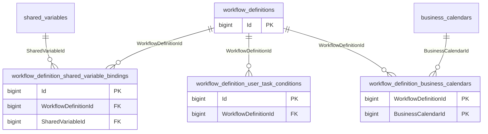

### `workflow_definitions`

Each row is one immutable version of a workflow. `POST /api/workflows` creates version 1 and `PUT /api/workflows/{id}` always inserts a new row; existing rows are never rewritten. Every version of one workflow shares the same `WorkflowKey`, which is the stable cross-version identity used by instance search, business keys, idempotency, delegation, and task distribution.

| Column | Meaning |
| --- | --- |
| `Id` | Version row ID. This is the API's `workflowId`; instances, jobs, and audits pin the exact version through it. |
| `WorkflowKey` | Stable family key, stamped from the JSON model `id` on every save. |
| `Version` | Version number, unique within `WorkflowKey`. |
| `Name` | Display name copied from the definition. |
| `Definition` | The complete editor JSON as `jsonb` (GIN-indexed). Lanes, nodes, flows, and variables live here, not in separate tables. |
| `IsPublished` | Only published versions can start instances. |
| `IsDefault`, `DefaultActivatedAt`, `DefaultActivationId` | Marks the family's published default version and records when it became the default. Message starts and task distribution resolve the default. |

- **Primary key:** `Id`
- **References:** none
- **Referenced by:** [`administrative_action_batches`](#administrative_action_batches).`WorkflowDefinitionId`, [`administrative_action_batch_items`](#administrative_action_batch_items).`WorkflowDefinitionId`, [`conditional_boundary_subscriptions`](#conditional_boundary_subscriptions) (`WorkflowDefinitionId`, `WorkflowKey`), [`instance_history`](#instance_history).`WorkflowDefinitionId`, [`instance_variable_update_batch_items`](#instance_variable_update_batch_items).`CapturedWorkflowDefinitionId`, [`instance_variable_update_batch_jobs`](#instance_variable_update_batch_jobs).`WorkflowDefinitionId`, [`instance_variable_updates`](#instance_variable_updates).`WorkflowDefinitionId`, [`node_executions`](#node_executions).`WorkflowDefinitionId`, [`sequence_flow_occurrences`](#sequence_flow_occurrences).`WorkflowDefinitionId`, [`shared_variable_revisions`](#shared_variable_revisions).`WorkflowDefinitionId`, [`timer_subscriptions`](#timer_subscriptions) (`WorkflowDefinitionId`, `WorkflowKey`), [`user_task_role_policies`](#user_task_role_policies).`WorkflowDefinitionId`, [`workflow_definition_shared_variable_bindings`](#workflow_definition_shared_variable_bindings).`WorkflowDefinitionId`, [`workflow_definition_user_task_conditions`](#workflow_definition_user_task_conditions).`WorkflowDefinitionId`, [`workflow_incidents`](#workflow_incidents) (`WorkflowDefinitionId`, `WorkflowKey`), [`workflow_instances`](#workflow_instances) (`WorkflowDefinitionId`, `WorkflowKey`), [`workflow_instance_version_change_batches`](#workflow_instance_version_change_batches).`SourceWorkflowDefinitionId`, [`workflow_instance_version_change_batches`](#workflow_instance_version_change_batches).`TargetWorkflowDefinitionId`, [`workflow_instance_version_change_batch_items`](#workflow_instance_version_change_batch_items).`CapturedSourceWorkflowDefinitionId`, [`workflow_instance_version_changes`](#workflow_instance_version_changes).`SourceWorkflowDefinitionId`, [`workflow_instance_version_changes`](#workflow_instance_version_changes).`TargetWorkflowDefinitionId`, [`workflow_jobs`](#workflow_jobs) (`WorkflowDefinitionId`, `WorkflowKey`), [`workflow_definition_call_targets`](#workflow_definition_call_targets).`WorkflowDefinitionId`, [`call_activity_executions`](#call_activity_executions).`ParentDefinitionId`, [`call_activity_executions`](#call_activity_executions).`ChildDefinitionId`
- **Unique:** (`Id`, `WorkflowKey`) (alternate key); (`WorkflowKey`, `Version`)

The alternate key `(Id, WorkflowKey)` is the target of the composite foreign keys from `workflow_instances`, `workflow_jobs`, `workflow_incidents`, `timer_subscriptions`, and `conditional_boundary_subscriptions`. It guarantees that a row's denormalized `WorkflowKey` always matches its exact version.

Node IDs and sequence-flow IDs stored in other tables (`NodeId`, `FlowId`, `SequenceFlowId`, and similar) are authored integers inside `Definition`. They are not foreign keys.

### `workflow_definition_user_task_conditions`

Holds the compiled form of a user task's `inboxVisibilityCondition`, one row per definition version and node. It is created when the definition is saved, and PostgreSQL evaluates it during inbox queries before count, ordering, and paging.

| Column | Meaning |
| --- | --- |
| `WorkflowDefinitionId`, `NodeId` | The owning version and user-task node; unique together. |
| `NodeName`, `NodeExternalId` | Node snapshot for diagnostics. |
| `ProgramJson`, `ProgramVersion` | The compiled expression program and its format version, evaluated by `flowbit.evaluate_inbox_visibility_condition`. |
| `VariableNames`, `ExternalReferences` | The instance variables and context values (claims, config, settings, `sys.*`) the program reads. |
| `SemanticFingerprint` | Identifies semantically equal programs across versions. |

- **Primary key:** `Id`
- **References:** `WorkflowDefinitionId` → [`workflow_definitions`](#workflow_definitions) (required, `CASCADE`)
- **Referenced by:** [`user_tasks`](#user_tasks).`InboxVisibilityConditionId`
- **Unique:** (`WorkflowDefinitionId`, `NodeId`)

A `BEFORE INSERT` trigger on `user_tasks` copies the matching row ID into `user_tasks.InboxVisibilityConditionId`. An open task therefore keeps its original rule even after the instance switches workflow versions.

### `workflow_definition_shared_variable_bindings`

Records each top-level `scope: "shared"` process variable of a definition version: its workflow-local alias, the catalog entry it binds, and the requested access.

| Column | Meaning |
| --- | --- |
| `WorkflowDefinitionId` | Owning version. Deleting the version deletes its bindings. |
| `Alias` | The workflow-local variable name; unique per version. |
| `SharedVariableId`, `SharedKey` | The bound catalog entry and its canonical key; one binding per entry per version. |
| `Access` | `read` or `readWrite`. |

- **Primary key:** `Id`
- **References:** `SharedVariableId` → [`shared_variables`](#shared_variables) (required, `RESTRICT`); `WorkflowDefinitionId` → [`workflow_definitions`](#workflow_definitions) (required, `CASCADE`)
- **Referenced by:** none
- **Unique:** (`WorkflowDefinitionId`, `Alias`); (`WorkflowDefinitionId`, `SharedVariableId`)

The `RESTRICT` reference to `shared_variables` prevents deleting a catalog entry while any definition version binds it.

### `workflow_definition_business_calendars`

Records each business calendar a definition version names in a timer's `calendar` or a user task's `dueDateCalendar`. Rows are written when the version is saved and again when it is published, with the calendar rows locked `FOR KEY SHARE`, so a concurrent calendar delete waits and then sees them.

| Column | Meaning |
| --- | --- |
| `WorkflowDefinitionId` | Owning version. Deleting the version deletes its rows. |
| `BusinessCalendarId` | The named calendar. |
| `CreatedAt` | When the row was written. |

- **Primary key:** (`WorkflowDefinitionId`, `BusinessCalendarId`)
- **References:** `BusinessCalendarId` → [`business_calendars`](#business_calendars) (required, `CASCADE`); `WorkflowDefinitionId` → [`workflow_definitions`](#workflow_definitions) (required, `CASCADE`)
- **Referenced by:** none
- **Unique:** the primary key; index on `BusinessCalendarId`

The API refuses to delete a calendar that a published version, a running instance, or an open job uses, counting through these rows. Deleting a calendar that only unpublished versions without open work use removes their rows; publishing such a version then fails until the calendar exists again.

## Call activities

A call is written from one side at a time. Invocation rows are written only while holding the parent instance's lock, and result rows are written once while holding the child's lock and never change. Neither side's rows hold a foreign key to the other side's instance or token where that could wait on a lock held by the other side's transaction, and processing a job locks only the receiver.

The relationship survives retention: `call_activity_executions` keeps one compact row per visit for the instance's lifetime, and only its bulky captured values become eligible under the `workflowHistory` policy after settlement, aged from the parent's terminal time. An open call job, an unsettled result, or a referenced definition is never removed. Deleting a definition is refused while an invocation references it, including a queued one with no child.

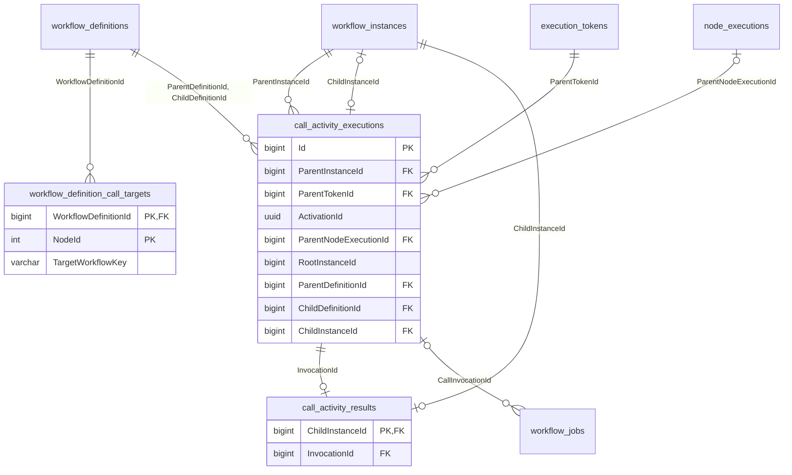

### `workflow_definition_call_targets`

Records the family each call node of a definition version names, so `GET /api/workflows/{workflowKey}/callers` can find callers without reading every definition. Rows are written when the version is saved.

| Column | Meaning |
| --- | --- |
| `WorkflowDefinitionId`, `NodeId` | Owning version and call node. Deleting the version deletes its rows. |
| `TargetWorkflowKey` | The family the call names. It is a plain string, because a target need not exist yet. |

- **Primary key:** (`WorkflowDefinitionId`, `NodeId`)
- **References:** `WorkflowDefinitionId` → [`workflow_definitions`](#workflow_definitions) (required, `CASCADE`)
- **Referenced by:** none
- **Unique:** the primary key; index on `TargetWorkflowKey`

### `call_activity_executions`

One durable visit to a call activity. One invocation owns at most one child, and one child belongs to exactly one invocation. Stored states are `queued` (no child yet), `running` (child created), and settled `completed`, `failed`, or `cancelled`. The API's `resultReady` is `running` with a result row.

| Column | Meaning |
| --- | --- |
| `ParentInstanceId`, `ParentTokenId`, `ActivationId`, `ParentNodeId` | The parent activation that owns the visit. A re-entered node always has a new activation. |
| `ParentNodeExecutionId` | Optional audit reference, set to null when retention removes the row. It is not the ownership fence. |
| `RootInstanceId`, `ChildDepth` | The call tree and the depth of the child this visit creates. The depth check allows one above the supported maximum of 32, so a call blocked under the deepest parent can record its failure. |
| `ParentDefinitionId` | Exact parent version, independent of later parent version changes. |
| `TargetWorkflowKey` | The family named at entry. |
| `ChildDefinitionId`, `ChildStartEventId`, `ChildInstanceId` | The version, start, and child chosen when the child was created. All three are null or all three are set. |
| `State` | See above. |
| `CapacityReserved`, `AdmittedAt` | Whether the visit holds an admission slot. Unreserved unsettled rows are allowed only while queued with no child: they were blocked before admission and are left out of admission counts. Settling clears the flag. |
| `ContractJson`, `InputValuesJson` | The captured call contract and input snapshot. Missing values are recorded separately from explicit null. Cleared by retention after settlement. |
| `FailureCode`, `FailureDescription`, `ChildFaultCode` | A stable call failure code, up to 1,000 characters of safe text, and the child's error end code. |
| `CausedBy` | The actor whose transition reached the call, for audit only. It grants nothing. |
| `CreatedAt`, `UpdatedAt`, `StartedAt`, `SettledAt` | Lifecycle times. |
| `SnapshotsPrunedAt` | When retention cleared the captured values. |
| `MultiInstanceExecutionId`, `AutomaticMultiInstanceItemId` | Inactive until automatic multi-instance is enabled: the automatic body and item an item invocation belongs to. Both are set or both are null; an ordinary call has neither. |

- **Primary key:** `Id`
- **References:** `ParentInstanceId`, `ChildInstanceId` → [`workflow_instances`](#workflow_instances) (`RESTRICT`); `ParentTokenId` → [`execution_tokens`](#execution_tokens) (`RESTRICT`); `ParentNodeExecutionId` → [`node_executions`](#node_executions) (optional, `SET NULL`); `ParentDefinitionId`, `ChildDefinitionId` → [`workflow_definitions`](#workflow_definitions) (`RESTRICT`); (`AutomaticMultiInstanceItemId`, `MultiInstanceExecutionId`, `ParentInstanceId`) → [`multi_instance_activity_items`](#multi_instance_activity_items) (optional, `RESTRICT`)
- **Referenced by:** [`call_activity_results`](#call_activity_results).`InvocationId`, [`workflow_jobs`](#workflow_jobs).`CallInvocationId`
- **Unique:** (`ParentInstanceId`, `ParentTokenId`, `ActivationId`) where `AutomaticMultiInstanceItemId IS NULL`; `ChildInstanceId` where it is not null; `AutomaticMultiInstanceItemId` where it is not null
- **Indexes:** (`ParentInstanceId`, `Id`) for paged history; (`ParentTokenId`, `State`) for unsettled calls; `RootInstanceId` for reserved unsettled calls, used by admission counting
- **Checks:** `CK_call_activity_executions_state`, `_reservation`, `_admission`, `_settlement`, `_child_shape`, `_child_resolution`, `_depth`, and `_automatic_item_pair`

### `call_activity_results`

One row for a child that finished while its invocation was unsettled. It holds only the mapped output values and safe terminal metadata, never all child variables. The call outcome is distinct from the child's status: an invalid output is `faulted` with `call_output_invalid` while the child stays completed.

| Column | Meaning |
| --- | --- |
| `ChildInstanceId` | The child that finished. |
| `InvocationId` | The invocation waiting for it. |
| `Outcome` | `completed`, `faulted`, or `cancelled`. |
| `OutputValuesJson` | Captured output values. Cleared by retention after the invocation settles. |
| `FailureCode`, `FailureDescription`, `ChildFaultCode` | As on the invocation. |
| `CapturedAt` | The child's terminal commit. |

- **Primary key:** `ChildInstanceId`
- **References:** `InvocationId` → [`call_activity_executions`](#call_activity_executions) (`RESTRICT`); `ChildInstanceId` → [`workflow_instances`](#workflow_instances) (`RESTRICT`)
- **Referenced by:** none
- **Unique:** `InvocationId`

## Instances and start identity

The instance row and the claim tables that make starts and message deliveries idempotent or unique.

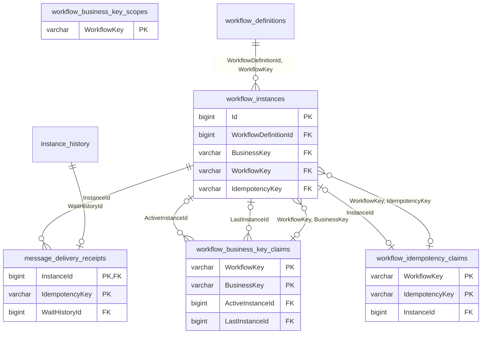

### `workflow_instances`

One row per started instance. It owns lifecycle status and timestamps. It no longer stores the current step: execution position lives in `execution_tokens` and human work in `user_tasks`. Every runtime transition locks this row first (`SELECT ... FOR UPDATE`).

| Column | Meaning |
| --- | --- |
| `Id` | Instance ID used throughout the API. |
| `WorkflowDefinitionId`, `WorkflowKey` | The exact definition version the instance runs, plus its family key. Changed only by a version change, which is audited in `workflow_instance_version_changes`. |
| `Status` | `running`, `completed`, `faulted`, or `cancelled`. |
| `StartedBy` | Canonical actor that started the instance. |
| `BusinessKey`, `BusinessKeyUniqueness` | Optional domain key and its `active`/`all` uniqueness mode. Ownership is held in `workflow_business_key_claims`. |
| `IdempotencyKey` | Private transport idempotency key for keyed starts. Ownership is held in `workflow_idempotency_claims`. |
| `CreatedAt`, `UpdatedAt` | Creation time and instance revision. Moves, multi-instance fan-out, version changes, and retention advance the revision in their transaction. A staged service/script visit changing only from pending to active can retain the instance revision. |
| `FinishedAt` | Latest terminal transition; the retention age reference. |
| `HistoryPrunedAt` | Set when retention first deletes instance-owned history. It is allowed only on terminal instances and permanently blocks reactivation. |
| `NodeActivityFromCreation` | Non-null Boolean, default `true` for new instances, including older API writers that omit the column. Existing instances begin `false`; the separate classification migration promotes those with an unseeded `node` visit at `startEvent`, `messageStartEvent`, or `timerStartEvent` and no `HistoryPrunedAt`. Reactivation/version changes never reset it. |
| `NodeActivityPrunedAt` | Nullable UTC timestamp of the first actual node-execution deletion by retention. Set in the deleting transaction with `HistoryPrunedAt` and `UpdatedAt`; other retention categories and protected rows never set it. |
| `CallRootInstanceId`, `CallDepth` | The root of this instance's call tree and its depth, immutable after insertion. A root has null and 0; a child has its root and a positive depth, at most 32. The root is a plain column rather than a foreign key, so creating a nested child never waits on the root's row lock. |
| `LastReactivationTokenId` | Root token created by the most recent reactivation; null if the instance was never reactivated. Tokens from this ID onward belong to the current run, so it marks the run boundary after retention removes the `instanceReactivated` history row. The migration that added it filled it from the reactivation history still present. It is not a foreign key. |

- **Primary key:** `Id`
- **References:** (`WorkflowDefinitionId`, `WorkflowKey`) → [`workflow_definitions`](#workflow_definitions) (`Id`, `WorkflowKey`) (required, `RESTRICT`); (`WorkflowKey`, `BusinessKey`) → [`workflow_business_key_claims`](#workflow_business_key_claims) (optional, `RESTRICT`); (`WorkflowKey`, `IdempotencyKey`) → [`workflow_idempotency_claims`](#workflow_idempotency_claims) (optional, `RESTRICT`)
- **Referenced by:** [`administrative_action_batch_items`](#administrative_action_batch_items).`InstanceId`, [`complex_gateway_states`](#complex_gateway_states).`InstanceId`, [`conditional_boundary_subscriptions`](#conditional_boundary_subscriptions).`InstanceId`, [`execution_tokens`](#execution_tokens).`InstanceId`, [`gateway_executions`](#gateway_executions).`InstanceId`, [`instance_history`](#instance_history).`InstanceId`, [`instance_variable_current_values`](#instance_variable_current_values).`InstanceId`, [`instance_variables`](#instance_variables).`InstanceId`, [`instance_variable_update_batch_items`](#instance_variable_update_batch_items).`InstanceId`, [`instance_variable_updates`](#instance_variable_updates).`InstanceId`, [`message_delivery_receipts`](#message_delivery_receipts).`InstanceId`, [`multi_instance_executions`](#multi_instance_executions).`InstanceId`, [`node_executions`](#node_executions).`InstanceId`, [`sequence_flow_occurrences`](#sequence_flow_occurrences).`InstanceId`, [`sequence_flow_summaries`](#sequence_flow_summaries).`InstanceId`, [`shared_variable_revisions`](#shared_variable_revisions).`InstanceId`, [`timer_subscriptions`](#timer_subscriptions).`InstanceId`, [`user_task_role_policies`](#user_task_role_policies).`InstanceId`, [`user_tasks`](#user_tasks).`InstanceId`, [`workflow_business_key_claims`](#workflow_business_key_claims).`ActiveInstanceId`, [`workflow_business_key_claims`](#workflow_business_key_claims).`LastInstanceId`, [`workflow_idempotency_claims`](#workflow_idempotency_claims).`InstanceId`, [`workflow_incidents`](#workflow_incidents).`InstanceId`, [`workflow_instance_version_change_batch_items`](#workflow_instance_version_change_batch_items).`InstanceId`, [`workflow_instance_version_changes`](#workflow_instance_version_changes).`InstanceId`, [`workflow_jobs`](#workflow_jobs).`InstanceId`, [`call_activity_executions`](#call_activity_executions).`ParentInstanceId`, [`call_activity_executions`](#call_activity_executions).`ChildInstanceId`, [`call_activity_results`](#call_activity_results).`ChildInstanceId`

### `workflow_business_key_scopes`

One row per workflow family whose published default version enabled business keys. The row is inserted the first time such a version becomes the published default, and it is never removed: from then on, a new version of that family must keep business keys.

| Column | Meaning |
| --- | --- |
| `WorkflowKey` | The workflow family (primary key). |
| `ActivatedAt` | When business keys were first enabled. |

- **Primary key:** `WorkflowKey`
- **References:** none
- **Referenced by:** none

There is no foreign key, because `WorkflowKey` is not unique in `workflow_definitions`.

### `workflow_business_key_claims`

Enforces business-key uniqueness across all versions of a workflow family. A start reserves `(WorkflowKey, BusinessKey)` under a row lock inside its transaction; a duplicate returns `409 business_key_conflict`.

| Column | Meaning |
| --- | --- |
| `WorkflowKey`, `BusinessKey` | Composite primary key. `BusinessKey` uses the `C` collation, so comparison is exact and case-sensitive. |
| `ActiveInstanceId` | Instance that currently holds the claim. In `active` mode it is released when that instance becomes terminal. |
| `LastInstanceId` | Most recent owner, kept after release. |
| `IsPermanent` | `true` for `all` uniqueness, where the key is never released. |

- **Primary key:** (`WorkflowKey`, `BusinessKey`)
- **References:** `ActiveInstanceId` → [`workflow_instances`](#workflow_instances) (optional, `RESTRICT`); `LastInstanceId` → [`workflow_instances`](#workflow_instances) (optional, `RESTRICT`)
- **Referenced by:** [`workflow_instances`](#workflow_instances) (`WorkflowKey`, `BusinessKey`)

`workflow_instances (WorkflowKey, BusinessKey)` references this table, while `ActiveInstanceId` and `LastInstanceId` point back at instances.

### `workflow_idempotency_claims`

Permanently reserves a start's transport idempotency key for a workflow family, across both start routes and all versions. A committed owner makes a retry return `409 idempotency_conflict` with the owner's `Location`. The claim is reserved before the business key and rolls back with a failed start.

| Column | Meaning |
| --- | --- |
| `WorkflowKey`, `IdempotencyKey` | Composite primary key; the key uses the `C` collation. |
| `InstanceId` | Owning instance (unique). It is nullable so the claim can be inserted before its instance in the same transaction. |
| `CreatedAt` | Reservation time. |

- **Primary key:** (`WorkflowKey`, `IdempotencyKey`)
- **References:** `InstanceId` → [`workflow_instances`](#workflow_instances) (optional, `RESTRICT`)
- **Referenced by:** [`workflow_instances`](#workflow_instances) (`WorkflowKey`, `IdempotencyKey`)
- **Unique:** `InstanceId`

This is a deliberate two-way link: `workflow_instances (WorkflowKey, IdempotencyKey)` references the claim, and the claim references the instance.

### `message_delivery_receipts`

Created when a delivery to an `intermediateMessageCatchEvent` with `message.deliveryIdempotency=true` commits. The receipt reserves the key for the instance forever, so any authenticated reuse returns 409 and cannot consume a later wait.

| Column | Meaning |
| --- | --- |
| `InstanceId`, `IdempotencyKey` | Composite primary key; the key uses the `C` collation. |
| `SourceNodeId`, `CorrelationHeaderName` | The catch node and the configured idempotency header. |
| `WaitHistoryId` | The `instance_history` row of the exact wait occurrence the delivery consumed. It is unique, so one wait has one winner. |
| `CredentialProofHash`, `CredentialProofSalt`, `EnvelopeProofHash`, `EnvelopeProofSalt`, `ProofVersion` | Salted hashes of the original credentials and request envelope. Reuse is recognized without storing secrets or payloads. |

- **Primary key:** (`InstanceId`, `IdempotencyKey`)
- **References:** `InstanceId` → [`workflow_instances`](#workflow_instances) (required, `CASCADE`); `WaitHistoryId` → [`instance_history`](#instance_history) (required, `RESTRICT`)
- **Referenced by:** none
- **Unique:** `WaitHistoryId`

## Execution positions and gateways

Where execution currently is, and the gateway scope tree that joins and interrupts resolve against.

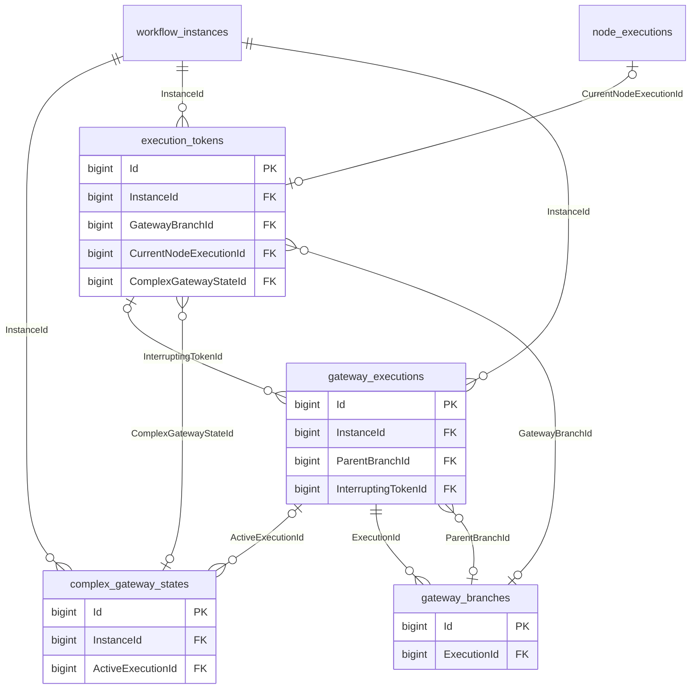

### `execution_tokens`

An instance may have several active tokens, for example one per parallel branch. A token records where execution currently rests and how it got there. It is the parent of user tasks, multi-instance executions, node visits, and durable waits.

| Column | Meaning |
| --- | --- |
| `InstanceId` | Owning instance. |
| `NodeId`, `NodeName`, `NodeType`, `NodeExternalId` | Snapshot of the node the token is on. Instance-list node filters and current-node display read the latest token. |
| `Status` | `active`, `completed`, `faulted`, `cancelled`, or `merged`. |
| `ActivationId` | Fence regenerated on each node activation. Jobs, timers, conditional subscriptions, and administrative items must present the matching value. |
| `WaitState`, `WaitingJobId`, `WaitingTimerSubscriptionId` | Durable wait kind (`asyncBefore`, `asyncAfter`, `timerCatch`, `timerBoundary`, `conditionalWake`, `callStart`) and the job or timer the token waits for. While a call's child runs, the token has no wait state: it rests as a user task does, and the invocation records what it waits for. These two id columns have no foreign keys. |
| `WaitingMultiInstanceExecutionId` | Inactive until automatic multi-instance is enabled: the automatic body the token waits on, with wait state `automaticMultiInstance` and no single waiting job. `CK_execution_tokens_wait_shape` requires a waiting job, timer, or (for this wait state) body whenever a wait state is set. |
| `ArrivedViaFlowId` | The sequence flow that brought the token here. |
| `CurrentNodeExecutionId` | The current visit in `node_executions` (unique). It is null at a multi-instance parent. |
| `GatewayBranchId` | The gateway branch the token belongs to, which places it in the gateway scope tree. |
| `ComplexGatewayStateId`, `ComplexGatewayCycle`, `ComplexDrainStateIds`, `AutomaticActivationStateIds` | Complex-gateway bookkeeping (GIN-indexed arrays). |
| `AutomaticActivationCount` | Consecutive automatic activations, checked against `Workflow.Async.MaxConsecutiveAutomaticActivations`. |
| `FaultCode`, `FaultDescription`, `TerminationReason` | Fault snapshot and why the token ended. The inactive automatic-MI foundation uses `multiInstanceFailed` for an uncaught body failure, with a stable source/result fault code. |

- **Primary key:** `Id`
- **References:** `ComplexGatewayStateId` → [`complex_gateway_states`](#complex_gateway_states) (optional, `NO ACTION`); `CurrentNodeExecutionId` → [`node_executions`](#node_executions) (optional, `NO ACTION`); `GatewayBranchId` → [`gateway_branches`](#gateway_branches) (optional, `NO ACTION`); `InstanceId` → [`workflow_instances`](#workflow_instances) (required, `CASCADE`); `WaitingMultiInstanceExecutionId` → [`multi_instance_executions`](#multi_instance_executions) (optional, `NO ACTION`)
- **Referenced by:** [`administrative_action_batch_items`](#administrative_action_batch_items).`TokenId`, [`conditional_boundary_subscriptions`](#conditional_boundary_subscriptions).`HostTokenId`, [`gateway_executions`](#gateway_executions).`InterruptingTokenId`, [`multi_instance_executions`](#multi_instance_executions).`TokenId`, [`node_executions`](#node_executions).`ExecutionTokenId`, [`timer_subscriptions`](#timer_subscriptions).`TokenId`, [`user_tasks`](#user_tasks).`TokenId`, [`workflow_jobs`](#workflow_jobs).`TokenId`, [`call_activity_executions`](#call_activity_executions).`ParentTokenId`
- **Unique:** `CurrentNodeExecutionId`

### `gateway_executions`

Each firing of a Parallel, Inclusive, or Complex gateway writes one row. Exclusive gateways never create rows. Split executions own `gateway_branches`, which makes them the generic scope that joins, `joinCancellation`, and `scopedInterruptEvent` resolve against.

| Column | Meaning |
| --- | --- |
| `InstanceId`, `GatewayNodeId` | Owning instance and gateway node. |
| `GatewayType` | `parallelGateway`, `inclusiveGateway`, or `complexGateway`. |
| `Direction` | `split` or `merge`. |
| `Status` | `active`, `joined`, `completed`, `interrupted`, or `cancelled`. |
| `SelectedFlowIds` | Outgoing flows chosen by a split. |
| `Phase`, `Cycle` | Complex gateways only: `start` or `reset` phase, and the cycle number. |
| `ParentBranchId` | The enclosing branch. Nested scopes form a tree through this column and `gateway_branches.ExecutionId`. |
| `InterruptingNodeId`, `InterruptingTokenId` | Which node and surviving token interrupted the scope (cancelling join or scoped interrupt). |
| `CompletionReason`, `CompletedAt` | Why and when the execution closed. |

- **Primary key:** `Id`
- **References:** `InstanceId` → [`workflow_instances`](#workflow_instances) (required, `CASCADE`); `InterruptingTokenId` → [`execution_tokens`](#execution_tokens) (optional, `NO ACTION`); `ParentBranchId` → [`gateway_branches`](#gateway_branches) (optional, `NO ACTION`)
- **Referenced by:** [`complex_gateway_states`](#complex_gateway_states).`ActiveExecutionId`, [`gateway_branches`](#gateway_branches).`ExecutionId`

### `gateway_branches`

One row per outgoing flow a split selected. Tokens and nested gateway executions point at their branch to record scope lineage.

| Column | Meaning |
| --- | --- |
| `ExecutionId` | The split execution that created the branch. |
| `Ordinal`, `OriginatingFlowId` | Branch position and outgoing flow; each is unique within the execution. |
| `Status` | `active`, `merged`, `completed`, `interrupted`, or `cancelled`. |

- **Primary key:** `Id`
- **References:** `ExecutionId` → [`gateway_executions`](#gateway_executions) (required, `CASCADE`)
- **Referenced by:** [`execution_tokens`](#execution_tokens).`GatewayBranchId`, [`gateway_executions`](#gateway_executions).`ParentBranchId`, [`node_executions`](#node_executions).`EntryGatewayBranchId`, [`node_executions`](#node_executions).`ExitGatewayBranchId`
- **Unique:** (`ExecutionId`, `Ordinal`); (`ExecutionId`, `OriginatingFlowId`)

### `complex_gateway_states`

One row per Complex gateway node per instance (unique), holding the state that `activationCondition` evaluation and reset routing need between transitions.

| Column | Meaning |
| --- | --- |
| `InstanceId`, `GatewayNodeId` | Owning instance and gateway node. |
| `Phase` | `waitingForStart`, `waitingForReset`, or `interruptedDraining`. |
| `Cycle` | Current activation cycle. |
| `ContributingFlowIds`, `RemainingFlowIds` | Incoming flows that fired the current activation and flows still expected before reset. |
| `DrainingTokenIds`, `ActivationDrainStateIds` | Pre-interrupt token provenance being drained. |
| `ActiveExecutionId` | The current `gateway_executions` row. |
| `AutomaticActivationCount` | Automatic-activation counter for the loop limit. |

- **Primary key:** `Id`
- **References:** `ActiveExecutionId` → [`gateway_executions`](#gateway_executions) (optional, `NO ACTION`); `InstanceId` → [`workflow_instances`](#workflow_instances) (required, `CASCADE`)
- **Referenced by:** [`execution_tokens`](#execution_tokens).`ComplexGatewayStateId`
- **Unique:** (`InstanceId`, `GatewayNodeId`)

## User tasks and multi-instance work

Human work items, their captured authorization, and multi-instance aggregation.

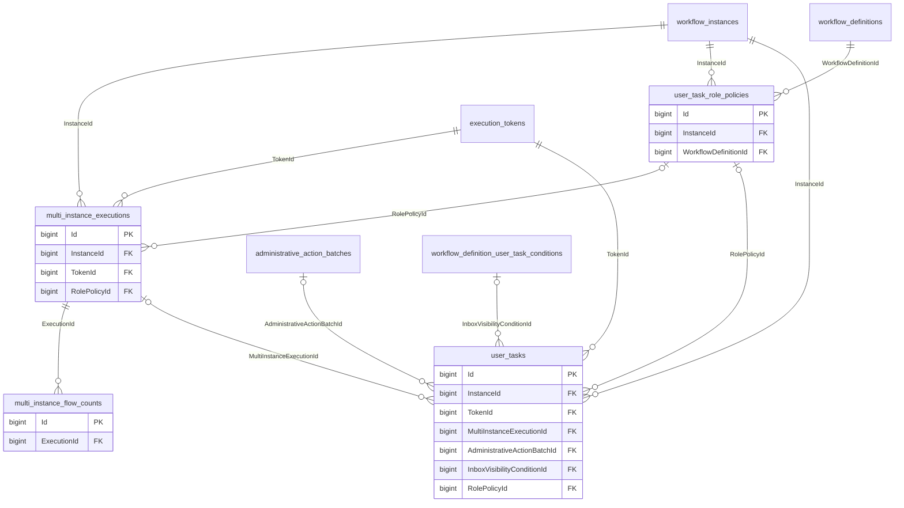

### `user_tasks`

A normal user task creates one work item each time a token rests on it. A multi-instance task creates one item per child under a single parent token. Inbox membership, claims, assignment, and completion are all read from and written to this table.

| Column | Meaning |
| --- | --- |
| `InstanceId`, `TokenId` | Owning instance and the token resting on the task. |
| `NodeId`, `NodeName`, `NodeExternalId` | Node snapshot. |
| `Status` | `pending` (sequential multi-instance item not yet active), `active`, `completed`, or `cancelled`. |
| `Roles` | Inbox role projection (GIN-indexed). The authoritative captured roles are in `user_task_role_policies` via `RolePolicyId`. |
| `RequiresClaim`, `ClaimedBy` | Claim requirement and current claimant. |
| `RequiresAssignment`, `Assignee` | Required-assignment gate and the directly assigned user. A case-insensitive expression index backs assignee lookups. |
| `DueAt`, `Priority` | Nullable due time and priority resolved from the task's `dueDate` and `priority` when the work item was created. Children of a multi-instance execution share one value. Never recomputed. The `(Status, DueAt, Id)` index backs due-date filters. |
| `InboxVisibilityConditionId` | The compiled inbox condition captured at insert. |
| `MultiInstanceExecutionId`, `ItemIndex`, `ItemValueJson` | Multi-instance parent, child index (unique within the parent), and the collection value for that child. |
| `SelectedFlowId`, `ResultJson` | Chosen outgoing flow and submitted values. |
| `CompletedBy`, `CompletedByRoles`, `CompletedActingFor`, `CompletionDelegationId`, `CompletionKind`, `CompletionReason`, `CompletedAt` | Completion audit, including delegation. |
| `AdministrativeActionBatchId` | The administrative batch that completed or cancelled the item, if any. |

- **Primary key:** `Id`
- **References:** `AdministrativeActionBatchId` → [`administrative_action_batches`](#administrative_action_batches) (optional, `RESTRICT`); `InboxVisibilityConditionId` → [`workflow_definition_user_task_conditions`](#workflow_definition_user_task_conditions) (optional, `RESTRICT`); `InstanceId` → [`workflow_instances`](#workflow_instances) (required, `CASCADE`); `MultiInstanceExecutionId` → [`multi_instance_executions`](#multi_instance_executions) (optional, `RESTRICT`); `RolePolicyId` → [`user_task_role_policies`](#user_task_role_policies) (optional, `RESTRICT`); `TokenId` → [`execution_tokens`](#execution_tokens) (required, `RESTRICT`)
- **Referenced by:** [`administrative_action_batch_items`](#administrative_action_batch_items).`UserTaskId`, [`node_executions`](#node_executions).`UserTaskId`, [`workflow_jobs`](#workflow_jobs).`UserTaskId`
- **Unique:** (`MultiInstanceExecutionId`, `ItemIndex`)

### `user_task_role_policies`

Captures task roles and per-flow action roles together on entry, so later variable changes cannot change who may act. A policy is shared by one normal task, or by a multi-instance parent and all of its children. Role management never edits a policy: it inserts a replacement and repoints the open work under optimistic `expectedRolePolicyId`.

| Column | Meaning |
| --- | --- |
| `InstanceId`, `WorkflowDefinitionId`, `NodeId` | Owning instance, the definition version it was captured from, and the task node. |
| `Roles` | Captured task roles. |
| `OutgoingFlowRolesJson` | Captured action roles for every selectable outgoing flow. |
| `CreatedAt` | Capture time. |

- **Primary key:** `Id`
- **References:** `InstanceId` → [`workflow_instances`](#workflow_instances) (required, `CASCADE`); `WorkflowDefinitionId` → [`workflow_definitions`](#workflow_definitions) (required, `RESTRICT`)
- **Referenced by:** [`multi_instance_executions`](#multi_instance_executions).`RolePolicyId`, [`user_tasks`](#user_tasks).`RolePolicyId`

### `multi_instance_executions`

One row per activation of a multi-instance user task. The parent token stays on the node while children run as `user_tasks` rows, and this row aggregates their outcomes. `ActivityKind` is `userTask` for these rows. The same table also holds automatic bodies of service, script, and call activities, which stay inactive until automatic multi-instance is enabled; their extra columns and rules are under [Automatic multi-instance foundation](#automatic-multi-instance-foundation). Readers of human work filter `ActivityKind = 'userTask'`.

| Column | Meaning |
| --- | --- |
| `ActivityKind` | `userTask` (the default) or an automatic activity type. |
| `InstanceId`, `TokenId`, `NodeId` | Owning instance, parent token, and task node. At most one active execution exists per token and node. |
| `Mode`, `Source` | `parallel` or `sequential`; `collection` or `cardinality`. |
| `OnePerActor` | Whether one actor may complete at most one child. |
| `TotalCount`, `CompletedCount`, `CancelledCount` | Child progress counters. |
| `Status` | `active`, `completed`, `interrupted`, or `cancelled`. |
| `WinningFlowId`, `CompletionReason`, `CompletedAt` | The outcome flow that advanced the parent, and why. |
| `ResultVariable` | Variable that receives the ordered child results. |
| `RolePolicyId` | Role snapshot shared by the parent and its children. |

- **Primary key:** `Id`
- **References:** `InstanceId` → [`workflow_instances`](#workflow_instances) (required, `CASCADE`); `RolePolicyId` → [`user_task_role_policies`](#user_task_role_policies) (optional, `RESTRICT`); `TokenId` → [`execution_tokens`](#execution_tokens) (required, `RESTRICT`); `WorkflowDefinitionId`, `PinnedChildDefinitionId` → [`workflow_definitions`](#workflow_definitions) (optional, `RESTRICT`); `InputSnapshotId` → [`workflow_job_snapshots`](#workflow_job_snapshots) (optional, `RESTRICT`)
- **Referenced by:** [`administrative_action_batch_items`](#administrative_action_batch_items).`MultiInstanceExecutionId`, [`multi_instance_flow_counts`](#multi_instance_flow_counts).`ExecutionId`, [`node_executions`](#node_executions).`MultiInstanceExecutionId`, [`user_tasks`](#user_tasks).`MultiInstanceExecutionId`, [`workflow_jobs`](#workflow_jobs).`MultiInstanceExecutionId`, [`multi_instance_activity_items`](#multi_instance_activity_items).`MultiInstanceExecutionId`, [`execution_tokens`](#execution_tokens).`WaitingMultiInstanceExecutionId`, [`call_activity_executions`](#call_activity_executions).`MultiInstanceExecutionId`
- **Unique:** (`TokenId`, `NodeId`) where `Status = 'active'`; (`InstanceId`, `NodeId`) where `ActivityKind <> 'userTask' AND Status = 'active'`; (`TokenId`, `ActivationId`) where `ActivityKind <> 'userTask'`
- **Checks:** `CK_multi_instance_executions_activity_kind`, `_automatic_shape`, `_automatic_counts`, `_completion_size`, and `_call_pin_shape`

### Automatic multi-instance foundation

The `AddAutomaticMultiInstanceCore` and `ValidateAutomaticMultiInstanceConstraints`
migrations install the storage foundation described below. Automatic execution remains
inactive pending adapter integration; these objects do not enable service, script, or
call multi-instance execution. Existing rows retain `ActivityKind = 'userTask'`,
their human task/role/vote semantics, and their existing result format.

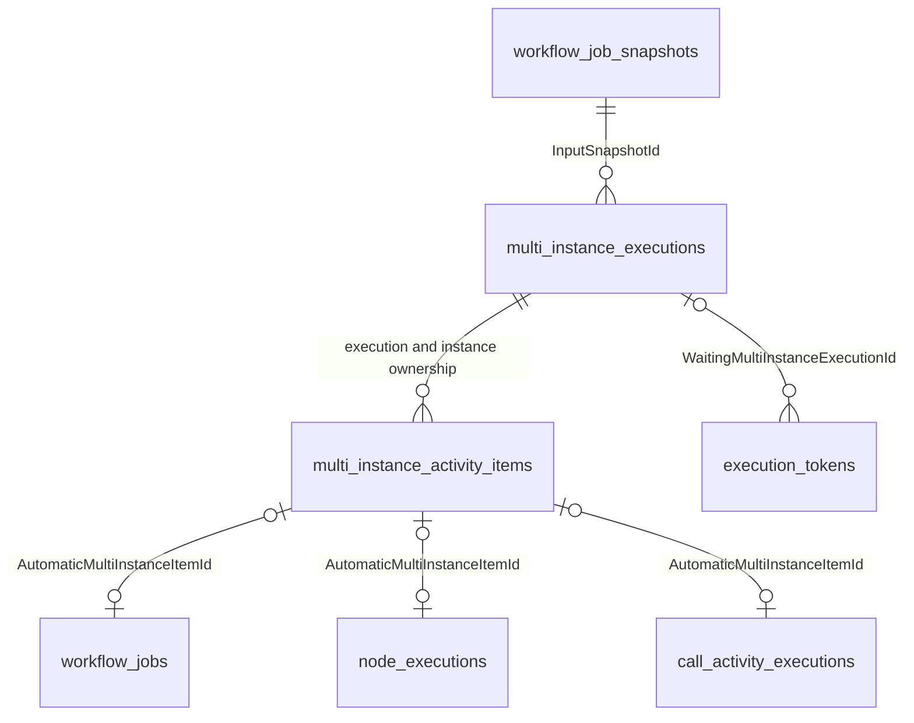

`multi_instance_executions` adds:

| Columns | Contract |
| --- | --- |
| `ActivityKind` | Required `userTask` (default), `serviceTask`, `scriptTask`, or `callActivity`. |
| `WorkflowDefinitionId`, `ActivationId` | Immutable automatic definition/token activation correlation. Definition FK uses `RESTRICT`. |
| `InputSnapshotId` | `RESTRICT` FK to `workflow_job_snapshots`; retains the copied collection, body inputs and optional FlowInfo captured at successful initialization independently of job retention. FlowInfo is stored once in `VariablesJson.flowInfo` and counts toward the 1 MiB bound. |
| `AggregateScope`, `AggregateSharedKey`, `AggregateValueVersion` | `instance` or `shared` output identity and publication fence. A shared aggregate requires a key; instance aggregates have no shared key. |
| `MaxInstances`, `EffectiveConcurrency` | Captured positive item limit from the existing setting and admitted window (0 for an empty body; otherwise at most 1,000). The independent snapshot/result limits also bound fan-out. |
| `Phase`, `AdmissionBlockedReason`, `ControlGeneration` | `running`, `dispatch`, `completing`, `errorCompletion`, or `settled`; optional admission reason and nonnegative control generation. |
| `CompletionJson` | First accepted error-completion route/diagnostic intent, bounded to 1 MiB and retained independently of control-job cleanup. |
| `FailedCount`, `ResultBytes` | Nonnegative failures and bounded aggregate accounting (0–1,048,576 bytes). |
| `PinnedChildDefinitionId`, `PinnedChildStartEventId`, `PinState` | The target version and default plain start a nonempty call body pins at initialization; the call adapter resolves them, and they do not implement child execution. `CK_multi_instance_executions_call_pin_shape` requires all three on a nonempty call body and refuses them on every other body: `PinState` is `pinned` while the body is active and `released` once it settles. The pinned definition FK uses `RESTRICT`, and definition operations refuse unpublication while a pinned body is open, before its first child exists. |

The automatic shape check requires the definition, activation, snapshot, aggregate and
window fields and excludes role policies/one-per-actor behavior. A filtered unique index
on `(InstanceId, NodeId)` permits one active automatic body per node. Another unique
index on `(TokenId, ActivationId)` fences initialization, including settled history.
`(Id, InstanceId)` is an alternate key for item ownership. An unsettled automatic body
counts as one reserved slot in the instance's open-job count; its dispatch/completion
job uses that slot without counting twice.

Body settlement and its outgoing traversal have separate history evidence: both use
`automaticMultiInstanceCompleted`, with payload `purpose` values `settlement` and
`traversal` respectively. Aggregate assembly reads bounded, index-ordered pages of
item status and committed local results; it never loads staged inputs or candidates.

Automatic item node visits copy `EnteredViaFlowId` and `EntryGatewayBranchId`
from the current parent activation. Diagram history groups those entries by body,
so a nonempty body contributes one arrival regardless of its item count. An empty
body has no item visit and retains the documented possibility of missing incoming
evidence. Completion copies the captured causal actor, roles, selected audit
claims and delegation fields into the visit's completion fields; calls capture
only the fixed system actor. Shared publication sets the revision's
`NodeExecutionId` to the retained item visit. Audit pruning removes that optional
link without removing the item's saved inputs, candidate or committed result.

Current control incidents are projected from existing `workflow_jobs` and
`workflow_incidents`, matched to body activation and control generation. They
add no schema columns and do not inflate failed-item counts. An item's staged
context retains shared/environment inputs and output versions; resolved local
defaults are rebuilt per execution attempt rather than persisted as retry state.

### `multi_instance_activity_items`

Automatic items are runtime state. They are never human tasks and contain no assignee,
claim, role policy, or selected flow. The copied element lives only in the body snapshot;
an item stores its zero-based `ItemIndex`.

| Columns | Contract |
| --- | --- |
| `Id`, `InstanceId`, `MultiInstanceExecutionId`, `ItemIndex` | Stable identity and ownership; nonnegative index, unique per execution. |
| `Status`, `Phase` | `pending`, `active`, `completed`, `failed`, or `cancelled`; `execution`, `publication`, or `settled`. Recoverable incidents keep admitted items active and keep their slot. |
| `StagedInputJson`, `CandidateJson` | Frozen item inputs and accepted execution candidate. Combined JSONB text size is at most 1 MiB. Candidate survives publication conflicts. Both are cleared when the body settles, since nothing reads them afterwards. |
| `ResultJson`, `SharedWriteCorrelationsJson` | Committed local result (at most 1 MiB) and value-free shared-write correlations. |
| `ErrorCode`, `ErrorDescription` | Bounded diagnostics, 100 and 1,000 characters respectively. |
| `CreatedAt`, `UpdatedAt`, `StartedAt`, `CompletedAt` | Lifecycle times; pending items are unstarted, active items have a start, terminal items have completion. |

The composite FK `(MultiInstanceExecutionId, InstanceId)` references the body with
`CASCADE`; `(Id, MultiInstanceExecutionId, InstanceId)` is an alternate ownership key.
Admission and paging use `(MultiInstanceExecutionId, Status, ItemIndex)`. Item creation
and ledger creation use bounded set-based inserts; cancellation updates bounded batches.
Job and ledger retention never delete items. A body's snapshot row stays while the body
references it, including completed history. When workflow-history retention prunes a
finished instance, it empties each settled body's snapshot (`VariablesJson` becomes `{}`
and `InvocationJson` and `FlowInfoJson` are cleared), so item detail then shows no copied
element; item `ResultJson` stays. Removing an instance requires deleting
its retained jobs, call references, ledger references, and token body-wait references
before deleting the body/items; the application does not delete instances.

The foundation also extends these tables:

- `execution_tokens.WaitingMultiInstanceExecutionId` is an optional `NO ACTION` FK to
  the body. The wait-shape check accepts an `automaticMultiInstance` wait with this
  correlation, independently of an individual item job.
- `node_executions` accepts `automaticActivityItem`, requiring an item, MI execution,
  and index while refusing a user-task ID. `AutomaticMultiInstanceItemId` is unique,
  and its composite item/body/instance FK uses `RESTRICT`. Pending items have pending
  visits; automatic token entry, including the queued interval before initialization,
  creates no parent visit. An empty body has no fabricated visit; pre-initialization
  failures remain on the entry job/incident.
- `workflow_jobs.AutomaticMultiInstanceItemId` has a unique non-null index and a
  composite item/body/instance FK (`RESTRICT`). `multiInstanceItem` requires that
  correlation and the activity queue, and no other job kind may carry it: a call
  item's `callStart`, `callResume`, and `callCancel` reach the item through their
  invocation. An item counts as blocked, and admission pauses, while its own
  `multiInstanceItem` job or parent-owned `callStart` has an open incident; this is
  read from the incident, so it holds however the incident opened. Dispatch/completion use the control queue and
  `MultiInstanceControlGeneration`; the generation is unique per body and a filtered
  unique index allows one open control job per body. `PublicationFenceRefreshRequested`
  records an authorized publication retry without clearing successful candidates or
  frozen inputs; a call item's `callResume` carries it too. A body's `asyncAfter` job
  names the body but runs after it settles and retries as an ordinary job. Ordinary-job
  retry semantics are unchanged. `IX_workflow_jobs_MultiInstanceExecutionId` indexes
  the body column for every job kind, beside the partial control-slot index.
- `call_activity_executions` adds nullable `AutomaticMultiInstanceItemId` and
  `MultiInstanceExecutionId`, with a composite item/body/parent-instance FK (`RESTRICT`)
  and unique non-null item ownership. `CK_call_activity_executions_automatic_item_pair`
  requires both or neither, so a half-set pair cannot bypass the composite FK. Ordinary
  `(ParentInstanceId, ParentTokenId, ActivationId)` uniqueness applies only when the
  item ID is null. Retention cannot erase this identity and make an item invocation
  appear ordinary.

The large `workflow_jobs` and `node_executions` checks are first installed `NOT VALID`;
the separate validation migration scans them outside a transaction and can resume after
interruption. A third migration, `HardenAutomaticMultiInstanceCore`, restores the general
`IX_workflow_jobs_MultiInstanceExecutionId` index and adds the call-pin and invocation
item-pair checks. Both concurrency settings are seeded as strings (`4` and `1000`); see
[engine settings](engine-settings.md). Downgrade refuses to remove this schema while any
automatic body history exists. The migration does not fabricate past automatic work.

### `multi_instance_flow_counts`

One row per execution and outgoing flow, counting how many completed children chose that flow. It backs `CountFlow(flowId)` and `PercentFlow(flowId)` in completion conditions.

| Column | Meaning |
| --- | --- |
| `ExecutionId`, `FlowId` | The multi-instance execution and outcome flow; unique together. |
| `CompletedCount` | Number of children that completed through the flow. |

- **Primary key:** `Id`
- **References:** `ExecutionId` → [`multi_instance_executions`](#multi_instance_executions) (required, `CASCADE`)
- **Referenced by:** none
- **Unique:** (`ExecutionId`, `FlowId`)

## Variables, history, and flow evidence

Append-only variable history and its search projection, the instance audit trail, the node-visit ledger, and FlowInfo evidence.

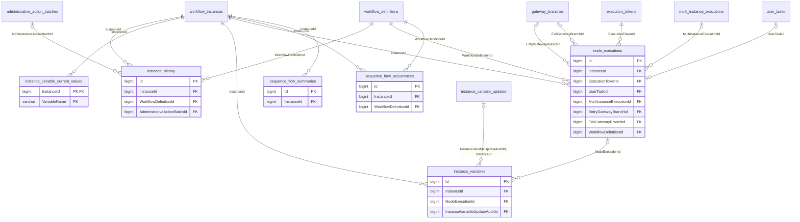

### `instance_variables`

The authoritative variable history. Every write appends a row, including identical values and administrative raw-JSON updates; rows are never updated in place.

| Column | Meaning |
| --- | --- |
| `InstanceId`, `VariableName`, `ValueJson` | Owning instance, variable name, and JSON value. |
| `SetAt`, `SetBy`, `ActingFor`, `DelegationId` | When the value was written, by whom, and on whose behalf. |
| `SourceActionId` | The sequence flow whose submitted values produced the write, if any. |
| `NodeExecutionId` | The node visit that produced the write. Execution detail shows only these attributed changes. |
| `InstanceVariableUpdateAuditId` | The administrative update operation that produced the write, if any. |

- **Primary key:** `Id`
- **References:** `InstanceId` → [`workflow_instances`](#workflow_instances) (required, `CASCADE`); (`InstanceVariableUpdateAuditId`, `InstanceId`) → [`instance_variable_updates`](#instance_variable_updates) (`Id`, `InstanceId`) (optional, `RESTRICT`); `NodeExecutionId` → [`node_executions`](#node_executions) (optional, `RESTRICT`)
- **Referenced by:** none

The `AFTER INSERT` trigger `instance_variables_sync_current_value` upserts the newest row per `(InstanceId, VariableName)` into `instance_variable_current_values`.

### `instance_variable_current_values`

Read-optimized projection of the latest value for each instance variable. Latest-value enrichment, inbox action checks, and all advanced `variableFilter` searches read this table; audit and execution detail read `instance_variables`.

| Column | Meaning |
| --- | --- |
| `InstanceId`, `VariableName` | Composite primary key. |
| `ValueJson` | Latest value. It has a GIN index plus expression indexes for case-insensitive root strings and root numbers. |
| `SourceVariableId` | The `instance_variables.Id` the value came from. The trigger replaces a row only when this ID is newer. There is no foreign key. |
| `SetAt` | Time of the source write. |

- **Primary key:** (`InstanceId`, `VariableName`)
- **References:** `InstanceId` → [`workflow_instances`](#workflow_instances) (required, `CASCADE`)
- **Referenced by:** none

### `instance_history`

The instance's event and audit trail: flow traversals, automatic routing, claims, assignments, role changes, reactivation, conditional triggers, and more. It feeds instance detail and claim inheritance. It is not a complete node-lifecycle ledger; use `node_executions` for that.

| Column | Meaning |
| --- | --- |
| `InstanceId`, `WorkflowDefinitionId` | Owning instance and the version in effect when the row was written. |
| `FromStepId`, `ToStepId` | Source and target node IDs (legacy "step" naming). |
| `ActionId` | Sequence flow taken, when the event selected one. |
| `Note` | Event kind, for example `start`, `automatic`, `gateway`, `message`, `taskClaim`, `taskAssignment`, `taskRolesChanged`, or `instanceReactivated`. |
| `Payload` | Event-specific JSON details. |
| `PerformedBy`, `PerformedAt`, `ActingFor`, `DelegationId`, `ActorClaimsJson` | Actor, time, delegation attribution, and allowlisted JWT claims (`WorkflowAudit:AllowedClaims`). |
| `TokenId`, `UserTaskId`, `MultiInstanceExecutionId`, `ItemIndex` | Runtime correlation. These columns have no foreign keys. |
| `Reason`, `SharedVariableWritesJson`, `AdministrativeActionBatchId` | Optional audit reason, value-free shared-variable write correlations, and the originating administrative batch. |

- **Primary key:** `Id`
- **References:** `AdministrativeActionBatchId` → [`administrative_action_batches`](#administrative_action_batches) (optional, `RESTRICT`); `InstanceId` → [`workflow_instances`](#workflow_instances) (required, `CASCADE`); `WorkflowDefinitionId` → [`workflow_definitions`](#workflow_definitions) (required, `RESTRICT`)
- **Referenced by:** [`message_delivery_receipts`](#message_delivery_receipts).`WaitHistoryId`

### `node_executions`

The authoritative, read-only ledger of committed node visits. A normal visit is correlated to one token, and a parallel fork produces one row per branch token. A normal user task shares its visit with its work item. A multi-instance task produces one `userTaskItem` row per child and no parent row. `/api/node-executions` searches this table.

The [instance diagram history](ui-guide.md#read-the-instance-diagram) aggregates the whole retained set for the current exact definition. Each ordinary source traversal counts its `node` exit once. An async-after source or multi-instance source instead counts the target's entry, using one distinct `MultiInstanceExecutionId` when the target is multi-instance, including pending children. Votes (`SelectedFlowId`) do not add traversals. Ordinary source exits also prove arrivals at multi-instance tasks that ended before fan-out. Arrivals from async-after or multi-instance sources can lack both an exit and children; such edges conservatively report uncertain coverage. Rebinding open visits during a version switch changes their definition, while completed exits remain on their original version; a target-side traversal can therefore move with its still-open target visit. No arrival table, rollup, or new traversal records are introduced.

| Column | Meaning |
| --- | --- |
| `InstanceId`, `WorkflowDefinitionId`, `ExecutionTokenId` | Owning instance, version, and token. |
| `NodeId`, `NodeName`, `NodeType`, `NodeExternalId`, `NodeRolesJson` | Immutable node snapshot. |
| `ExecutionKind` | `node`, `userTaskItem`, or `automaticActivityItem` (one per automatic item, inactive until automatic multi-instance is enabled). |
| `Status` | `pending`, `active`, `completed`, `cancelled`, `faulted`, or `merged`. |
| `CompletionReason` | Why the visit ended, for example `userAction`, `boundaryCaught`, or `parallelJoin`. It is required exactly when the visit is terminal. |
| `UserTaskId` | The work item sharing this visit (unique). |
| `MultiInstanceExecutionId`, `ItemIndex` | Multi-instance parent and child index (unique together). |
| `AutomaticMultiInstanceItemId` | The automatic item an `automaticActivityItem` row records (unique). |
| `EnteredViaFlowId`, `SelectedFlowId`, `ExitedViaFlowId` | Entry, chosen, and exit flows. |
| `EntryGatewayBranchId`, `ExitGatewayBranchId` | Gateway branch correlation. |
| `TriggeredBy*`, `CompletedBy*` | Actor, roles, claims, and delegation snapshots for whoever started and completed the visit. |
| `CreatedAt`, `StartedAt`, `CompletedAt`, `UpdatedAt` | Lifecycle timestamps. A seeded pending row has no `StartedAt`. |
| `ErrorCode`, `ErrorDescription` | Failure diagnostics, bounded to 1,000 characters. |
| `IsCutoverSeeded` | `true` for rows the migration seeded from open work. |

- **Primary key:** `Id`
- **References:** `EntryGatewayBranchId` → [`gateway_branches`](#gateway_branches) (optional, `NO ACTION`); `ExecutionTokenId` → [`execution_tokens`](#execution_tokens) (required, `RESTRICT`); `ExitGatewayBranchId` → [`gateway_branches`](#gateway_branches) (optional, `NO ACTION`); `InstanceId` → [`workflow_instances`](#workflow_instances) (required, `CASCADE`); `MultiInstanceExecutionId` → [`multi_instance_executions`](#multi_instance_executions) (optional, `RESTRICT`); `UserTaskId` → [`user_tasks`](#user_tasks) (optional, `RESTRICT`); `WorkflowDefinitionId` → [`workflow_definitions`](#workflow_definitions) (required, `RESTRICT`)
- **Referenced by:** [`execution_tokens`](#execution_tokens).`CurrentNodeExecutionId`, [`instance_variables`](#instance_variables).`NodeExecutionId`, [`shared_variable_revisions`](#shared_variable_revisions).`NodeExecutionId`, [`call_activity_executions`](#call_activity_executions).`ParentNodeExecutionId`
- **Unique:** (`MultiInstanceExecutionId`, `ItemIndex`) where `MultiInstanceExecutionId IS NOT NULL AND ItemIndex IS NOT NULL`; `UserTaskId` where `UserTaskId IS NOT NULL`

### `sequence_flow_occurrences`

One row per explicit actor selection (action) and/or token movement (traversal) of a sequence flow. It is written for definitions that reference `FlowInfo` and always for administrative actions.

| Column | Meaning |
| --- | --- |
| `InstanceId`, `WorkflowDefinitionId`, `SequenceFlowId`, `SourceNodeId`, `TargetNodeId` | Owning instance, version, and the flow with its endpoints. |
| `Kind`, `IsAction`, `IsTraversal` | Evidence kind and whether the row counts as an action, a traversal, or both. |
| `User`, `UserRoles`, `ActingFor`, `DelegationId` | Validated actor and all roles at that moment. |
| `ValuesJson` | Flow-local submitted values. |
| `AdministrativeActionJson` | Batch and action correlation for administrative selections. |
| `TokenId`, `UserTaskId`, `MultiInstanceExecutionId`, `ItemIndex` | Runtime correlation without foreign keys. One action per work item is enforced by a unique index on `UserTaskId` where `IsAction`. |
| `SharedVariableWritesJson`, `OccurredAt` | Value-free shared write correlations and event time. |

- **Primary key:** `Id`
- **References:** `InstanceId` → [`workflow_instances`](#workflow_instances) (required, `CASCADE`); `WorkflowDefinitionId` → [`workflow_definitions`](#workflow_definitions) (required, `RESTRICT`)
- **Referenced by:** none
- **Unique:** `UserTaskId` where `UserTaskId IS NOT NULL AND IsAction`

### `sequence_flow_summaries`

One row per instance and sequence flow, upserted in the same transaction as each occurrence. `FlowInfo(flowId, path)` and `execution.getFlowInfo` read this row, so evaluation cost does not grow with loops or multi-instance fan-out.

| Column | Meaning |
| --- | --- |
| `InstanceId`, `SequenceFlowId` | Unique together. |
| `ActionCount`, `TraversalCount` | Lifetime counters. |
| `LastAction*`, `LastTraversal*` | User, roles, kind, time, values, delegation, administrative action, and shared-write correlations of the latest action and traversal. |

- **Primary key:** `Id`
- **References:** `InstanceId` → [`workflow_instances`](#workflow_instances) (required, `CASCADE`)
- **Referenced by:** none
- **Unique:** (`InstanceId`, `SequenceFlowId`)

## Durable jobs, timers, and subscriptions

Work processed by `Flowbit.Worker`, plus the timer and conditional-boundary state it fires from.

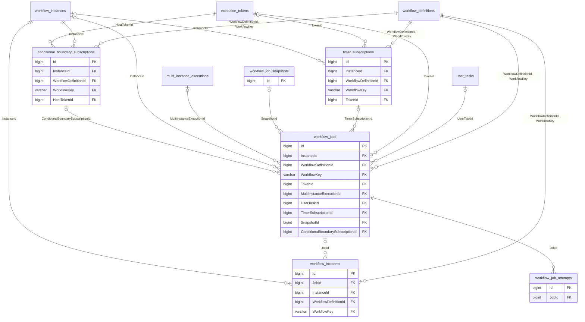

### `workflow_jobs`

Each row is one unit of durable work, leased by `Flowbit.Worker` with `FOR UPDATE SKIP LOCKED`. The same table serves instance work (async continuations, timers, durable conditional wakes) and instance-less control work (administrative, version-change, and variable-update batch phases). Locked finalization reads use the current persisted lease and publication-recovery fields even when the same context previously enqueued or read the job.

| Column | Meaning |
| --- | --- |
| `Kind` | `asyncBefore`, `asyncAfter`, `timer`, `timerStart`, `timerBoundary`, `conditionalWake`, `callStart`, `callResume`, `callCancel`, `administrativeBatchPrepare`, `administrativeBatchExecute`, `instanceVersionChangeBatchPrepare`, `instanceVersionChangeBatchExecute`, `instanceVariableUpdateBatchPrepare`, or `instanceVariableUpdateBatchExecute`; inactive until automatic multi-instance is enabled, also `multiInstanceStart`, `multiInstanceItem`, `multiInstanceDispatch`, and `multiInstanceComplete`. |
| `QueueClass`, `Priority`, `DueAt` | `control` or `activity` queue, priority, and earliest run time. |
| `Status` | `queued`, `running`, `resultReady`, `retry`, `completed`, `incident`, `cancelled`, or `skipped`. |
| `Phase`, `PayloadJson`, `ResultJson`, `ErrorJson` | Job-specific progress, input, staged result, and last error. |
| `AttemptCount`, `MaxAttempts`, `RetryDelays`, `FailureHandling` | Retry policy; `FailureHandling` is `boundaryFirst` or `retryFirst`. |
| `WorkerId`, `LeaseToken`, `LeaseGeneration`, `LeaseExpiresAt`, `HeartbeatAt` | Lease state. Finalization must present the current lease generation. |
| `InstanceId`, `TokenId`, `ActivationId`, `UserTaskId`, `MultiInstanceExecutionId` | Runtime fences. `InstanceId` is null for instance-less work. |
| `TimerSubscriptionId`, `ScheduledOccurrenceAt` | Timer occurrence; unique together, so each occurrence gets one job. A `timer_schedule_failed` incident's `timerStart` job has a subscription but no occurrence. |
| `ConditionalBoundarySubscriptionId`, `ConditionalBoundaryOccurrence` | Durable conditional-boundary occurrence; unique together. |
| `CallInvocationId` | The call invocation a `callStart`, `callResume`, or `callCancel` job belongs to; unique with `Kind`. The job row belongs to its sender's instance and token: `callResume` to the child, `callCancel` to the parent. |
| `SnapshotId` | Frozen input snapshot in `workflow_job_snapshots`. |
| `WorkflowDefinitionId`, `WorkflowKey`, `NodeId`, `NodeName`, `NodeType` | Version and node context. |
| `AutomaticActivationCount` | Carries the automatic-loop allowance. |
| `AutomaticMultiInstanceItemId`, `MultiInstanceControlGeneration`, `PublicationFenceRefreshRequested` | Automatic-body correlation: the item a `multiInstanceItem` job runs, a dispatch or completion job's control generation, and an authorized publication-only retry. See [Automatic multi-instance foundation](#automatic-multi-instance-foundation). |

- **Primary key:** `Id`
- **References:** `ConditionalBoundarySubscriptionId` → [`conditional_boundary_subscriptions`](#conditional_boundary_subscriptions) (optional, `RESTRICT`); `InstanceId` → [`workflow_instances`](#workflow_instances) (optional, `CASCADE`); `MultiInstanceExecutionId` → [`multi_instance_executions`](#multi_instance_executions) (optional, `RESTRICT`); `SnapshotId` → [`workflow_job_snapshots`](#workflow_job_snapshots) (optional, `RESTRICT`); `TimerSubscriptionId` → [`timer_subscriptions`](#timer_subscriptions) (optional, `RESTRICT`); `TokenId` → [`execution_tokens`](#execution_tokens) (optional, `RESTRICT`); `UserTaskId` → [`user_tasks`](#user_tasks) (optional, `RESTRICT`); (`WorkflowDefinitionId`, `WorkflowKey`) → [`workflow_definitions`](#workflow_definitions) (`Id`, `WorkflowKey`) (required, `RESTRICT`); `CallInvocationId` → [`call_activity_executions`](#call_activity_executions) (optional, `RESTRICT`); (`AutomaticMultiInstanceItemId`, `MultiInstanceExecutionId`, `InstanceId`) → [`multi_instance_activity_items`](#multi_instance_activity_items) (optional, `RESTRICT`)
- **Referenced by:** [`administrative_action_batches`](#administrative_action_batches).`ExecutionJobId`, [`administrative_action_batches`](#administrative_action_batches).`PreparationJobId`, [`instance_variable_update_batch_jobs`](#instance_variable_update_batch_jobs).`JobId`, [`workflow_incidents`](#workflow_incidents).`JobId`, [`workflow_instance_version_change_batches`](#workflow_instance_version_change_batches).`ExecutionJobId`, [`workflow_instance_version_change_batches`](#workflow_instance_version_change_batches).`PreparationJobId`, [`workflow_job_attempts`](#workflow_job_attempts).`JobId`
- **Unique:** (`ConditionalBoundarySubscriptionId`, `ConditionalBoundaryOccurrence`) where `ConditionalBoundarySubscriptionId IS NOT NULL AND ConditionalBoundaryOccurrence IS NOT NULL`; (`TimerSubscriptionId`, `ScheduledOccurrenceAt`) where `TimerSubscriptionId IS NOT NULL AND ScheduledOccurrenceAt IS NOT NULL`; (`CallInvocationId`, `Kind`) where `CallInvocationId IS NOT NULL`; `AutomaticMultiInstanceItemId` where it is not null; (`MultiInstanceExecutionId`, `MultiInstanceControlGeneration`) where the generation is not null; `MultiInstanceExecutionId` among open dispatch and completion jobs (`IX_workflow_jobs_automatic_control_slot`)
- **Indexes:** `MultiInstanceExecutionId` (`IX_workflow_jobs_MultiInstanceExecutionId`)
- **Checks:** include `CK_workflow_jobs_automatic_item_shape` and `CK_workflow_jobs_automatic_control_shape`

### `workflow_job_attempts`

Attempt history for retries, incidents, and the Operations UI.

| Column | Meaning |
| --- | --- |
| `JobId`, `AttemptNumber` | Unique together. |
| `LeaseGeneration`, `WorkerId` | The lease and worker that ran the attempt. |
| `Status` | `running`, `resultReady`, `completed`, `failed`, `leaseLost`, or `cancelled`. |
| `FailureCode`, `FailureDescription`, `StartedAt`, `FinishedAt` | Outcome details. A `leaseLost` attempt has `FailureCode` `leaseExpired` when its lease expired, or `workerShutdown` when a stopping Worker released the lease after its drain window. |

- **Primary key:** `Id`
- **References:** `JobId` → [`workflow_jobs`](#workflow_jobs) (required, `CASCADE`)
- **Referenced by:** none
- **Unique:** (`JobId`, `AttemptNumber`)

### `workflow_job_snapshots`

Stores the inputs a job must use when it runs later: the variable overlay, the prepared invocation, and the version fences used to detect conflicting writes before output is committed.

| Column | Meaning |
| --- | --- |
| `Kind`, `EvaluationTime`, `SizeBytes` | Snapshot kind, the logical evaluation time, and stored size. |
| `VariablesJson`, `FlowInfoJson`, `InvocationJson` | Frozen variables, FlowInfo summaries, and prepared call. |
| `OutputVariableVersionsJson` | Instance-variable version fences for output targets. |
| `SharedVariableRevisionsJson`, `SharedOutputValueVersionsJson` | Shared-variable fences. The legacy catalog-revision map and the value-revision map are dual-written during the rollout. |

- **Primary key:** `Id`
- **References:** none
- **Referenced by:** [`workflow_jobs`](#workflow_jobs).`SnapshotId`, [`multi_instance_executions`](#multi_instance_executions).`InputSnapshotId`

Snapshots have no outgoing foreign keys. Retention removes orphaned snapshots together with completed jobs.

### `workflow_incidents`

Opened when durable work cannot continue on its own, for example exhausted retries, an output conflict, `job_conflict` for a conflict in a job that still owns its work, `automatic_loop_limit`, or `timer_schedule_failed` for a timer start whose first due time cannot be computed. At most one incident is open per job.

| Column | Meaning |
| --- | --- |
| `Type`, `Summary`, `Details` | Incident classification and diagnostics. |
| `Status`, `ResolvedAt`, `ResolvedBy` | `open` or `resolved`, with resolution fields required exactly when resolved. |
| `JobId`, `OriginalJobId` | The live job, set to null if the job is later deleted, and a permanent copy of its ID. |
| `InstanceId`, `WorkflowDefinitionId`, `WorkflowKey`, `NodeId`, `NodeName` | Context. |

- **Primary key:** `Id`
- **References:** `InstanceId` → [`workflow_instances`](#workflow_instances) (optional, `CASCADE`); `JobId` → [`workflow_jobs`](#workflow_jobs) (optional, `SET NULL`); (`WorkflowDefinitionId`, `WorkflowKey`) → [`workflow_definitions`](#workflow_definitions) (`Id`, `WorkflowKey`) (required, `RESTRICT`)
- **Referenced by:** none
- **Unique:** (`JobId`, `Status`) where `Status = 'open'`

### `timer_subscriptions`

One row per armed timer. A definition-level timer start has no instance or token; at most one is active or paused per definition and node. A timer start whose first due time could not be computed stays paused, with `NextDueAt` set to its activation time, until its `timer_schedule_failed` incident is retried. An instance timer is fenced by `(InstanceId, TokenId, ActivationId, TimerNodeId)`.

| Column | Meaning |
| --- | --- |
| `WorkflowDefinitionId`, `WorkflowKey`, `TimerNodeId`, `TimerNodeName` | Version and timer node. |
| `InstanceId`, `TokenId`, `ActivationId` | Instance fence; null for timer starts. |
| `AttachedToNodeId`, `CancelActivity` | Host node and interrupting flag, for boundaries only. |
| `ScheduleKind`, `ScheduleExpression` | `timeDate`, `timeDuration`, `timeCycle`, or, for a timer start only, `cron`, plus the schedule value as authored, after trimming: an ISO-8601 value, the NCalc text of an [expression schedule](node-reference.md#expression-schedules), never its result, or a [cron expression](node-reference.md#cron-schedules) with its syntax kept. Version changes compare this text. At most 300 characters; authoring allows 128. |
| `ScheduleCalendar` | The business calendar a `timeDuration` was counted in; null for wall-clock schedules and always null for `cron`. Version changes compare it, ignoring case, with the target timer's calendar. |
| `ScheduleTimeZone` | The IANA zone of a `cron` schedule, at most 100 characters; null for every other kind. A cron start whose first occurrence could not be calculated keeps its expression and zone here too. |
| `NextDueAt`, `Occurrence` | Next due time, in UTC, and occurrence counter for recurring timers. For an expression schedule, `NextDueAt` is the due time its result gave when the timer activated; it is never recomputed. For `cron`, `Occurrence` starts at 0 and increases by one for each persisted successor, including one that skips a downtime backlog: it is a fencing generation, not a count of cron matches or missed runs, and a cron time is never rebuilt from it. The timer job's `ScheduledOccurrenceAt` keeps the same occurrence, while its `DueAt` can move for a delivery retry. |
| `Status`, `CompletedAt` | `active`, `paused`, `completed`, or `cancelled`. A `cron` row is never `completed`. |

- **Primary key:** `Id`
- **References:** `InstanceId` → [`workflow_instances`](#workflow_instances) (optional, `CASCADE`); `TokenId` → [`execution_tokens`](#execution_tokens) (optional, `RESTRICT`); (`WorkflowDefinitionId`, `WorkflowKey`) → [`workflow_definitions`](#workflow_definitions) (`Id`, `WorkflowKey`) (required, `RESTRICT`)
- **Referenced by:** [`administrative_action_batch_items`](#administrative_action_batch_items).`TimerSubscriptionId`, [`workflow_jobs`](#workflow_jobs).`TimerSubscriptionId`
- **Unique:** (`InstanceId`, `TokenId`, `ActivationId`, `TimerNodeId`) where `InstanceId IS NOT NULL AND TokenId IS NOT NULL`; (`WorkflowDefinitionId`, `TimerNodeId`) where `InstanceId IS NULL AND Status IN ('active', 'paused')`. The unique occurrence index on [`workflow_jobs`](#workflow_jobs) `(TimerSubscriptionId, ScheduledOccurrenceAt)` holds one job per occurrence, cron included. The indexes are unchanged by cron.
- **Checks:** `CK_timer_subscriptions_status`, `_occurrence`, and `_terminal_time`; `CK_timer_subscriptions_schedule_kind` allows the four kinds. `CK_timer_subscriptions_cron_shape` requires a `cron` row to have a nonblank `ScheduleTimeZone`, no `ScheduleCalendar`, and no `InstanceId`, `TokenId`, or `AttachedToNodeId`, and every other kind to have no `ScheduleTimeZone`; a NULL comparison counts as a violation. `CK_timer_subscriptions_cron_not_completed` refuses `Status = 'completed'` for `cron`, so a cron schedule ends only by cancellation. `AddCronTimerSchedules` adds these three `NOT VALID` in one transaction, and `ValidateCronTimerScheduleConstraints` validates each outside a transaction, so a stopped validation is finished by applying it again.

### `conditional_boundary_subscriptions`

One row per conditional boundary per host activation. Evaluation compares the new truth value with `IsConditionTrue` to detect false-to-true edges, and every capture increments `Occurrence`.

| Column | Meaning |
| --- | --- |
| `InstanceId`, `HostTokenId`, `HostActivationId`, `BoundaryNodeId` | Activation fence; unique together. |
| `AttachedToNodeId`, `BoundaryNodeName`, `OutgoingFlowId` | Host node, boundary name, and continuation flow. |
| `Condition`, `DeliveryMode`, `CancelActivity` | Captured condition, `atomic` or `durableAsync`, and interrupting flag. |
| `IsConditionTrue`, `Occurrence` | Last evaluated truth value and capture count. |
| `Status`, `CompletedAt` | `active`, `completed`, or `cancelled`. |
| `WorkflowDefinitionId`, `WorkflowKey` | Version context. |

- **Primary key:** `Id`
- **References:** `HostTokenId` → [`execution_tokens`](#execution_tokens) (required, `RESTRICT`); `InstanceId` → [`workflow_instances`](#workflow_instances) (required, `CASCADE`); (`WorkflowDefinitionId`, `WorkflowKey`) → [`workflow_definitions`](#workflow_definitions) (`Id`, `WorkflowKey`) (required, `RESTRICT`)
- **Referenced by:** [`workflow_jobs`](#workflow_jobs).`ConditionalBoundarySubscriptionId`
- **Unique:** (`InstanceId`, `HostTokenId`, `HostActivationId`, `BoundaryNodeId`)

## Administrative operations

Administrative actions, version changes, and raw variable updates. Each batch family has a header, frozen items, and an immutable per-instance audit where applicable.

```mermaid
erDiagram
    administrative_action_batches {
        bigint Id PK
        bigint PreparationJobId FK
        bigint ExecutionJobId FK
        bigint WorkflowDefinitionId FK
    }
    administrative_action_batch_items {
        bigint Id PK
        bigint BatchId FK
        bigint InstanceId FK
        bigint UserTaskId FK
        bigint TokenId FK
        bigint WorkflowDefinitionId FK
        bigint MultiInstanceExecutionId FK
        bigint TimerSubscriptionId FK
    }
    workflow_instance_version_changes {
        bigint Id PK
        bigint InstanceId FK
        bigint SourceWorkflowDefinitionId FK
        bigint TargetWorkflowDefinitionId FK
        bigint BatchId FK
        bigint BatchItemId FK
    }
    workflow_instance_version_change_batches {
        bigint Id PK
        bigint SourceWorkflowDefinitionId FK
        bigint TargetWorkflowDefinitionId FK
        bigint PreparationJobId FK
        bigint ExecutionJobId FK
    }
    workflow_instance_version_change_batch_items {
        bigint Id PK
        bigint BatchId FK
        bigint InstanceId FK
        bigint CapturedSourceWorkflowDefinitionId FK
    }
    instance_variable_updates {
        bigint Id PK
        bigint InstanceId FK
        bigint WorkflowDefinitionId FK
        bigint BatchId FK
        bigint BatchItemId FK
    }
    instance_variable_update_batches {
        bigint Id PK
    }
    instance_variable_update_batch_items {
        bigint Id PK
        bigint BatchId FK
        bigint InstanceId FK
        bigint CapturedWorkflowDefinitionId FK
    }
    instance_variable_update_batch_jobs {
        bigint Id PK
        bigint BatchId FK
        bigint WorkflowDefinitionId FK
        bigint JobId FK
    }
    workflow_jobs |o--o| administrative_action_batches : "ExecutionJobId"
    workflow_jobs |o--o| administrative_action_batches : "PreparationJobId"
    workflow_definitions ||--o{ administrative_action_batches : "WorkflowDefinitionId"
    administrative_action_batches ||--o{ administrative_action_batch_items : "BatchId"
    workflow_instances ||--o{ administrative_action_batch_items : "InstanceId"
    multi_instance_executions |o--o{ administrative_action_batch_items : "MultiInstanceExecutionId"
    timer_subscriptions |o--o{ administrative_action_batch_items : "TimerSubscriptionId"
    execution_tokens ||--o{ administrative_action_batch_items : "TokenId"
    user_tasks |o--o{ administrative_action_batch_items : "UserTaskId"
    workflow_definitions ||--o{ administrative_action_batch_items : "WorkflowDefinitionId"
    instance_variable_update_batches ||--o{ instance_variable_update_batch_items : "BatchId"
    workflow_definitions ||--o{ instance_variable_update_batch_items : "CapturedWorkflowDefinitionId"
    workflow_instances ||--o{ instance_variable_update_batch_items : "InstanceId"
    instance_variable_update_batches ||--o{ instance_variable_update_batch_jobs : "BatchId"
    workflow_jobs |o--o| instance_variable_update_batch_jobs : "JobId"
    workflow_definitions ||--o{ instance_variable_update_batch_jobs : "WorkflowDefinitionId"
    instance_variable_update_batches |o--o{ instance_variable_updates : "BatchId"
    instance_variable_update_batch_items |o--o| instance_variable_updates : "BatchItemId, BatchId, InstanceId"
    workflow_instances ||--o{ instance_variable_updates : "InstanceId"
    workflow_definitions ||--o{ instance_variable_updates : "WorkflowDefinitionId"
    workflow_jobs |o--o| workflow_instance_version_change_batches : "ExecutionJobId"
    workflow_jobs |o--o| workflow_instance_version_change_batches : "PreparationJobId"
    workflow_definitions ||--o{ workflow_instance_version_change_batches : "SourceWorkflowDefinitionId"
    workflow_definitions ||--o{ workflow_instance_version_change_batches : "TargetWorkflowDefinitionId"
    workflow_instance_version_change_batches ||--o{ workflow_instance_version_change_batch_items : "BatchId"
    workflow_definitions ||--o{ workflow_instance_version_change_batch_items : "CapturedSourceWorkflowDefinitionId"
    workflow_instances ||--o{ workflow_instance_version_change_batch_items : "InstanceId"
    workflow_instance_version_change_batches |o--o{ workflow_instance_version_changes : "BatchId"
    workflow_instance_version_change_batch_items |o--o| workflow_instance_version_changes : "BatchItemId"
    workflow_instances ||--o{ workflow_instance_version_changes : "InstanceId"
    workflow_definitions ||--o{ workflow_instance_version_changes : "SourceWorkflowDefinitionId"
    workflow_definitions ||--o{ workflow_instance_version_changes : "TargetWorkflowDefinitionId"
```

### `administrative_action_batches`

Header row for one administrative action: an exact definition, a source user-task node, and one authored action (`directFlow` or `timerBoundary`). Selection, preparation, confirmation, and execution are tracked here. An immediate direct override from instance detail is stored as a one-item batch.

| Column | Meaning |
| --- | --- |
| `WorkflowDefinitionId`, `WorkflowKey`, `SourceNodeId` | Exact version and source node. |
| `ActionKind`, `FlowId`, `BoundaryNodeId`, `MultiInstanceMode` | The selected action and, for multi-instance tasks, `forceParent` or `completeAllChildren`. |
| `CommonVariablesJson`, `Reason`, `ActionSnapshotJson` | Common payload, optional reason, and action snapshot. |
| `SelectionJson` | Frozen explicit or `allMatching` selection. |
| `Status` | `preparing`, `ready`, `queued`, `running`, `completed`, `completedWithIssues`, `cancelled`, or `failed`. |
| `TotalItemCount`, `TotalAffectedTaskCount`, and the other `*ItemCount` columns | Progress counters. The affected-task count is limited by `WorkflowBatchActions.MaxAffectedTasks`. |
| `PreparedBy`, `PreparedByRolesJson`, `ConfirmedBy`, `ConfirmedByRolesJson`, `CancelledBy`, `CancellationReason` | Actor and role snapshots. |
| `PreparationJobId`, `ExecutionJobId` | The durable phase jobs; set to null if the job is deleted. |
| `IdempotencyKey` | Optional creation key, unique per `PreparedBy`. |

- **Primary key:** `Id`
- **References:** `ExecutionJobId` → [`workflow_jobs`](#workflow_jobs) (optional, `SET NULL`); `PreparationJobId` → [`workflow_jobs`](#workflow_jobs) (optional, `SET NULL`); `WorkflowDefinitionId` → [`workflow_definitions`](#workflow_definitions) (required, `RESTRICT`)
- **Referenced by:** [`administrative_action_batch_items`](#administrative_action_batch_items).`BatchId`, [`instance_history`](#instance_history).`AdministrativeActionBatchId`, [`user_tasks`](#user_tasks).`AdministrativeActionBatchId`
- **Unique:** `ExecutionJobId` where `ExecutionJobId IS NOT NULL`; `PreparationJobId` where `PreparationJobId IS NOT NULL`; (`PreparedBy`, `IdempotencyKey`) where `IdempotencyKey IS NOT NULL`

### `administrative_action_batch_items`

One row per selected position: an ordinary user task or a multi-instance parent, each at most once per batch. The captured fences are revalidated before execution, and each item commits in its own transaction.

| Column | Meaning |
| --- | --- |
| `BatchId`, `InstanceId`, `WorkflowDefinitionId`, `SourceNodeId`, `FlowId` | Batch and position context. |
| `PositionKind`, `TokenId`, `TokenActivationId`, `CapturedPositionUpdatedAt` | Position kind and token fence. |
| `UserTaskId`, `MultiInstanceExecutionId`, `AffectedTaskCount` | Target work and the number of tasks it will complete or cancel. |
| `TimerSubscriptionId`, `TimerJobId`, `CapturedTimerOccurrence`, `CapturedTimerStatus`, `CapturedTimerSubscriptionUpdatedAt` | Timer-boundary fence. `TimerJobId` has no foreign key. |
| `Status` | `preparing`, `eligible`, `ineligible`, `queued`, `succeeded`, `skipped`, `failed`, or `cancelled`. |
| `IssuesJson`, `ResultJson`, `ErrorCode`, `ErrorDescription` | Blockers, the post-route result snapshot, and failure details. |

- **Primary key:** `Id`
- **References:** `BatchId` → [`administrative_action_batches`](#administrative_action_batches) (required, `CASCADE`); `InstanceId` → [`workflow_instances`](#workflow_instances) (required, `RESTRICT`); `MultiInstanceExecutionId` → [`multi_instance_executions`](#multi_instance_executions) (optional, `RESTRICT`); `TimerSubscriptionId` → [`timer_subscriptions`](#timer_subscriptions) (optional, `RESTRICT`); `TokenId` → [`execution_tokens`](#execution_tokens) (required, `RESTRICT`); `UserTaskId` → [`user_tasks`](#user_tasks) (optional, `RESTRICT`); `WorkflowDefinitionId` → [`workflow_definitions`](#workflow_definitions) (required, `RESTRICT`)
- **Referenced by:** none
- **Unique:** (`BatchId`, `MultiInstanceExecutionId`) where `MultiInstanceExecutionId IS NOT NULL`; (`BatchId`, `UserTaskId`) where `UserTaskId IS NOT NULL`

### `workflow_instance_version_changes`

Written for every successful in-place version change, whether direct or from a batch.

| Column | Meaning |
| --- | --- |
| `InstanceId`, `SourceWorkflowDefinitionId`, `TargetWorkflowDefinitionId` | The instance and both versions. |
| `ChangedBy`, `ChangedByRolesJson`, `ChangedAt`, `Reason` | Actor snapshot, time, and the required reason. |
| `BatchId`, `BatchItemId` | Batch correlation; null for direct changes. One audit row per batch item. |

- **Primary key:** `Id`
- **References:** `BatchId` → [`workflow_instance_version_change_batches`](#workflow_instance_version_change_batches) (optional, `RESTRICT`); `BatchItemId` → [`workflow_instance_version_change_batch_items`](#workflow_instance_version_change_batch_items) (optional, `RESTRICT`); `InstanceId` → [`workflow_instances`](#workflow_instances) (required, `CASCADE`); `SourceWorkflowDefinitionId` → [`workflow_definitions`](#workflow_definitions) (required, `RESTRICT`); `TargetWorkflowDefinitionId` → [`workflow_definitions`](#workflow_definitions) (required, `RESTRICT`)
- **Referenced by:** none
- **Unique:** `BatchItemId` where `BatchItemId IS NOT NULL`

### `workflow_instance_version_change_batches`

Header for a batch version change from one exact source definition to a distinct published target in the same family.

| Column | Meaning |
| --- | --- |
| `WorkflowKey`, `SourceWorkflowDefinitionId`, `TargetWorkflowDefinitionId` | Family and versions; source and target must differ. |
| `SelectionJson`, `Reason` | Frozen selection and the required 1–1,000 character reason. |
| `Status` | Batch lifecycle status. |
| `TotalItemCount`, `EligibleItemCount`, `IneligibleItemCount`, `WarningItemCount`, `StaleItemCount`, `BlockedItemCount`, and the other `*ItemCount` columns | Counters. `StaleItemCount` overlaps the preparation and execution classifications. |
| `PreparedBy*`, `ConfirmedBy*`, `CancelledBy`, `CancellationReason` | Actor and role snapshots. |
| `PreparationJobId`, `ExecutionJobId`, `IdempotencyKey` | Phase jobs and an optional creation key, unique per `PreparedBy`. |

- **Primary key:** `Id`
- **References:** `ExecutionJobId` → [`workflow_jobs`](#workflow_jobs) (optional, `SET NULL`); `PreparationJobId` → [`workflow_jobs`](#workflow_jobs) (optional, `SET NULL`); `SourceWorkflowDefinitionId` → [`workflow_definitions`](#workflow_definitions) (required, `RESTRICT`); `TargetWorkflowDefinitionId` → [`workflow_definitions`](#workflow_definitions) (required, `RESTRICT`)
- **Referenced by:** [`workflow_instance_version_change_batch_items`](#workflow_instance_version_change_batch_items).`BatchId`, [`workflow_instance_version_changes`](#workflow_instance_version_changes).`BatchId`
- **Unique:** `ExecutionJobId` where `ExecutionJobId IS NOT NULL`; `PreparationJobId` where `PreparationJobId IS NOT NULL`; (`PreparedBy`, `IdempotencyKey`) where `IdempotencyKey IS NOT NULL`

### `workflow_instance_version_change_batch_items`

One row per instance in a batch, unique per batch. It holds the frozen fence and the per-instance outcome.

| Column | Meaning |
| --- | --- |
| `BatchId`, `InstanceId` | Unique together. |
| `CapturedSourceWorkflowDefinitionId`, `CapturedInstanceUpdatedAt` | The fence that execution rechecks. |
| `Status` | Item lifecycle status. |
| `BlockersJson`, `WarningsJson`, `ResultJson`, `ErrorCode`, `ErrorDescription` | Compatibility issues and outcome. |

- **Primary key:** `Id`
- **References:** `BatchId` → [`workflow_instance_version_change_batches`](#workflow_instance_version_change_batches) (required, `CASCADE`); `CapturedSourceWorkflowDefinitionId` → [`workflow_definitions`](#workflow_definitions) (required, `RESTRICT`); `InstanceId` → [`workflow_instances`](#workflow_instances) (required, `RESTRICT`)
- **Referenced by:** [`workflow_instance_version_changes`](#workflow_instance_version_changes).`BatchItemId`
- **Unique:** (`BatchId`, `InstanceId`)

### `instance_variable_updates`

Audit row for one administrative update operation on one running instance, from `PATCH /api/instances/{id}/variables` or a batch item. The variable rows it wrote reference it.

| Column | Meaning |
| --- | --- |
| `InstanceId`, `WorkflowDefinitionId` | Instance and the version in effect. |
| `RequestedVariablesJson`, `ResultJson` | Requested values and the per-variable `added`/`updated` outcome. |
| `PerformedBy`, `PerformedByRolesJson`, `PerformedAt`, `Reason` | Actor snapshot. |
| `IdempotencyKey` | Optional key, unique per instance and performer. |
| `BatchId`, `BatchItemId` | Batch correlation. The composite reference `(BatchItemId, BatchId, InstanceId)` guarantees the item belongs to the same batch and instance. |

- **Primary key:** `Id`
- **References:** `BatchId` → [`instance_variable_update_batches`](#instance_variable_update_batches) (optional, `RESTRICT`); (`BatchItemId`, `BatchId`, `InstanceId`) → [`instance_variable_update_batch_items`](#instance_variable_update_batch_items) (`Id`, `BatchId`, `InstanceId`) (optional, `RESTRICT`); `InstanceId` → [`workflow_instances`](#workflow_instances) (required, `CASCADE`); `WorkflowDefinitionId` → [`workflow_definitions`](#workflow_definitions) (required, `RESTRICT`)
- **Referenced by:** [`instance_variables`](#instance_variables) (`InstanceVariableUpdateAuditId`, `InstanceId`)
- **Unique:** (`Id`, `InstanceId`) (alternate key); (`BatchItemId`, `BatchId`, `InstanceId`) where `BatchItemId IS NOT NULL`; (`InstanceId`, `PerformedBy`, `IdempotencyKey`) where `IdempotencyKey IS NOT NULL`

### `instance_variable_update_batches`

Header for an administrative variable-update batch in one workflow family.

| Column | Meaning |
| --- | --- |
| `WorkflowKey`, `VariablesJson`, `SelectionJson`, `Reason` | Family, requested values, frozen selection, and reason. |
| `Status` | `preparing`, `ready`, `queued`, `running`, `completed`, `completedWithIssues`, `cancelled`, or `failed`. |
| `*ItemCount` columns | Progress counters. |
| `PreparedBy*`, `ConfirmedBy*`, `CancelledBy`, `CancellationReason`, `IdempotencyKey` | Actor snapshots and an optional creation key, unique per `PreparedBy`. |

- **Primary key:** `Id`
- **References:** none
- **Referenced by:** [`instance_variable_update_batch_items`](#instance_variable_update_batch_items).`BatchId`, [`instance_variable_update_batch_jobs`](#instance_variable_update_batch_jobs).`BatchId`, [`instance_variable_updates`](#instance_variable_updates).`BatchId`
- **Unique:** (`PreparedBy`, `IdempotencyKey`) where `IdempotencyKey IS NOT NULL`

Unlike the other batch headers, this table has no job columns. It runs one prepare job and one execute job per represented definition, linked through `instance_variable_update_batch_jobs`.

### `instance_variable_update_batch_items`

One row per instance, unique per batch, with the frozen fence and the add/update plan.

| Column | Meaning |
| --- | --- |
| `BatchId`, `InstanceId` | Unique together. |
| `CapturedWorkflowDefinitionId`, `CapturedInstanceUpdatedAt` | Execution fence. |
| `PlanJson`, `WarningsJson` | Per-variable add/update plan and active-job warnings. |
| `Status`, `ResultJson`, `ErrorCode`, `ErrorDescription` | Item outcome. |

- **Primary key:** `Id`
- **References:** `BatchId` → [`instance_variable_update_batches`](#instance_variable_update_batches) (required, `CASCADE`); `CapturedWorkflowDefinitionId` → [`workflow_definitions`](#workflow_definitions) (required, `RESTRICT`); `InstanceId` → [`workflow_instances`](#workflow_instances) (required, `RESTRICT`)
- **Referenced by:** [`instance_variable_updates`](#instance_variable_updates) (`BatchItemId`, `BatchId`, `InstanceId`)
- **Unique:** (`Id`, `BatchId`, `InstanceId`) (alternate key); (`BatchId`, `InstanceId`)

### `instance_variable_update_batch_jobs`

One row per batch, definition, and phase (`prepare` or `execute`).

| Column | Meaning |
| --- | --- |
| `BatchId`, `WorkflowDefinitionId`, `Phase` | Unique together. |
| `JobId` | The live job; set to null if the job is deleted. |
| `OriginalJobId` | Permanent copy of the job ID (unique). |

- **Primary key:** `Id`
- **References:** `BatchId` → [`instance_variable_update_batches`](#instance_variable_update_batches) (required, `CASCADE`); `JobId` → [`workflow_jobs`](#workflow_jobs) (optional, `SET NULL`); `WorkflowDefinitionId` → [`workflow_definitions`](#workflow_definitions) (required, `RESTRICT`)
- **Referenced by:** none
- **Unique:** (`BatchId`, `WorkflowDefinitionId`, `Phase`); `JobId` where `JobId IS NOT NULL`; `OriginalJobId`

The deferrable constraint trigger `TR_instance_variable_update_batch_jobs_validate_live_job` rejects a `JobId` whose job belongs to a different workflow definition.

## Shared variables

The deployment-wide shared-variable catalog, its current values and immutable history, request idempotency, and machine clients. See [shared variables](../Flowbit/README.md#shared-variables) for runtime semantics.

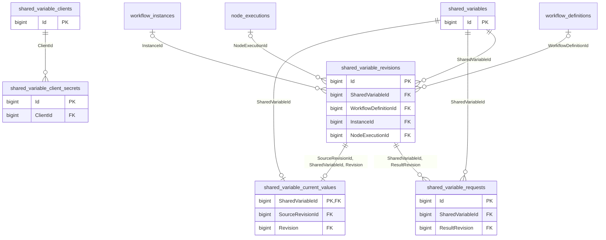

### `shared_variables`

Catalog and lifecycle row for one deployment-wide shared variable. A definition binds to it but cannot change its contract.

| Column | Meaning |
| --- | --- |
| `Key` | Canonical key (`citext`, unique). |
| `DataType`, `IsArray`, `Nullable`, `Validation` | Value contract that bindings must match exactly. |
| `Description`, `Status`, `ArchivedAt` | `active` or `archived`. |
| `CurrentRevision` | Advances on every committed mutation; the API compare-and-swap value. |
| `ValueRevision` | Advances only when the effective value changes; the precise durable-job output fence. |
| `CreatedById`, `CreatedByKind`, `UpdatedById`, `UpdatedByKind`, `HistoryPrunedAt` | Actor attribution and retention marker. |

- **Primary key:** `Id`
- **References:** none
- **Referenced by:** [`shared_variable_current_values`](#shared_variable_current_values).`SharedVariableId`, [`shared_variable_requests`](#shared_variable_requests).`SharedVariableId`, [`shared_variable_revisions`](#shared_variable_revisions).`SharedVariableId`, [`workflow_definition_shared_variable_bindings`](#workflow_definition_shared_variable_bindings).`SharedVariableId`
- **Unique:** `Key`

### `shared_variable_current_values`

Holds the current value, separate from the catalog row. A missing row means the key has never been set; `IsDeleted` means the value was unset.

| Column | Meaning |
| --- | --- |
| `SharedVariableId` | Primary key and catalog reference. |
| `ValueJson`, `IsDeleted` | Current JSON value (GIN-indexed when not deleted), or unset. A stored JSON `null` is a value. |
| `Revision`, `SourceRevisionId`, `SetAt` | The exact revision row the value came from. The composite reference to `shared_variable_revisions (Id, SharedVariableId, Revision)` keeps the projection consistent with history. |

- **Primary key:** `SharedVariableId`
- **References:** `SharedVariableId` → [`shared_variables`](#shared_variables) (required, `RESTRICT`); (`SourceRevisionId`, `SharedVariableId`, `Revision`) → [`shared_variable_revisions`](#shared_variable_revisions) (`Id`, `SharedVariableId`, `Revision`) (required, `RESTRICT`)
- **Referenced by:** none
- **Unique:** `SourceRevisionId`; (`SourceRevisionId`, `SharedVariableId`, `Revision`)

The trigger `tr_shared_variable_current_values_value_revision` (`AFTER INSERT OR UPDATE OF "Revision"`) advances the owning catalog row's `CurrentRevision` and `ValueRevision`, so writes from legacy binaries remain visible to value-fenced workers.

### `shared_variable_revisions`

Append-only history of catalog and value mutations. It may contain every previous value; it is audit data, not a secret store.

| Column | Meaning |
| --- | --- |
| `SharedVariableId`, `Revision` | Revision is globally unique and allocated by PostgreSQL. Gaps are possible, and revisions are not a cross-key commit order. |
| `Operation` | `create`, `set`, `deleteValue`, `updateDescription`, `archive`, or `reactivate`. |
| `HasValue`, `ValueJson`, `ValueChanged` | Value after the mutation and whether the effective value changed. |
| `Source`, `CallerKind`, `CallerId`, `RequestId`, `Reason` | Who or what made the change. `RequestId` has no foreign key. |
| `InstanceId`, `WorkflowDefinitionId`, `NodeExecutionId`, `SourceActionId` | Workflow correlation for runtime writes. |

- **Primary key:** `Id`
- **References:** `InstanceId` → [`workflow_instances`](#workflow_instances) (optional, `RESTRICT`); `NodeExecutionId` → [`node_executions`](#node_executions) (optional, `RESTRICT`); `SharedVariableId` → [`shared_variables`](#shared_variables) (required, `RESTRICT`); `WorkflowDefinitionId` → [`workflow_definitions`](#workflow_definitions) (optional, `RESTRICT`)
- **Referenced by:** [`shared_variable_current_values`](#shared_variable_current_values) (`SourceRevisionId`, `SharedVariableId`, `Revision`), [`shared_variable_requests`](#shared_variable_requests) (`SharedVariableId`, `ResultRevision`)
- **Unique:** (`Id`, `SharedVariableId`, `Revision`) (alternate key); (`SharedVariableId`, `Revision`) (alternate key); `Revision`

Revision allocation always calls `flowbit.next_shared_variable_revision()`, which
uses `nextval('flowbit.shared_variable_revision_seq')`. Same-key writes serialize
on the catalog row inside their transaction; the existing catalog/value revision
checks reject stale writes when an expected revision is supplied.

`RemoveSharedVariableRevisionState` removes the former allocator table, its
guard trigger/function, and its manual cutover function. It advances the sequence
above both existing revisions and previously allocated sequence values, including
allocations from rolled-back transactions, while preserving catalog, current,
history, and request rows. Fresh installations allocate from the sequence after
the full migration chain without a separate cutover. See the coordinated
[deployment procedure](deployment.md#upgrade-and-compatibility-rules).

### `shared_variable_requests`

Each committed mutation that carries a request ID records a fingerprint and the response. An identical retry replays the stored response, and a different payload with the same request ID is rejected.

| Column | Meaning |
| --- | --- |
| `CallerKind`, `CallerId`, `RequestId` | Unique together; case-sensitive. |
| `Operation`, `RequestHash` | Operation and request fingerprint. |
| `ResponseJson` | Stored response for replay. |
| `SharedVariableId`, `SharedKey`, `ResultRevision` | The mutated entry and the revision the request produced. |

- **Primary key:** `Id`
- **References:** `SharedVariableId` → [`shared_variables`](#shared_variables) (required, `RESTRICT`); (`SharedVariableId`, `ResultRevision`) → [`shared_variable_revisions`](#shared_variable_revisions) (`SharedVariableId`, `Revision`) (required, `RESTRICT`)
- **Referenced by:** none
- **Unique:** (`CallerKind`, `CallerId`, `RequestId`)

### `shared_variable_clients`

Administrator-managed clients that call the shared-variable API without a user JWT.

| Column | Meaning |
| --- | --- |
| `ClientId` | Administrator-chosen, case-sensitive, immutable identifier (unique). |
| `DisplayName`, `Scopes` | Display name and the granted scopes `shared-variables.read` and/or `shared-variables.write`. |
| `Status`, `RevokedAt`, `RevocationReason`, `ExpiresAt` | `active` or `revoked`, and an optional expiry. |
| `ActiveSecretVersion`, `Revision` | Current secret version and optimistic concurrency value. |
| `CreatedById`, `CreatedByKind`, `UpdatedById`, `UpdatedByKind` | Attribution. |

- **Primary key:** `Id`
- **References:** none
- **Referenced by:** [`shared_variable_client_secrets`](#shared_variable_client_secrets).`ClientId`
- **Unique:** `ClientId`

### `shared_variable_client_secrets`

Secrets are never stored in plaintext. Rotation adds a version and keeps the previous one valid for a grace period.

| Column | Meaning |
| --- | --- |
| `ClientId`, `Version` | Unique together. `ClientId` here is the numeric `shared_variable_clients.Id`. |
| `Algorithm`, `Iterations`, `Salt`, `Digest` | Hash parameters: 100,000–2,000,000 iterations and a salt of at least 16 bytes. |
| `ValidUntil`, `RevokedAt`, `CreatedAt` | Rotation grace window and revocation. |

- **Primary key:** `Id`
- **References:** `ClientId` → [`shared_variable_clients`](#shared_variable_clients) (required, `RESTRICT`)
- **Referenced by:** none
- **Unique:** (`ClientId`, `Version`)

## Delegation

Standing user delegation grants and their per-workflow acceptance policy. Delegation is runtime data, not workflow-definition data.

These tables have no foreign keys, so this area has no relationship diagram.

### `user_delegations`

Each row grants one delegate access to one delegator's assigned or claimed tasks for one workflow family, valid for `[ValidFrom, ValidUntil)`. There is no uniqueness rule, so a pair may hold several grants over time. Grants are kept after rejection, revocation, or expiry. Delegated actions record the grant in nullable `DelegationId` columns elsewhere, which have no foreign keys.

| Column | Meaning |
| --- | --- |
| `Delegator`, `Delegate`, `WorkflowKey` | Canonical users (`citext`) and the workflow family. |
| `ValidFrom`, `ValidUntil` | Finite UTC validity window. |
| `RequiresAcceptance`, `AcceptanceState` | Snapshot of the policy at creation; `notRequired`, `pending`, `accepted`, or `rejected`. |
| `DecisionAt`, `DecisionBy`, `DecisionReason` | Acceptance decision. |
| `RevokedAt`, `RevokedBy`, `RevocationReason` | Revocation, all set together or all null. |
| `CreatedBy`, `CreationReason`, `UpdatedAt` | Creator (the delegator or an administrator) and the optimistic concurrency value. |

- **Primary key:** `Id`
- **References:** none
- **Referenced by:** none

### `workflow_delegation_policies`

One row per workflow family. Each new grant snapshots `RequiresAcceptance`.

| Column | Meaning |
| --- | --- |
| `WorkflowKey` | Primary key. |
| `RequiresAcceptance` | Whether new grants need delegate acceptance. |
| `CreatedBy`, `UpdatedBy`, `CreatedAt`, `UpdatedAt` | Attribution and concurrency. |

- **Primary key:** `WorkflowKey`
- **References:** none
- **Referenced by:** none

## Settings

Deployment-wide configuration managed through the settings API and UI.

These tables have no foreign keys, so this area has no relationship diagram.

### `engine_settings`

String settings managed at `/engine-settings`, unique per namespace and key. Examples are `Workflow.RequiredRole`, `Settings.RequiredRole`, and `NodeExecution.RequiredRole`.

| Column | Meaning |
| --- | --- |
| `Namespace`, `Key`, `Value` | Logical identifier (immutable after creation) and string value. |
| `Description`, `CreatedAt`, `UpdatedAt` | Optional description, creation time, and optimistic concurrency timestamp. |
| `CreatedBy`, `UpdatedBy` | Nullable actor strings, at most 300 characters. Authenticated creation sets both; updates preserve the creator and replace the updater. Unknown historical actors remain null. |

- **Primary key:** `Id`
- **References:** none
- **Referenced by:** none
- **Unique:** (`Namespace`, `Key`)

The protected row `Webhooks.CaptureEnabled` stores the lifecycle capture switch as canonical lowercase `true` or `false`. Only namespace `Webhooks` and key `CaptureEnabled` are allowed; the database guard rejects aliases, invalid values, deletion, and key changes. Generic settings management can edit this row. The capture audit trigger records one `captureEnabled`/`captureDisabled` entry for an actual value toggle, and none for metadata-only edits. SQL operators use `set_lifecycle_event_capture(boolean, text)`, which retains its signature and does nothing when the value is unchanged. The helper and toggle guard reject an operator that is blank after Unicode whitespace trimming; helper writes and audit actors use the trimmed name. Capture reads the row directly without locks or a Boolean cast; missing or unusable values disable capture.

`ConsolidateLifecycleCaptureSettings` moves the old singleton state here and drops `lifecycle_event_capture_state`, with no compatibility view. It copies the old `ChangedAt` to both initial timestamps and `ChangedBy` to `UpdatedBy`, leaving the original creator unknown. Down reconstructs the singleton from the current value and removes both actor columns.

The reserved row `AiAuthoring.Models` stores the AI assistant's model list, including write-only keys. The generic settings API hides it and refuses to write it; it is managed only through `/api/ai-models`.

### `workflow_settings`

Global, read-only values for workflow expressions, exposed as `setting.<name>` or `setting.<namespace>.<name>`.

| Column | Meaning |
| --- | --- |
| `Namespace`, `Name`, `Value` | Logical identifier and JSON value of any root type. |
| `Description`, `CreatedAt`, `UpdatedAt` | Optional description and optimistic concurrency timestamp. |

- **Primary key:** `Id`
- **References:** none
- **Referenced by:** none
- **Unique:** (`Namespace`, `Name`)

## Business calendars

Working time that timer durations and user-task due dates can count in, managed at `/business-calendars` and through `/api/business-calendars`. See [working-time durations](node-reference.md#working-time-durations).

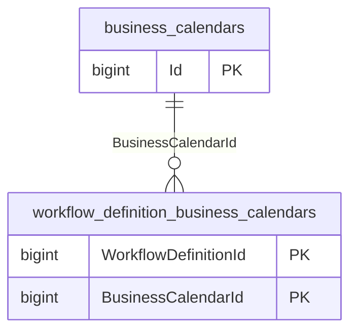

### `business_calendars`

One named calendar. Timers and work items read it when they start and save their due time, so editing a row never moves a saved due time.

| Column | Meaning |
| --- | --- |
| `Name` | `citext` name that workflows use; unique ignoring case and fixed after creation. |
| `Description` | Optional description. |
| `TimeZone` | IANA time-zone id in which periods and holiday dates are read. |
| `WeeklyHours` | `jsonb` object with all seven lowercase weekdays, each an array of `{ "start", "end" }` periods in `HH:mm`, where an end may be `24:00`. |
| `Holidays` | `jsonb` array of `{ "date", "name", "workingHours" }` in date order; an empty `workingHours` closes the date. |
| `CreatedAt`, `UpdatedAt` | Creation time and optimistic concurrency timestamp. |

- **Primary key:** `Id`
- **References:** none
- **Referenced by:** [`workflow_definition_business_calendars`](#workflow_definition_business_calendars).`BusinessCalendarId`
- **Unique:** (`Name`)

The `AddBusinessCalendars` migration seeds `examples.weekdays` (Monday to Friday, 09:00 to 17:00, `Etc/UTC`) when it is missing, for the [example catalog](../examples/README.md).

## Retention

History and audit retention policies and the Worker-owned cleanup coordinator. See [history and audit retention](../Flowbit/README.md#history-and-audit-retention).

These tables have no foreign keys, so this area has no relationship diagram.

### `retention_policies`

One row per retention category: `workflowHistory`, `variableHistory`, `nodeActivity`, `administrativeAudits`, `sharedVariableHistory`, `completedJobs`, `resolvedIncidents`, `webhookDeliveries`, and `lifecycleEvents`.

| Column | Meaning |
| --- | --- |
| `Category` | Primary key. |
| `RetentionDays` | Null means keep forever. |
| `IsInitialized` | Whether the Worker has initialized an operational category from its configuration. |
| `Revision`, `UpdatedBy`, `UpdatedAt` | Optimistic concurrency and attribution. |

- **Primary key:** `Category`
- **References:** none
- **Referenced by:** none

### `retention_coordinator`

One durable coordinator row holding the cleanup lease and two bounded run documents. It is not an append-only run log.

| Column | Meaning |
| --- | --- |
| `LeaseOwner`, `LeaseGeneration`, `LeaseExpiresAt` | Worker lease for cleanup. |
| `NextScheduledAt`, `WorkerLastSeenAt` | Scheduling and Worker liveness. |
| `CurrentRunJson`, `LastRunJson` | Progress and bookmarks of the current run, and the last run's result. |

- **Primary key:** `Id`
- **References:** none
- **Referenced by:** none

## Lifecycle webhooks

Transactional capture of lifecycle events and the Worker's webhook delivery queue. Capture triggers on `workflow_instances`, `user_tasks`, `workflow_incidents`, and `user_delegations` write `lifecycle_events` at commit; nothing in this area holds a foreign key to runtime rows. See [deployment](deployment.md#lifecycle-webhooks) and the [runtime reference](../Flowbit/README.md#lifecycle-webhooks).

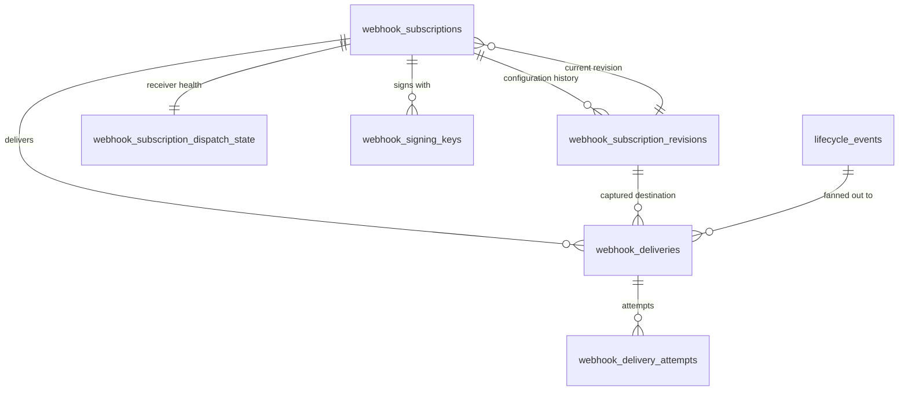

- **Body bound.** Every string a capture function copies into a body is bounded by a column limit, never truncated. Workflow keys are at most 300 characters in every source table and in `lifecycle_events`, and so are task external IDs (`user_tasks.NodeExternalId`). An incident's node external ID comes from the definition JSON, which does not limit it, so it is reported as JSON `null` when it is not a string or is longer than the 300 characters that tokens and tasks can hold. The other fields are numbers, UUIDs, timestamps, and fixed status strings. Even if every character escapes to six bytes, a body stays under 5 KiB, far below the 16 KiB `CK_lifecycle_events_body` check; a body over that check would fail the source commit.
- **Incident nodes.** An `incident.opened` body reports a node only when an authored node applies. Its capture function reads the source job's `Kind`: version-change and variable-update batch jobs name the initial start event only to anchor their row, so their incidents report null `nodeId` and `nodeExternalId`, as does a `NodeId` that is not positive. An administrative batch job reports the user task whose positions its batch acts on, and every other job kind reports its own node. `LifecycleEventCaptureTests` classifies every job kind, so a new kind must be classified there and, when no node applies, listed in `capture_workflow_incident_lifecycle()`.
- **Cleanup.** [Retention](#retention) runs the `webhookDeliveries` category before `lifecycleEvents`; both keep rows forever by default. Delivery cleanup ages `succeeded` and `discarded` deliveries from `SettledAt` and deletes each delivery's `webhook_delivery_attempts` rows before the delivery. Pending, scheduled, leased, and failed deliveries are never deleted, so a failure must be retried or discarded first. Event cleanup ages events from `OccurredAt` and deletes one only when `FanoutCompletedAt` is set and no delivery references it. Both skip locked rows instead of waiting. Subscriptions, revisions, dispatch state, management audit, signing-key rows, and the key ring are kept; the Worker only clears the `ProtectedSecret` of a key that is no longer current or previous once its `RemoveSecretNotBefore` has passed. Webhook cleanup never touches runtime rows, `HistoryPrunedAt`, or reactivation eligibility.

Capture configuration is the protected `Webhooks.CaptureEnabled` row in [`engine_settings`](#engine_settings); the former singleton capture table no longer exists.

### `lifecycle_events`

One committed transition that matched at least one active target when it committed. A transition matching nothing writes no row.

| Column | Meaning |
| --- | --- |
| `Id` | UUIDv7 event id, sent as `webhook-id`. |
| `Type`, `SchemaVersion`, `OccurredAt`, `RecordedAt` | Event type, body schema version, transition time from the source row, and capture time. |
| `SourceTable`, `SourceId` | The row change that produced the event (`SourceId` is null for test events). |
| `WorkflowKey`, `WorkflowDefinitionId`, `WorkflowVersion`, `InstanceId`, `UserTaskId` | Indexed copies of envelope fields; immutable references without foreign keys. |
| `Body` | The exact compact UTF-8 JSON bytes, built by the trigger and reused for every attempt; at most 16 KiB. |
| `RecipientUserIds` | Internal canonical recipients (the new assignee, the effective assignee at activation, or the delegate) for the planned notification center; never sent externally. |
| `TargetRevisionIds` | Subscription revisions captured at commit; no foreign key. |
| `FanoutCompletedAt` | When the Worker created this event's deliveries; null while pending. |

- **Primary key:** `Id`
- **References:** none
- **Referenced by:** `webhook_deliveries.EventId` (`RESTRICT`)

### `webhook_subscriptions`

| Column | Meaning |
| --- | --- |
| `Id`, `Name`, `Description` | UUID id and display metadata. |
| `CurrentRevisionId` | The destination revision that new captures use. |
| `State`, `PauseReason` | `active`, `paused`, or `archived`; while paused, `administrator`, `receiverGone`, or `receiverUnavailable`. |
| `MaxConcurrency` | Requests in flight to this receiver, 1–16. |
| `Revision` | Optimistic management revision. |
| `CreatedAt`, `CreatedBy`, `UpdatedAt`, `UpdatedBy`, `ArchivedAt`, `ArchivedBy`, `ArchiveSettledAt` | Attribution; `ArchiveSettledAt` marks the end of archive discarding. |

- **Primary key:** `Id`
- **References:** `CurrentRevisionId` → `webhook_subscription_revisions.Id` (`RESTRICT`)
- **Referenced by:** revisions, dispatch state, signing keys, and deliveries (`RESTRICT`)
- **Unique:** (`CurrentRevisionId`) where `State = 'active'`

### `webhook_subscription_revisions`

Immutable delivery configuration: `ConfigurationRevision` (unique per subscription), `EndpointUrl` (confidential; may carry a receiver token), `EventTypes` (`text[]`, nonempty, GIN-indexed for the triggers' match), optional exact `WorkflowKey`, and creation attribution. Retained indefinitely.

- **Primary key:** `Id`
- **References:** `SubscriptionId` → `webhook_subscriptions.Id` (`RESTRICT`)
- **Referenced by:** `webhook_subscriptions.CurrentRevisionId`, `webhook_deliveries.RevisionId` (`RESTRICT`)
- **Unique:** (`SubscriptionId`, `ConfigurationRevision`)

### `webhook_subscription_dispatch_state`

One row per subscription, written by the Worker and by resume so dispatch never touches the management revision: `ConsecutiveFailures`, `BackoffStartedAt`, `BackoffUntil`, `BackoffSeconds`, `LastSuccessAt`, `LastFailureAt`, `LastOutcome`, `LastHttpStatus`, `LastOutcomeAt`, and `LastAcquiredAt`, which orders acquisition fairly.

- **Primary key:** `SubscriptionId` → `webhook_subscriptions.Id` (`RESTRICT`)
- **Referenced by:** none

### `webhook_signing_keys`

| Column | Meaning |
| --- | --- |
| `Id`, `SubscriptionId` | UUID key id and owner. |
| `ProtectedSecret` | Data Protection payload of the 32-byte secret; cleared (with `SecretRemovedAt`) after the key retires and `RemoveSecretNotBefore` passes. |
| `Status` | `current`, `previous` (signs until `OverlapExpiresAt`), `revoked`, `expired`, or `retired`. Partial unique indexes allow one current and one previous key per subscription. |
| `CreatedAt`, `CreatedBy`, `RevokedAt`, `RevokedBy`, `RetiredAt` | Attribution, kept after removal as audit metadata. |

- **Primary key:** `Id`
- **References:** `SubscriptionId` → `webhook_subscriptions.Id` (`RESTRICT`)
- **Referenced by:** none
- **Unique:** (`SubscriptionId`) where `Status = 'current'` (`IX_webhook_signing_keys_current`); (`SubscriptionId`) where `Status = 'previous'` (`IX_webhook_signing_keys_previous`)

### `webhook_deliveries`

| Column | Meaning |
| --- | --- |
| `Id`, `EventId`, `SubscriptionId`, `RevisionId` | Delivery id, its event, and the destination revision captured with the event. `(EventId, SubscriptionId)` is unique. |
| `IsTest`, `EventType`, `WorkflowKey`, `InstanceId`, `OccurredAt` | Copies used by filters and ordering. |
| `State` | `pending`, `retryScheduled`, `delivering`, `succeeded`, `failed`, or `discarded`; `SettledAt` is set exactly for succeeded and discarded. |
| `DueAt` | When the delivery may next be acquired. |
| `RetryGeneration`, `GenerationStartedAt`, `DeadlineAt`, `GenerationAttempts`, `LifetimeAttempts` | Retry budget: 12 send intents within 72 hours of the generation's first send. |
| `LeaseOwner`, `LeaseToken`, `LeaseGeneration`, `LeaseExpiresAt`, `LeasedFromState` | Lease fence, all set only while `delivering`. |
| `LastOutcome`, `LastHttpStatus`, `FailureCode`, `LastAttemptAt` | Safe outcome codes; `failed` requires a failure code. |
| `Revision`, `CreatedAt`, `UpdatedAt` | Optimistic revision for retry and discard. |

- **Primary key:** `Id`
- **References:** `EventId` → `lifecycle_events.Id`, `SubscriptionId` → `webhook_subscriptions.Id`, `RevisionId` → `webhook_subscription_revisions.Id` (all `RESTRICT`)
- **Referenced by:** `webhook_delivery_attempts.DeliveryId` (`RESTRICT`)
- **Unique:** (`EventId`, `SubscriptionId`)

### `webhook_delivery_attempts`

One acquired attempt: `AttemptNumber` (unique per delivery), `RetryGeneration`, `LeaseGeneration`, `SigningKeyIds` (`uuid[]`), `AcquiredAt`, `SendIntentAt` (null when released before sending), `CompletedAt`, `Outcome`, `HttpStatus`, and `DurationMilliseconds`. Response bodies are never stored.

- **Primary key:** `Id`
- **References:** `DeliveryId` → `webhook_deliveries.Id` (`RESTRICT`)
- **Referenced by:** none
- **Unique:** (`DeliveryId`, `AttemptNumber`)

### `webhook_management_audit`

Append-only `Operation`, canonical `Actor` (an administrator or `system`), optional `SubscriptionId` and `DeliveryId`, `OccurredAt`, and bounded `ChangesJson`. It never holds keys, signatures, payloads, URL paths or queries, or remote error text. Kept indefinitely in this release.

- **Primary key:** `Id`
- **References:** none
- **Referenced by:** none

### `webhook_data_protection_keys`

The `Flowbit.Webhooks` Data Protection key ring: `FriendlyName` and `Xml`, each key wrapped with the configured certificate. Back it up with the certificate; see [signing keys and the key ring](deployment.md#signing-keys-and-the-key-ring).

- **Primary key:** `Id`
- **References:** none
- **Referenced by:** none

## Local identity

Users and refresh sessions for `Authentication:Mode=Local`. See [local authentication](local-authentication.md).

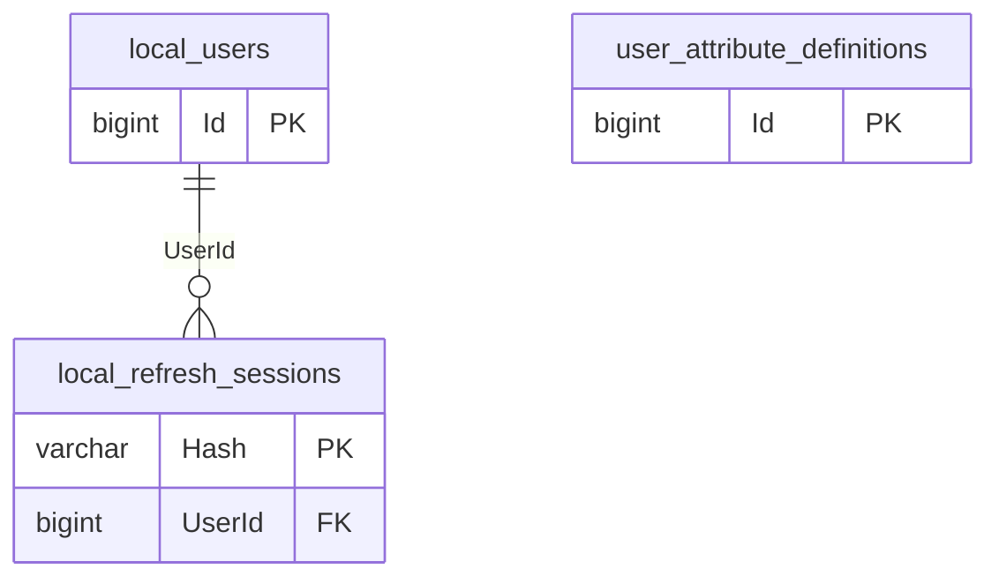

### `local_users`

Database-backed users for `Authentication:Mode=Local`.

| Column | Meaning |
| --- | --- |
| `Username` | Login and actor identity (`citext`, unique), emitted in tokens as `Username`. |
| `PasswordHash` | ASP.NET Core Identity hash; no plaintext. |
| `FirstName`, `LastName`, `IsActive` | Profile and activation. |
| `RolesJson`, `ClaimsJson`, `AttributesJson` | Roles, extra claims, and typed attribute values keyed by `user_attribute_definitions.Key`. |
| `FailedAttempts`, `LockedUntil` | Lockout state. |
| `Revision` | Concurrency token. |

- **Primary key:** `Id`
- **References:** none
- **Referenced by:** [`local_refresh_sessions`](#local_refresh_sessions).`UserId`
- **Unique:** `Username`

### `user_attribute_definitions`

Administrator-defined fields whose values are stored in `local_users.AttributesJson`. That link is by key and has no foreign key.

| Column | Meaning |
| --- | --- |
| `Key` | Field key (`citext`, unique). |
| `Label`, `Type`, `Required`, `ChoicesJson` | Field definition. |
| `ClaimType` | Optional claim the value is emitted as. |
| `Revision` | Concurrency token. |

- **Primary key:** `Id`
- **References:** none
- **Referenced by:** none
- **Unique:** `Key`

### `local_refresh_sessions`

Refresh tokens rotate atomically. Reusing a consumed token revokes its whole family.

| Column | Meaning |
| --- | --- |
| `Hash` | Primary key: the hex SHA-256 hash of the refresh token. Token bodies are never stored. |
| `UserId` | Owning user. Deleting the user deletes their sessions. |
| `FamilyId` | Rotation family. |
| `Used`, `Revoked`, `ExpiresAt` | Rotation, revocation, and absolute expiry. |

- **Primary key:** `Hash`
- **References:** `UserId` → [`local_users`](#local_users) (required, `CASCADE`)
- **Referenced by:** none

## Database objects outside tables

Migrations also create these objects with raw SQL. They are part of the schema contract: do not drop or bypass them.

| Object | Kind | Purpose |
| --- | --- | --- |
| `instance_variables_sync_current_value` → `sync_instance_variable_current_value()` | `AFTER INSERT` trigger on `instance_variables` | Upserts the newest value into `instance_variable_current_values`. |
| `snapshot_user_task_inbox_visibility_condition` → `snapshot_user_task_inbox_visibility_condition()` | `BEFORE INSERT` trigger on `user_tasks` | Copies the instance version's compiled inbox condition ID onto the new work item. |
| `evaluate_inbox_visibility_condition()`, `inbox_visibility_compare()`, `inbox_visibility_normalize_value()`, `inbox_visibility_to_number()` | Functions | Evaluate compiled inbox visibility programs inside inbox SQL. |
| `TR_instance_variable_update_batch_jobs_validate_live_job` → `validate_instance_variable_update_batch_job_definition()` | Deferrable constraint trigger on `instance_variable_update_batch_jobs` | Ensures a linked job belongs to the same workflow definition. |
| `tr_shared_variable_current_values_value_revision` → `sync_shared_variable_value_revision()` | `AFTER INSERT OR UPDATE OF "Revision"` trigger on `shared_variable_current_values` | Advances the catalog row's `CurrentRevision` and `ValueRevision`. |
| `shared_variable_revision_seq`, `next_shared_variable_revision()` | Sequence and function | Allocate global shared-variable revisions through `nextval`; rollbacks may leave gaps. |
| `IX_iv_current_name_root_string_ci_instance`, `IX_iv_current_name_root_number_instance` | Expression indexes on `instance_variable_current_values` | Case-insensitive root-string and numeric lookups for variable search. |
| `IX_user_tasks_AssigneeLower_Status_UpdatedAt_Id`, `IX_node_executions_*_Lower_*` | Expression indexes | Case-insensitive actor and external-ID lookups. |
| `UX_multi_instance_executions_ActiveTokenNode` | Partial unique index | At most one active multi-instance execution per token and node. |
| `TR_workflow_instances_lifecycle_insert`, `TR_workflow_instances_lifecycle_status` → `capture_workflow_instance_lifecycle()` | Deferred constraint triggers on `workflow_instances` (`AFTER INSERT`; `AFTER UPDATE OF "Status"` when it changes) | Record `instance.*` events at commit. |
| `TR_user_tasks_lifecycle_insert`, `TR_user_tasks_lifecycle_update` → `capture_user_task_lifecycle()` | Deferred constraint triggers on `user_tasks` (`AFTER INSERT` unless pending without an assignee; `AFTER UPDATE OF "Status", "Assignee"` when status or the case-insensitive assignee changes) | Record `task.*` events at commit. |
| `TR_workflow_incidents_lifecycle_insert` → `capture_workflow_incident_lifecycle()` | Deferred constraint trigger on `workflow_incidents` (`AFTER INSERT` of an open incident) | Records `incident.opened`, reading the source job's kind and the node's external ID under the [incident node rules](#lifecycle-webhooks). |
| `TR_user_delegations_lifecycle_insert` → `capture_user_delegation_lifecycle()` | Deferred constraint trigger on `user_delegations` (`AFTER INSERT`) | Records `delegation.granted`. |
| `lifecycle_capture_wanted()`, `lifecycle_event_targets()`, `record_lifecycle_event()`, `lifecycle_event_timestamp()`, `lifecycle_json_text()` | Functions | The capture gate (switch, `flowbit.lifecycle_events` setting, any matching target), target matching, and canonical body construction. A new lifecycle status or source table must update these and the capture functions. |
| `uuid_v7()` | Function | Time-ordered UUIDv7 event and delivery ids; PostgreSQL 18 adds a built-in. |
| `set_lifecycle_event_capture(boolean, text)`, `record_webhook_test_event(uuid)` | Functions | Update the canonical capture engine setting with monotonic timestamp/operator metadata (unchanged calls are no-ops), and queue a signed test event for one subscription. |
| `TR_engine_settings_capture_guard` → `guard_lifecycle_capture_setting()` | `BEFORE INSERT OR UPDATE OR DELETE` row trigger on `engine_settings` | Protect the canonical capture key, Boolean value, and row against deletion or renaming. |
| `TR_engine_settings_capture_audit` → `audit_lifecycle_capture_setting()` | `AFTER UPDATE` row trigger on `engine_settings` | Record one webhook management audit entry for an actual capture Boolean toggle in the same transaction. |

The former shared-variable conditional tables (`shared_variable_wakes`, `shared_variable_wake_deliveries`, `shared_variable_wake_incidents`, and `workflow_definition_shared_variable_dependencies`) were dropped by the guarded `RemoveSharedVariableConditionalWakes` migration and no longer exist.

## Inspect a live database

To check this page against a deployed database, run the following read-only query with `psql` or any SQL client. It lists every foreign key with its columns and delete rule:

```sql
SELECT c.conrelid::regclass AS child_table,
       (SELECT string_agg(a.attname, ', ' ORDER BY k.ord)
          FROM unnest(c.conkey) WITH ORDINALITY k(attnum, ord)
          JOIN pg_attribute a ON a.attrelid = c.conrelid AND a.attnum = k.attnum) AS child_columns,
       c.confrelid::regclass AS parent_table,
       (SELECT string_agg(a.attname, ', ' ORDER BY k.ord)
          FROM unnest(c.confkey) WITH ORDINALITY k(attnum, ord)
          JOIN pg_attribute a ON a.attrelid = c.confrelid AND a.attnum = k.attnum) AS parent_columns,
       CASE c.confdeltype WHEN 'c' THEN 'CASCADE' WHEN 'n' THEN 'SET NULL'
            WHEN 'r' THEN 'RESTRICT' ELSE 'NO ACTION' END AS on_delete
  FROM pg_constraint c
 WHERE c.contype = 'f' AND c.connamespace = 'flowbit'::regnamespace
 ORDER BY 1, 2;
```

A database migrated to the current release has 66 `flowbit` tables (plus `__EFMigrationsHistory`) and 130 foreign keys.

## Keeping this page current

Update this page in the same change as any migration that adds, removes, or renames a table, a key, a foreign key, or a raw SQL object, or that changes what a column means. The [AGENTS.md documentation ownership map](../AGENTS.md#mandatory-documentation-maintenance) lists this page for persistence changes. To verify, apply every migration to a disposable database, then compare the inspection query above with the **References** lines, and the table list with the [table map](#table-map).

[Documentation home](index.md) · [Runtime reference](../Flowbit/README.md#storage) · [Deployment and operations](deployment.md)
