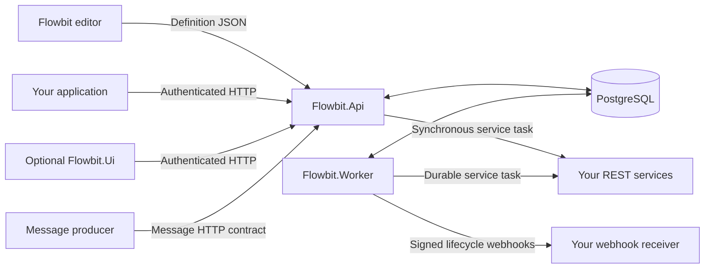

# Integrating Flowbit into your application

[Documentation home](index.md) · [First workflow](getting-started.md) · [API reference](api-guide.md)

Flowbit runs your business process as a durable, versioned workflow. Your application starts instances, presents the current actor's work, submits actions, and reads progress through HTTP. The engine owns routing, task authorization, persisted variables, timers, and execution history.

Start with the [runnable getting-started guide](getting-started.md). This guide explains the contracts to keep when replacing the sample UI with your own application. For every endpoint and response field, use the [API reference](api-guide.md).

## Contents

- [Choose the integration boundary](#choose-the-integration-boundary)
- [Generate clients and AI-assisted integrations](#generate-clients-and-ai-assisted-integrations)
- [Authenticate the actual actor](#authenticate-the-actual-actor)
- [Understand a workflow definition](#understand-a-workflow-definition)
- [Generate and validate workflow drafts](#generate-and-validate-workflow-drafts)
- [Keep identifiers distinct](#keep-identifiers-distinct)
- [Collect and validate variables](#collect-and-validate-variables)
- [Build an inbox and action form](#build-an-inbox-and-action-form)
- [Apply ownership and role policies](#apply-ownership-and-role-policies)
- [Handle parallel and multi-instance work](#handle-parallel-and-multi-instance-work)
- [Perform explicit administrative actions](#perform-explicit-administrative-actions)
- [Select and change workflow versions](#select-and-change-workflow-versions)
- [Integrate inbound messages](#integrate-inbound-messages)
- [Separate retries from business identity](#separate-retries-from-business-identity)
- [Integrate automatic work and durable jobs](#integrate-automatic-work-and-durable-jobs)
- [Call another workflow](#call-another-workflow)
- [Read progress, search, and audit](#read-progress-search-and-audit)
- [Lifecycle webhooks](#lifecycle-webhooks)
- [Handle errors and concurrent changes](#handle-errors-and-concurrent-changes)

## Choose the integration boundary



| Component | Responsibility in an integration |
| --- | --- |
| Editor | Author and export JSON. The shared HTML/CSS/JavaScript asset folder runs independently of the engine and is also mounted inline in Flowbit.Ui. |
| API | Validate/version/publish definitions; start, inspect, and advance runtime work over HTTP. |
| PostgreSQL | Store immutable definition snapshots and transactional runtime state in the `flowbit` schema. |
| Worker | Execute durable jobs, timer events, and durable conditional wakes, and send [lifecycle webhooks](#lifecycle-webhooks). It shares the API's database and required workflow context configuration. |
| Flowbit.Ui | Optional Blazor client for visual authoring, exploration, task handling, and operations. Your own application can use the API without running it. |

Keep application business records in your application's store and retain the returned Flowbit instance ID as the link. Use a configured business key when the engine must also enforce domain uniqueness. Update engine state through its APIs and authored activities; direct writes to runtime tables bypass transactions, authorization, subscriptions, and audit.

No BPMN XML import/export or embedded BPMN SDK is implied by this integration. Flowbit consumes its own BPMN-aligned JSON model; consult the [supported elements and extensions](bpmn-support.md) before translating another engine's process.

## Generate clients and AI-assisted integrations

In Development, use `GET /openapi/v1.json` as the machine-readable contract for SDK generation, API explorers, and AI coding tools. Every published API operation has a stable path-derived `operationId`, a purpose-specific summary and description, described parameters and request bodies, explicit response descriptions, and described component schemas and properties. A contract test generates the real endpoint surface in memory and fails when a route is missing its catalog entry, when operation IDs collide, or when operation, input, output, or schema descriptions are absent.

Bearer-protected routes declare the bearer security scheme. Message delivery and message-start routes instead declare the paired `MessageClientId` and `MessageClientSecret` schemes; task-distribution routes declare their separate paired distributor schemes. Both pairs use the `X-Client-Id` and `X-Client-Secret` header names, but they represent different configured credentials. Shared-variable data routes continue to declare bearer **or** the complete managed shared-variable client pair. Do not combine schemes unless the operation's OpenAPI `security` alternatives say to do so.

Some runtime headers are authored per workflow and therefore cannot have a fixed OpenAPI parameter name: message correlation headers, delivery idempotency headers, and start idempotency headers. Read the operation description and the selected immutable workflow definition before issuing those calls. The [HTTP API reference](api-guide.md) remains the source for complete examples, concurrency behavior, dynamic-header rules, and business-level constraints that a structural schema cannot express.

## Authenticate the actual actor

User-facing API operations use bearer JWT access tokens. `Authentication:Mode=OpenIdConnect` validates issuer, audience, lifetime, and signature through the configured provider's discovery/signing keys, then requires the configured API scope. `Local` provides database-backed password login and HS256 token issuance through `POST /api/auth/token`; it also accepts externally signed tokens without directory membership. Its exact default actor claim is `Username`, and its role claim defaults to `roles`. `DevelopmentToken` uses `Jwt:Issuer`, `Jwt:Audience`, and `Jwt:Key` only in Development. See [OpenID Connect](openid-connect.md) or [Local authentication](local-authentication.md) for configuration, HTTP contracts and session behavior.

For local DevelopmentToken testing, obtain a token from Flowbit.Ui's `/token` page as shown in [getting started](getting-started.md). The test identity remains shared by the entire UI process; use this utility only in a trusted development environment. In OpenIdConnect mode the UI uses provider sign-in and a per-login server session; `/token` is unavailable. The authenticated UI [`/_info` endpoint](openid-connect.md#view-your-current-access-token) returns the caller's current access token for manual API testing; refresh and ID tokens remain server-side. OIDC integrations obtain their own delegated access token; Local integrations use password login or trusted externally signed tokens. UI session expiry does not replay a failed workflow command.

Check the API's resolved identity instead of assuming a claim in an unvalidated token is the actor:

```http
GET /api/auth/context HTTP/1.1
Authorization: Bearer <token>
Accept: application/json
```

Example response for an identity created with these roles:

```json
{
  "user": "alice",
  "roles": ["Requester", "Reviewer"]
}
```

`Authentication.UserIdentityClaim` is an engine setting read once at API startup. When present, it selects the canonical actor claim strictly; a missing or invalid value fails authentication. Without it, a non-default OIDC `Authentication:Oidc:NameClaimType` remains a strict override. Otherwise all modes use `Username`, then `ClaimTypes.Name` (`http://schemas.xmlsoap.org/ws/2005/05/identity/claims/name`), then `sub` or mapped `ClaimTypes.NameIdentifier`. Fall back only when a claim is absent; reject blank, non-string, ambiguous or longer-than-300-character selected values. Values are trimmed and repeated case-equivalent values identify the same actor. Bare JWT `name`, `preferred_username` and `flowbit_user` are not automatic fallbacks. Preserve existing actor strings when provisioning accounts so assignments, claims, delegation, and history remain associated with the same users. Restart API replicas together for identity configuration changes and require fresh sign-in after upgrading older tokens; no ownership migration runs automatically. `WorkflowContext.AllowedClaims` separately controls expression access to claims and does not choose the actor.

Workflow-definition and all administrative-action endpoints use `Workflow.RequiredRole`: any role in its comma-separated list matches case-insensitively, missing/blank defaults to `admin`, and a custom value replaces the default. Administrative actions also require a nonblank actor. This permission does not automatically satisfy authored `Requester`, `Reviewer`, or other roles on ordinary task APIs. Other administrative and operational endpoint families have their own policies, documented in the API reference.

Access scopes differ by resource. The inbox and personal task routes enforce task visibility, ownership, and actor roles. **The current `GET /api/instances/{id}` endpoint requires authentication but does not apply those personal task-visibility checks.** Do not expose it as a per-tenant or per-owner data boundary without implementing that boundary in your integration. Instance lists, activity searches, management routes, and message routes each have their own authorization contract.

## Generate and validate workflow drafts

The [portable authoring skill](ai-authoring.md) contains a model-derived schema, supported-capability index, behavior references, and canonical examples. External agents can generate canonical JSON without a repository checkout or running server. The packaged version/hash identifies the contract; schema conformance alone does not prove execution semantics or deployment readiness.

For an authoritative read-only check, send the raw definition JSON to `POST /api/workflows/validate` using a workflow-author JWT. No AI key is required. The response separates `isValid`/`errors` from `canSave`/`saveBlockers`, `canPublish`/`publicationBlockers`, and `warnings`. Validation never creates a version, warms definition caches, calls authored REST integrations, or executes scripts. A successful check does not guarantee Worker availability, external credentials, or business correctness. Existing create/version/publish operations perform their normal checks again when the user saves or publishes.

Flowbit.Ui's assistant lets its model read the packaged guides and examples, write the full definition itself, and check it with these same rules; Flowbit then validates the proposed definition again. The model's explanation and open questions remain outside the canonical JSON. Explicit application to the editor preserves undo and workflow-family identity; source revisions prevent delayed proposals from replacing later edits. See [authoring API operations](api-guide.md#ai-authoring-and-read-only-validation).

## Understand a workflow definition

For a complete catalog of task, event, and gateway properties, including defaults, validation rules, and nested configuration, see the [node and property reference](node-reference.md).

The [Roles, Claim, and Bypass example](../examples/user-tasks/01-roles-claim-and-bypass.json) is the canonical first integration. Its root structure has these responsibilities:

| JSON field | Meaning |
| --- | --- |
| `id` | Stable workflow key shared by all versions in a workflow family. |
| `name` | Display name. |
| `initialEventId` | Default user-startable `startEvent` node ID. Pass `startEventId` explicitly to select another plain start. Message and timer starts use their own entry mechanisms. |
| `flowNodes` | Events, tasks, and gateways with authored integer IDs and type-specific configuration. |
| `sequenceFlows` | Directed connections with integer IDs, `sourceRef`, and `targetRef`; user-task outgoing flows also describe actions and their input contracts. |
| `variables` | Top-level process-variable declarations, initialized or bound by the engine. |
| `lanes` | Editor layout containers. Placing a node in a lane does not grant a runtime role. |
| `cancelRoles`, `unclaimRoles` | Separate workflow permissions for cancellation and recovery unclaim. |
| `taskAssignmentRoles`, `taskRoleManagementRoles` | Separate permissions for ownership management and editing waiting work's captured roles. Empty lists disable those management capabilities. |

Nodes and flows may carry ordered `attributes` string key/value pairs for application metadata, such as a form identifier. They do not execute code, create permissions, or change routing. The engine returns them on relevant task/flow contracts. Keep credentials in server-side configuration, not attributes or definition JSON.

A minimal approval definition is structurally shaped like this:

```json
{
  "id": "minimal-approval",
  "name": "Minimal Approval",
  "initialEventId": 1,
  "variables": [],
  "lanes": [],
  "flowNodes": [
    { "id": 1, "name": "Start", "type": "startEvent", "roles": ["Requester"] },
    { "id": 2, "name": "Review", "type": "userTask", "roles": ["Reviewer"], "requiresClaim": true },
    { "id": 3, "name": "Approved", "type": "endEvent" }
  ],
  "sequenceFlows": [
    { "id": 101, "name": "Open review", "sourceRef": 1, "targetRef": 2 },
    { "id": 201, "name": "Approve", "sourceRef": 2, "targetRef": 3 }
  ]
}
```

This illustrates the execution structure; use the curated sample for a laid-out diagram and validated input fields. Submit a definition inside the API request envelope, `{"definition": <workflow object>, "publish": false}`. Saving performs server-side validation and creates a versioned snapshot. An editor export by itself does not publish a runnable definition.

Node IDs must be unique within the node collection; flow IDs must be unique within the flow collection, and references must resolve. Variable names are compared case-insensitively and duplicates within a declaration collection are rejected. Model configuration is validated against each node's topology and supported feature set. A normal user task cannot have a default flow; a multi-instance user task must have its engine-only default fallback.

## Keep identifiers distinct

| Identifier | Example | Use |
| --- | --- | --- |
| Workflow key / definition JSON `id` | `example-user-task-roles-claim-bypass` | Stable family key for starting the published default and searching across versions. |
| Workflow definition database `id` / request `workflowId` | A returned integer | One immutable version; use for publication, exact-version starts, or version-change targets. |
| `version` | `1` | Human-facing version number within a family; it is not the database ID. |
| Instance `id` | A returned integer | One process run; use in `/api/instances/{id}` and persist in your business record. |
| Authored node `id` | `2` in the tutorial | A node in the definition, reused across visits and instances. |
| Authored flow `id` | `201` in the tutorial | An edge/action in the definition; returned by action discovery. |
| `externalId` | `FLOW_APPROVE_AFTER_CLAIM` | Optional authored integration label; useful for mapping a discovered action to an application command. It is not the runtime task ID. |
| `userTaskId` / task `id` | A returned integer | Exact work item to claim or complete, including one multi-instance child. |
| `tokenId` | A returned integer | One persisted execution position; an instance may own several. |
| `multiInstanceExecutionId` | A returned integer | One repeated-task execution and its aggregate state; used for parent interrupts and role management. |
| Node-execution `id` | A returned integer | One committed node visit or multi-instance child lifecycle in the activity ledger. |
| `rolePolicyId` | A returned integer | Immutable role snapshot used as the concurrency token for role edits. |
| Job ID / activation ID | Returned integer / UUID | Durable work and the activation it belongs to; used for operations and stale-result fencing. |

Capture IDs from responses. Do not assume the first imported workflow, started instance, or created task has database ID `1`. In HTTP examples below, `{instanceId}`, `{taskId}`, and similar placeholders mean previously returned IDs.

## Collect and validate variables

Declarations describe input and storage contracts; submitted values are a JSON object keyed by variable name:

```json
{
  "variables": {
    "reviewNote": "Approved after budget review."
  }
}
```

| Declaration location | How values enter the engine |
| --- | --- |
| Plain start-event `variables` | Collected in `POST /api/instances`. Only this selected start's inputs are collected. |
| User-task sequence-flow `variables` | Collected when that specific action is taken. A user task itself is not a generic process-variable update form. |
| Top-level `variables` | Instance values initialize from defaults, or nullable null, and can be written by supported producers such as scripts and mappings. Shared declarations bind to the shared catalog. |
| Message-start `message.outputMappings` | Both typed declarations and extraction rules for the message payload. |
| Service/message-catch `outputMappings` | Typed operation-specific writes to process-variable targets. |

Use actual JSON types on HTTP requests:

| `dataType` | Example JSON value | Contract |
| --- | --- | --- |
| `string` | `"REQ-DEMO-001"` | A JSON string. |
| `number` | `149.95` | A JSON number; `"149.95"` is a string and fails external input typing. |
| `boolean` | `true` | A JSON boolean; `"true"` is not equivalent. |
| `date` | `"2026-09-09"` | A valid `yyyy-MM-dd` string. |
| `datetime` | `"2026-09-09T12:00:00Z"` | A parseable ISO datetime string containing `T`; use an explicit UTC offset for interoperable clients. |
| `json` | `{"source":"portal","priority":2}` | A JSON value; objects and nested values are preserved. It does not imply JSON Schema validation. |

`isArray: true` requires a JSON array whose elements match the declared type. `string` plus `isArray: true` means `string[]`, not a comma-separated string.

Input `required: true` requires an explicitly supplied, non-null value; whitespace-only strings count as missing. Required start/flow inputs cannot also define a default. Optional inputs may use a typed `defaultValue` when omitted. Missing optional values without defaults are not a request to clear existing state. Supply only declared fields: the action endpoint is not a general variable-patch endpoint, and extra properties are not a supported write mechanism.

Top-level instance variables require a default unless `nullable: true`. This nullability flag belongs to top-level declarations, not start/action inputs, and it is independent of whether an input is required. Omitted nullable defaults initialize to null. The `json` type accepts JSON values, including null where the surrounding contract allows it; required-input checks still reject null.

Defaults may contain `${variableName}` and allowed context placeholders. Declaration order matters when one default references another: later defaults can use earlier resolved values. NCalc `validation` rules run against the final collected values plus stored/context values, so cross-field validation is possible. Failed rules reject the transition. A client may validate early for usability, but the server remains authoritative.

For the tutorial, the start requires `requestReference` with `Len(Trim(requestReference)) >= 3`. The approval action requires `reviewNote` with the same minimum length. The supervisor escalation action instead requires `escalationNote` with a minimum trimmed length of five. Send the selected action's own fields.

Start and action inputs may also describe how a form presents them, with an optional `label`, plain-text `helpText`, and fixed `options` (`{ "value", "label" }`) for a single `string` or `number`. These properties are presentation-only. Flowbit.Ui forms offer only the listed options, but the engine accepts any value of the declared type from any client, so keep a `validation` rule, such as `outcome in ('approved', 'rejected')`, when other values must be rejected. Process variables reject them. See [form presentation](node-reference.md#form-presentation) for the limits.

### Output mappings and expression context

Service and message output mappings define `variable`, `path`, `dataType`, `isArray`, `required`, optional `defaultValue`, and optional `validation`. Paths select values from the JSON payload. Defaults apply to missing paths, not to present values of the wrong type. Outputs are validated as a batch before persistence, including checks against target variable contracts; a rejected message mapping does not partially write values.

String templates use `${sys.user}` or `${config.apiToken}`. NCalc expressions use bracketed dotted names, such as `[sys.user] == requester`. Available context includes system time/identity and instance/node information (`sys.*`), allowlisted token claims (`sys.claim.*`), server configuration (`config.*`), and database workflow settings (`setting.*`). This context is read-only and is not automatically persisted as instance variables. Context availability depends on the evaluator: conditional event predicates, for example, allow persisted instance-variable dependencies and reject these external context sources.

Shared aliases are declared only at the process level with `scope: "shared"`, `sharedKey`, and `access: "read"` or `"readWrite"`. They must match an existing catalog entry's canonical key and type/array/nullability/validation contract. They are not per-instance copies, do not appear as ordinary instance variable values, and cannot be used in conditional event predicates. A REST task accessing shared bindings requires `asyncBefore: true`. Use the [shared-variable runtime reference](../Flowbit/README.md#shared-variables) for authorization, revision checks, and transaction restrictions.

## Build an inbox and action form

Use the actor's inbox as your worklist, rather than deriving work from an instance's representative current node:

```http
GET /api/instances/inbox?workflowKey=example-user-task-roles-claim-bypass&page=1&pageSize=50&includeVariables=true HTTP/1.1
Authorization: Bearer <token>
```

Read `items`, `page`, `pageSize`, and `totalCount`. Each row includes its exact `userTaskId`, ownership, role information, and `canClaim`/`canAct` flags. `includeVariables` defaults to false; enabling it returns a latest-value object, not variable audit history.

When a task's definition sets [`dueDate` or `priority`](node-reference.md#due-date-and-priority), inbox rows, task detail, task history, task-management, and task-distribution rows carry the saved `dueAt` and `priority`. Open work items with a due time also carry `dueStatus`: `overdue` once `dueAt` is reached, `dueSoon` within the `UserTasks.DueSoonThreshold` window (one day by default; see [engine settings](engine-settings.md#usertasksduesoonthreshold)), and `upcoming` otherwise. The server computes it from its own clock when it builds the response, so show it instead of comparing `dueAt` with the client's clock. All three properties are omitted when they have no value. When the task names a [business calendar](node-reference.md#working-time-durations) in `dueDateCalendar`, `dueAt` is already counted in that calendar's working time, for example two working days later at the same time of day; clients need no calendar logic of their own, and the saved value does not change when an administrator edits the calendar.

Sort the inbox with `sort=dueAt:asc` or `sort=priority:desc`; tasks without a value come last in either direction. Filter it with repeated `dueStatus` values (`overdue`, `dueSoon`, `upcoming`, or `none` for no due date), `dueFrom` (inclusive), `dueTo` (exclusive), `minPriority`, and `maxPriority`. The POST search takes the same filters, with `dueStatuses` as an array. Send `dueFrom` and `dueTo` with an offset.

```http
GET /api/instances/inbox?dueStatus=overdue&dueStatus=dueSoon&sort=dueAt:asc&sort=priority:desc HTTP/1.1
Authorization: Bearer <token>
```

1. Open the selected `GET /api/user-tasks/{taskId}`. Render ownership and `capabilities`, including `canUnclaim`.
2. If permitted and needed, `POST /api/user-tasks/{taskId}/claim` with no body. Use the returned task state.
3. Call `GET /api/user-tasks/{taskId}/flows` after claiming to discover the actor's currently executable actions. Build each action's form from its `variables` and application metadata: show a declaration's `label` (or its `name`) and `helpText`, and offer its `options` as a list, submitting the chosen option's `value` unchanged.
4. Submit the selected returned flow ID and its input values. Refresh task/inbox/instance state after success or conflict.

For a `datetime` input entered as local time, send the local date and time with the user's UTC offset for that moment, for example `"2026-09-10T10:30:00+03:00"`. Flowbit.Ui does this with the browser's time zone. Flowbit stores the text as sent, so a value without an offset does not identify a moment: expressions compare it as text, and inbox visibility conditions treat it as unknown.

```http
POST /api/user-tasks/{taskId}/flows/{flowId} HTTP/1.1
Authorization: Bearer <token>
Content-Type: application/json

{
  "variables": {
    "reviewNote": "Approved after budget review."
  }
}
```

In the curated tutorial, discover `FLOW_APPROVE_AFTER_CLAIM` and use its returned `id` for `{flowId}`. The response is a `UserTaskActionAckDto`, including `userTaskId`, `instanceId`, `taskStatus`, `instanceStatus`, `selectedFlowId`, `executionPositions`, and optional progress/completion/fault information. A successful action does not necessarily complete the whole instance.

Treat capability flags and discovered actions as a snapshot. Another actor, timer, message, variable update, or manager may change eligibility between rendering and submission. The server rechecks authorization and state under its transaction locks.

A user-task outgoing `condition` uses **already persisted state**, before submitted action variables are applied. Posting a new value cannot make a previously hidden action executable in that same request. If your business process requires a decision based on newly entered values, submit them through an available action, then route through an appropriate gateway.

`inboxVisibilityCondition` is different: its bounded expression runs in PostgreSQL before membership, count, ordering, and paging. Only true includes a task; missing, null, invalidly typed, or failed arithmetic operands do not make it visible. Personal detail and mutations recheck the predicate and can return `404`. Management, distribution, and administrative operations retain their separate privileged scope.

An inbox item can remain in its database page with `canAct=false` and `canClaim=false` when none of its actions are eligible. Preserve the server's count and order; do not treat this as a broken task or silently remove it while displaying the original total.

## Apply ownership and role policies

Task eligibility combines several independent rules:

| Rule | Effect |
| --- | --- |
| Task `roles` | The actor must match at least one role when the list is non-empty. Role comparisons are case-insensitive. |
| Action `roles` | Adds another role check to the task's check; passing one does not bypass the other. |
| `requiresClaim` | Requires claim ownership for ordinary actions on shared-pool work. |
| `canActWithoutClaim` | Allows an otherwise-authorized actor to bypass a claim for this flow. A non-empty `canActWithoutClaimRoles` adds a bypass-specific role requirement. |
| `assignee` / `requiresAssignment` | Direct ownership and assignment gating. A claim bypass never overrides direct assignment. |
| `inboxVisibilityCondition` and flow `condition` | Membership and action guards, respectively. |

Empty literal task/action role lists mean unrestricted **within the endpoint's authenticated scope**. This is different from empty management-role lists, which disable that management permission. Claim inheritance and assignment inheritance can carry prior ownership into later work; inspect the created task rather than assuming every visit begins unowned.

Actual claim and unclaim changes append `taskClaim` instance-history events, including normal, recovery, delegated, and inherited changes. Unchanged retries create no extra event. Inherited claims record `authority: "claimInheritance"`, `claimMode`, `sourceHistoryId`, and `sourceNodeId`; their system actor has no JWT snapshot. Claim events have no sequence-flow ID and never become the prior flow-action actor for later inheritance. Assignment operations retain one `taskAssignment` event when they clear a claim.

In the tutorial, `Requester` starts; `Reviewer` or `Supervisor` can perform the review. `Supervisor` alone can select the escalation flow without acquiring the claim, including when another actor holds it. The flow still requires the supervisor role and its own input contract. `WorkflowAdministrator` permits cancellation for this example; it is not an automatic action override.

### Dynamic roles and management

`rolesVariable` on a user task or selectable non-default action references a declared process `string[]` variable. Task and action roles are captured together when work is created. Later variable changes, pending-item activation, or reassignment do not re-evaluate that captured policy. Invalid dynamic values fail closed.

An authorized `taskRoleManagementRoles` actor can inspect and replace the waiting role policy with `GET`/`POST /api/user-tasks/{taskId}/roles` for a normal task, or `/api/multi-instance-executions/{executionId}/roles` for a repeated task. Use the returned `rolePolicyId` as the request's `expectedRolePolicyId`, and submit the complete task/action role lists and an optional reason. An identical stale retry is unchanged success; a different stale edit is `409`. A multi-instance edit updates all unfinished children atomically and preserves completed history and ownership.

Follow the [sequential role-management example](../examples/multi-instance/README.md#role-management-across-active-and-pending-items)
to replace roles while one child is completed, one active, and one pending.

Ownership management uses `/assign` and `/unassign`, authorized independently through `taskAssignmentRoles`, with the task's returned `updatedAt` supplied as `expectedUpdatedAt`. Machine task distribution has its own configured workflow-family client credentials. Neither assignment management nor role management automatically grants normal action authority.

### Delegated work

Standing delegation is runtime policy, outside the workflow definition JSON. Its APIs create, accept/reject, and revoke time-bounded grants under the configured workflow delegation policy. Eligible delegated tasks appear through the existing inbox and task APIs with `delegatedAccess` identifying the grant and represented owner. The delegate signs in as themselves, still needs the applicable roles, and never obtains the owner's JWT or impersonates their role set. Completion audit preserves the actual actor and the represented owner. Use the server's capabilities and grant metadata instead of changing `claimedBy` in your client.

## Handle parallel and multi-instance work

An instance can own multiple active execution tokens. `currentNodeId`, `currentNodeName`, and `currentNodeExternalId` are representative display fields. Use `executionPositions` for concurrent positions and the inbox/task endpoints for actionable work. Do not assume one instance means one task, one claimant, or one waiting message.

Parallel/inclusive/complex gateways create and synchronize token work according to their topology. A normal end completes its branch; the instance remains running while other work is active. Terminate ends, error ends, scoped interrupts, and cancelling joins can cancel siblings. Refresh affected work after any transition instead of predicting sibling state entirely in the client.

A multi-instance user task owns one parent execution with many child work items. `collection` mode snapshots a `string[]` of directly assigned usernames; `cardinality` mode evaluates the item count and uses role/claim rules. Work can be parallel or sequential. Always submit a child action to its `userTaskId`.

For `onePerActor: true` cardinality work, the inbox offers one representative item per actor and an actor can complete at most one child in that execution. Two actors can initially see the same representative. If another actor wins the race, handle `409` and refresh to discover the next eligible item.

Aggregate completion conditions may run after each item (`afterEach`, the default) or after all items (`afterAll`). A winning outcome cancels unfinished work and advances the parent once. Engine-only flows (`isSelectable: false`) participate in aggregate routing but are never user actions; every multi-instance task requires one pure engine-only default fallback. The results record child votes separately from the final aggregate traversal.

Parent-level interrupt actions have their own discovery and execution routes:

```http
GET /api/multi-instance-executions/{executionId}/flows HTTP/1.1
Authorization: Bearer <token>
```

An authorized parent interrupt requires task and flow roles, but not an active assigned child or a claim. It can finish the parent and cancel unfinished children immediately, including under `afterAll`. Use its returned instance state to refresh the worklist. See the [multi-instance examples](../examples/multi-instance/README.md) for complete configurations.

The legacy instance-addressed claim/unclaim/flow routes return `409` when more than one active task makes the target ambiguous. Build new clients on task-addressed routes.

## Perform explicit administrative actions

Keep explicit overrides separate from your personal inbox/action form. `GET /api/instances/{id}/administrative-actions` discovers active ordinary tasks and multi-instance parents using the caller's current workflow-administrator permission. Use its paginated positions and action definitions to present the task, destination, affected count, and typed inputs. The permission comes from the API; do not infer it from a hard-coded `admin` string in the client.

After an explicit review/confirmation, POST to the same route with the selected position/action and exact workflow-definition ID, token ID/activation, position timestamp, and affected count returned by discovery. Include typed `variables` and an optional reason. The server derives the actor and creates the audit IDs. A multi-instance parent requires `forceParent` or `completeAllChildren`: the first cancels unfinished children without fabricating votes, and the second completes all unfinished active/pending children using the chosen action and common inputs. Both traverse the selected flow once and preserve completed-child history.

These explicit routes bypass task/action roles, assignment, claims, inbox visibility, and the selected action condition. They retain typed input validation, downstream routing, and runtime limits; engine-only/default flows are rejected. They neither replace captured task-role policies nor grant broader access through normal task/legacy action/parent-interrupt routes. After an override, refresh the instance and inbox to display the actual newly active work under its authored permissions.

A successful `200` includes refreshed instance detail and `administrativeActionBatchId` for a completed one-item audit. Execution and audit commit together; no administrative Worker jobs are created. Authored asynchronous continuations still require a Worker. On `409`, refresh and require a new selection; on `401`/`403`, clear restricted data and action controls. Disable duplicate submissions and do not automatically resubmit an uncertain or stale action.

Use [administrative batches](api-guide.md#administrative-action-batches) for frozen selections across instances and timer-boundary overrides. Every batch catalog/read/mutation route now requires the same administrator permission, including retries. The Worker checks the current setting against stored preparer/confirmer roles per item; those snapshots do not query your identity provider for later role revocation. Unauthorized preparation becomes `ineligible`, and unauthorized execution becomes `skipped` with `authentication_changed`. Review [rollout rules](deployment.md#upgrade-and-compatibility-rules) before upgrading older batch clients.

The [admin-action example](../examples/basics/10-admin-action.json) demonstrates why an admin-only actor cannot use the ordinary inbox at `approval1` (`User`) or `approval2` (`Manager`), while a configured workflow administrator can select their explicit administrative actions. See the [complete direct HTTP contract](api-guide.md#instance-administrative-actions) and [UI procedure](ui-guide.md#use-instance-administrative-actions).

## Select and change workflow versions

Create/import a definition, publish its returned database ID, and explicitly select the desired published default when starting by key. `PUT /api/workflows/{id}` creates a new immutable version; it does not rewrite running instances' definitions. A start must supply exactly one selector: an exact published `workflowId`, or a `workflowKey` that resolves to its published default. Supplying both or neither returns `400`. An unpublished definition cannot start a new instance.

Keep authored IDs and integration labels stable when behavior is meant to remain compatible. Changing a workflow's default affects future starts; existing instances retain their version unless an authorized version-change operation succeeds.

For active instance migration, call `POST /api/instances/{instanceId}/version-change/preview` with `targetWorkflowId`. Inspect `compatible`, `blockers`, and `warnings`; then submit the change with the preview's `expectedSourceWorkflowId`, `expectedUpdatedAt`, and a reason. The server revalidates in the mutation transaction. Do not copy a preview's concurrency values between instances or retry a stale change unchanged without rereading state.

Compatibility includes persisted variables, open task/action and role contracts, gateway/branch state, message/timer/conditional waits, and durable work. A same-family target is not sufficient by itself. Changing only a user task's `dueDate` or `priority` never blocks a change; open work items keep the values saved when they were created. Use the batch preview/execute APIs for managed migrations of many instances; see the API reference for their lifecycle. Database-schema upgrades and instance-definition version changes are separate operations.

## Integrate inbound messages

There are two message entry points:

| Endpoint | Selection and authentication |
| --- | --- |
| `POST /api/workflows/{workflowKey}/message-start` | Starts the published default's message start. Use the `startEvent` external-ID selector when needed to choose between message starts. |
| `POST /api/instances/{instanceId}/message` | Delivers to a waiting message catch in an existing instance. Use `catchEvent` with the exact authored external ID when multiple waits are ambiguous. |

These routes opt out of bearer authentication and authenticate the node's configured `X-Client-Id` and `X-Client-Secret`, plus its required custom-header contract. “Anonymous” in OpenAPI means no user bearer requirement, not unauthenticated delivery. Use the documented [message examples](../examples/messages/README.md) for payloads and server-side credential configuration.

For the curated catch example, once the instance reaches its message wait:

```http
POST /api/instances/{instanceId}/message HTTP/1.1
Content-Type: application/json
X-Client-Id: example-message-client
X-Client-Secret: <configured server-side secret>
X-Purchase-Order: PO-1001
X-Flowbit-Delivery-Key: provider-receipt-0001

{
  "receipt": {
    "accepted": true,
    "code": "RCPT-1001",
    "amount": 149.95,
    "receivedAt": "2026-09-09T12:00:00Z",
    "warnings": [],
    "provider": "example-provider"
  }
}
```

The payload is raw business JSON, not a `variables` envelope. Typed output mappings select its values. Non-empty message bodies require a JSON media type and must fit `WorkflowMessageDelivery.MaxPayloadBytes`. Acknowledgments contain runtime IDs/position/status and optional completion/fault data, rather than exposing the instance's full definition and history to the machine caller.

Message correlation is instance-scoped; it is not a cross-instance BPMN message bus. Store the returned instance ID for later deliveries, and model timer boundaries if a message wait needs a timeout route.

## Separate retries from business identity

| Contract | Configuration | Lifetime and behavior |
| --- | --- | --- |
| Start transport idempotency | Entry-node `idempotency` with `headerName` and an implicit variable name | Claims one request key across the workflow family permanently after commit. A duplicate returns `409`, not a replayed success response. |
| Business identity | Entry-node `businessKey` with a required string `variable` and `uniqueness: "active"` or `"all"` | Prevents duplicate domain cases for the family while active, or permanently. A new transport request can still conflict with an existing business case. |
| Catch delivery idempotency | `message.deliveryIdempotency` and optional `deliveryIdempotencyHeaderName` | Reserves a successfully committed delivery key for that instance; duplicates are `409`. It is independent of message correlation. |

Keys are trimmed, bounded to 300 Unicode characters, and case-sensitive. A start's transport header defaults to `Idempotency-Key` and also accepts the documented `X-Idempotency-Key` alias for that standard name; conflicting values are rejected. The header-derived start variable must not also be submitted in the body. Sending an arbitrary idempotency header to an unconfigured operation does not make that operation idempotent.

For a concrete keyed start, import and publish the [business-key example](../examples/start-events/README.md), choose its default, and use a token with `ActiveCaseStarter`:

```http
POST /api/instances HTTP/1.1
Authorization: Bearer <token>
Content-Type: application/json
Idempotency-Key: request-20260909-001

{
    "workflowKey": "example-start-business-key-scopes-idempotency",
  "startEventId": 1,
  "variables": {
    "caseId": "ACTIVE-REQ-DEMO-001",
    "caseSummary": "Purchase approval from the customer portal"
  }
}
```

Persist the transport key before the initial request and reuse that exact key after an uncertain network outcome. A committed transport duplicate returns:

```json
{ "code": "idempotency_conflict", "instanceId": 123 }
```

Here `123` is an illustrative existing ID, not an ID to copy. The `Location` response header points to the existing instance. A normal-start business-key conflict instead uses `code`, `error`, and `existingInstanceId`; message-start conflicts use `code` and `instanceId`. A catch conflict adds `sourceNodeId` and uses `idempotency_conflict` or `message_wait_conflict`. Handle each contract explicitly and reconcile the existing instance under the appropriate authorization.

The `active` business key becomes reusable after completion, fault, or cancellation, while the original transport key remains reserved. `all` remains reserved through those terminal states. Enabling business keys for a workflow family also constrains starts of older unkeyed versions; do not use an older version ID to bypass the family policy.

## Integrate automatic work and durable jobs

Without an asynchronous boundary, automatic tasks, scripts, REST services, and gateways run as part of the initiating engine transition until the instance reaches a wait or end. A slow synchronous service call can therefore extend the initiating API request. A modeled error boundary can route a service/script failure into business handling; an unhandled failure may reject the transition.

A REST service task can route different HTTP failures to different paths by attaching several error boundaries with an `errorMatch`:

```json
{
  "id": 30,
  "name": "Duplicate request",
  "type": "errorBoundaryEvent",
  "attachedToRef": 10,
  "errorMatch": { "httpStatusCodes": [409] }
}
```

An exact status wins over a range, and a range wins over a catch-all. Only the selected boundary's error output and continuation are committed. With no match, a synchronous transition rolls back and returns `400`, while durable work retries and then opens an incident, so add a catch-all if timeouts and network failures need a route. See [HTTP status matching](node-reference.md#http-status-matching) for the rules.

A failed handler path can call the service again. On an async host, the boundary and its path run in the job's finalization transaction until the next durable step. If that part fails while job attempts remain, for example at a gateway with no matching route, finalization rolls back and the next attempt repeats the REST call, then selects from the new result. A service or script task on the path is a durable job of its own, so its failure does not repeat this call. Treat this like any other at-least-once delivery below.

A running task's boundaries are part of its contract. Adding or removing a boundary, or changing its matcher, attachment, error output, or continuation, blocks a version change while that task has an open durable job. Reordering selectors or changing an omitted catch-all to an explicit `null` does not.

`asyncBefore` and `asyncAfter` create durable transaction boundaries on supported task types. Timer events and `conditional.deliveryMode: "durableAsync"` also need Worker processing. Configure the Worker and publication gate as described in [deployment](deployment.md); publishing a durable definition is not proof that a worker is processing it.

Durable external work is **at least once**. The worker stages work, invokes the external operation outside the long-running database transaction, and validates its lease/activation and output versions when finalizing. If a worker fails after a remote system commits but before Flowbit records success, the same work may be attempted again. The remote API must deduplicate effects.

For an asynchronous REST task, a service-header configuration can send the stable job ID to a downstream endpoint that supports idempotency:

```json
{
  "name": "Idempotency-Key",
  "value": "${sys.jobId}"
}
```

This is an authored `service.headers` entry, not an API response. `sys.jobId` remains stable across retries of that job; `sys.jobAttempt` identifies the attempt. Namespace the key in the downstream system if several Flowbit deployments share that endpoint. A later new activity/job is a separate operation. Flowbit's transaction locks cannot make a remote HTTP effect exactly once or physically cancel an already-running remote call.

Durable job policies control retry schedules and error-boundary precedence. Exhausted or conflicting work can open an incident for an authorized operator to inspect and retry. Do not resubmit the original user action to recover a job: the user action may already be committed. Read the instance's execution positions/job summary and use operational APIs instead.

The [durable-job walkthrough](../examples/durable-jobs/README.md) demonstrates
automatic recovery, exhaustion, and a bodyless incident-retry POST. The
[receipt-versus-timeout example](../examples/messages/README.md#example-03-receipt-versus-timeout)
demonstrates a message wait cancelled by its deadline; a late delivery returns
`400` without changing mapped values.

Atomic conditional catches evaluate within the variable writer's transaction. Durable conditional catches latch a true result and queue a wake that remains valid even if a later write makes the condition false. Conditional boundaries may also create sibling work or interrupt a host. Account for those transitions when your application updates variables administratively or submits outputs.

### Expression timers

A timer catch or boundary can take its date or duration from instance data, such as `"timeDate": "${contractEnd}"` or `"timeDuration": "if(urgent, 'PT4H', 'P2D')"`. The engine evaluates the expression once, when the timer activates, from the instance's stored variables, and saves the due time. The [node reference](node-reference.md#expression-schedules) lists the rules. For an integration they mean:

- **Send `datetime` values with an offset.** `2026-12-01T09:30:00+01:00` and `2026-12-01T08:30:00Z` work; `2026-12-01T09:30:00` is a valid `datetime` variable but fails when the timer activates. A `validation` rule on the input rejects such a value at the start instead:

  ```http
  POST /api/instances HTTP/1.1
  Authorization: Bearer <token>
  Content-Type: application/json

  {
    "workflowId": 42,
    "variables": { "contractEnd": "2026-12-01T09:30:00+01:00" }
  }
  ```

  The [contract end example](../examples/timers/07-contract-end-wait.json) shows the rule.
- **Write the input before the timer activates.** A boundary sees values stored when its host activates, including values written earlier in the same transition; it cannot read the output of the activity it guards. Shared variables and `sys.*`, `config.*`, and `setting.*` context are not available, so copy such a value into an instance variable first.
- **A failed activation is the caller's error.** A missing variable or an unusable result rejects the request that reached the timer (start, action, message delivery, or administrative action) with `400` and changes nothing. The message names the node and property, never the value:

  ```json
  { "error": "Timer boundary event #4 timer.timeDuration cannot be scheduled: variable 'slaDuration' has no value." }
  ```

  The caller is often not the person who can fix the data, and a synchronous failure leaves no incident; operators see it as a warning log. Inside a Worker job the same failure retries and then opens an incident.
- **Correcting a schedule.** Before a schedule is saved, correct the variable (for example with `PATCH /api/instances/{id}/variables`) and repeat the request, or retry the incident. After it is saved, the due time stands: later variable or calendar changes, Worker restarts, retries of a fired timer, and compatible version changes keep it. For a timer boundary on a user task, an administrator can take the boundary action at once, which always interrupts the task, or move the task on with a direct-flow action; a timer catch, or a boundary on another kind of host, can only wait or have its instance cancelled.
- **Version changes compare text.** An open expression timer allows an in-place version change only when the target authors the same text, `${...}` wrapper included.
- **Reactivation.** The [reactivation preview](api-guide.md#get-apiinstancesidreactivation) refuses a target whose expression timer boundary cannot be scheduled (`timer_boundary_unresolvable`) and warns when a timer boundary would already be due (`timer_boundary_already_due`); a commit for a refused target returns `409`.

### Cron timer starts

A timer start can run on a cron schedule in a named time zone, such as every weekday at 08:00 London time. The definition carries the schedule; there is no API that starts, pauses, or moves it:

```http
POST /api/workflows HTTP/1.1
Authorization: Bearer <token>
Content-Type: application/json

{
  "definition": {
    "id": "weekday-review",
    "name": "Weekday review",
    "flowNodes": [
      { "id": 1, "name": "Weekdays at 08:00", "type": "timerStartEvent",
        "timer": { "cron": "0 8 * * 1-5", "timeZone": "Europe/London" } },
      { "id": 2, "name": "Review", "type": "userTask" },
      { "id": 3, "name": "Done", "type": "endEvent" }
    ],
    "sequenceFlows": [
      { "id": 101, "sourceRef": 1, "targetRef": 2 },
      { "id": 201, "name": "Done", "sourceRef": 2, "targetRef": 3 }
    ]
  },
  "publish": true
}
```

Before saving, check the expression and see when it would run with the read-only [preview](api-guide.md#post-apiworkflowstimer-schedulespreview), which needs the same workflow-administrator role:

```http
POST /api/workflows/timer-schedules/preview HTTP/1.1
Authorization: Bearer <token>
Content-Type: application/json

{ "cron": "0 8 * * 1-5", "timeZone": "Europe/London", "fromUtc": "2026-11-08T12:00:00Z", "count": 5 }
```

The [node reference](node-reference.md#cron-schedules) defines the dialect and daylight-saving behavior. For an integration:

- **Activation.** The schedule belongs to the family's published default version. Saving a draft, previewing, or publishing a version that is not the default activates nothing. The first run is the first occurrence strictly after the version became the default; changing the default retires the schedule, and returning to a version later starts a new activation.
- **System starts.** Each run starts a fresh instance as the system actor `timer`, with process-variable defaults only; a timer start takes no inputs, roles, business key, or idempotency key.
- **Overlap.** Runs never wait for earlier instances, which may still be open; model mutual exclusion in the workflow if you need it.
- **No backfill.** An occurrence more than one minute late, for example while the Worker is stopped, starts nothing; the schedule moves to its first occurrence after the Worker's current time. Exactly one minute late still runs. Flowbit never replays missed runs.
- **No scheduled date in the instance.** A started instance does not receive its scheduled occurrence, and `sys.now` and `sys.today` are UTC, not the schedule's zone: a summer 00:30 run in `Europe/London`, or any 08:00 run in `Asia/Tokyo`, sees the previous date in `sys.today`. Do not derive a business date from it.
- **Finding the next run.** A published default's next scheduled start is its family's queued `timerStart` job; filter [`GET /api/jobs`](api-guide.md#get-apijobs) by `workflowKey` and `kind=timerStart`.

## Call another workflow

A [`callActivity`](node-reference.md#callactivity) starts a child instance of another workflow family and waits for it. There is no HTTP operation to start, complete, or retry a call: the engine owns those steps through durable jobs, so a Worker must be running.

**Publish the child first.** Publishing or making a version the default checks each call against its target's current published default, while drafts can be saved in either order. Two families that call each other have to be published in stages: publish one without the call, publish the other, then publish a new version with the call.

```http
POST /api/workflows HTTP/1.1
Host: localhost:5017
Authorization: Bearer TOKEN
Content-Type: application/json

{"definition":{"id":"example-call-manager-approval", ...},"publish":true}
```

Publish the parent the same way; the bodies here are excerpts, and the [paired examples](../examples/call-activities/README.md) contain complete definitions. Then start the parent as usual. The response can show it waiting at the call before a child exists:

```http
POST /api/instances HTTP/1.1
Host: localhost:5017
Authorization: Bearer TOKEN
Content-Type: application/json

{"workflowId":12,"startEventId":1,"variables":{"requestedAmount":250,"requestId":"REQ-1"}}
```

**When the version is chosen.** The Worker reads the family's published default when it creates the child, so a queued call has not chosen yet. Each visit then keeps its version, and changing the default does not touch an existing child. If the new default no longer fits, that visit fails with a stable code rather than selecting another version. Before changing a default, read [`GET /api/workflows/{workflowKey}/callers`](api-guide.md#get-apiworkflowsworkflowkeycallers). It reports each published caller's compatibility with the current default, a `candidateId`, or what would remain after deleting the default with `deletingId`. It is an advisory snapshot that reserves nothing, and the command checks its own rules again.

**Identity and retries.** Each visit has one durable invocation, which makes Worker retries safe. It is not a business identity: a child's `businessKey` still applies, and a conflict fails the call (`call_business_key_conflict`) rather than attaching the existing instance. A target start that requires a transport idempotency header cannot be called, because a call has no header to send. Child and parent continuation run as the system actor `callActivity`, so pass a requester or approver as a mapped input.

**Outcomes.** Results reach the parent only when the Worker delivers them, in one all-or-nothing batch.

| What you see | Meaning | What to do |
| --- | --- | --- |
| Call `queued` with `capacityReserved: false` | Blocked before admission, by its inputs, depth, or the tree's capacity. It holds no slot and has an open incident. | Fix the cause, then retry the incident. |
| Call `queued` with `capacityReserved: true` | Admitted and waiting for a Worker, or holding an incident from a failed start. | Check Workers and incidents. Retrying reuses its slot and cannot start a second child. |
| Call `running` with `openIncidentCount` above zero | A durable job in the child needs attention. This is not a fault, and the parent keeps waiting. | Recover the child's job. |
| Call `resultReady` | The child finished and a Worker is delivering the result. With an open incident, delivery failed and the frozen result is kept. | Fix the parent's state, then retry. The child does not run again. |
| Call `failed` | The failure was delivered: a boundary caught it, or the parent faulted at the call node. | Read `failureCode` and `childFaultCode`. |
| Call `cancelled` | The parent activation abandoned the call. It is different from a child cancelled on its own, which fails the call with `call_child_cancelled`. | No action. A completed child stays completed. |

**A cancelled parent is not yet a cancelled tree.** `POST /api/instances/{id}/cancel` returns when the parent is cancelled. Its descendants stop accepting new work at that commit, so a command on one returns `409`, but they stay `running` until their `callCancel` jobs run, which takes longer with a backlog and does not happen while Workers are stopped. Their tasks remain visible in the inbox until then. Treat an instance as finished only when its own `status` says so.

**Reading relationships.** Instance detail adds `parentCall` for a child and bounded `calls` counts, and a position waiting at a call has `call`. `parentCall.cancellationInProgress` is true while a running instance is being stopped because its own call or a call above it was cancelled, whereas `parentCall.state` describes only its own call. An incident on a `callResume` or `callCancel` job belongs to the instance that sent the message, which may have ended, so its `callTargetInstanceId` names the instance the message acts on. [`GET /api/instances/{id}/calls`](api-guide.md#get-apiinstancesidcalls) pages through direct outgoing calls, newest first, including visits with no child yet. General instance search treats parents and children as independent instances. These reads follow the instance-detail boundary: any authenticated actor can read them, and they grant no task, claim, or cancellation permission. Captured values are never returned.

**Other operations.** A parent with an unsettled outgoing call, or a child with an unsettled incoming call, cannot change version; this includes queued calls and results awaiting delivery. A linked child cannot be reactivated, and a root can be reactivated only after all its calls settle and every descendant has stopped, with fresh visits for future calls.

## Read progress, search, and audit

Use the resource that matches the question:

| Question | Read model |
| --- | --- |
| What can this actor do now? | Actor inbox, task detail, and task flow discovery. |
| Where is this process currently waiting? | Instance `executionPositions`, grouped `userTasks`, multi-instance and gateway progress, call state, job summaries. |
| Which child workflows did this instance call? | `GET /api/instances/{id}/calls`, and `parentCall` on a child's detail. |
| Which cases currently match business data? | Instance list/search, with workflow key, business key, node selectors, and latest-variable predicates. |
| What happened on a specific node visit? | `/api/node-executions` and its detail endpoint; visit status, timestamps, reasons, and attributed variable changes. |
| What values and transitions were recorded for an instance? | Instance detail `variables`/`history` and task history; these are audit collections, not one flat current-value object. |

List enrichment with `includeVariables=true` returns latest values. Repeated `var=name:value` filters use exact, case-insensitive comparisons of latest scalar values; arrays and objects do not match that shorthand. For typed/nested comparisons and Boolean composition use the structured `variableFilter` on the search APIs. Counting, authorization, sorting, and paging remain database-authoritative.

Instance lists use opaque cursors: follow `nextCursor` after the first page and keep the sort contract consistent. The inbox uses ordinary page/page-size selection. Do not assume every endpoint exposing `PagedResult` has the same paging mode; job, incident, attempt, and activity contracts are documented separately in the API reference.

Node-execution searches apply their own read policy. Latest-variable filters on these searches refer to the owning instance's current values, not values captured at visit time. The node ledger records committed visits from its deployment cutover onward; older completed visits are not reconstructed from transition history. Retention may remove older audit records and is relevant if your application needs historical evidence or later reactivation.

History `actorClaims` records selected JWT claims per event; node detail `startedByClaims` and `completedByClaims` record the causal starting and completing actors for one visit. Values are objects of string arrays, for example `{"depId":["finance"],"group":["reviewers","approvers"]}`. Arrays preserve repeated values. Treat null/missing as **not recorded**, and `{}` as **no selected claims present**. Claim/unclaim events do not overwrite the node's start/completion snapshots. Delegation keeps the actual caller's claims separate from `actingFor`.

Capture is opt-in through `WorkflowAudit:AllowedClaims`, independently of expression access through `WorkflowContext:AllowedClaims`. Only validated caller identity supplies snapshots; clients do not send audit claims in action bodies. Deferred execution carries the captured causal snapshot through durable work rather than reconstructing it from a Worker's identity or current configuration. Older rows and older queued work are not backfilled. History claims follow workflow-history retention; node claims follow node-activity retention. See [configuration, access, and rollout](deployment.md#selected-claim-audit) and the [response schemas](api-guide.md#schema-instancehistorydto).

### Flow evidence in authored logic

`FlowInfo(flowId, 'path')` makes instance-lifetime action/traversal summaries available to supported workflow expressions. An explicit human selection is an action; movement of an execution token is a traversal. A multi-instance child vote is action-only, while its aggregate outcome is traversal-only. With `asyncAfter`, the traversal is recorded once, when the durable continuation leaves the task. Counts and last-evidence snapshots let a downstream decision inspect who selected a route, including captured roles and values.

This is an authored expression facility, not a general HTTP query endpoint. It is supported in non-default Exclusive, Inclusive, and Complex outgoing conditions, multi-instance completion conditions, and script tasks; it is rejected in Complex activation conditions, action visibility, assignee/cardinality, and variable/output/header validation. `CountFlow`/`PercentFlow` remain local to the current multi-instance execution. No pre-deployment evidence is invented. See the [flow-evidence runtime reference](../Flowbit/README.md#instance-wide-flow-evidence-flowinfo) for paths, shapes, and persistence behavior.

## Lifecycle webhooks

Instead of polling, a receiver can subscribe to committed lifecycle events: instances starting, completing, faulting, being cancelled or reactivated; tasks being created, assigned, completed, or cancelled; delegations being granted; and incidents opening. Settings administrators manage subscriptions through the [webhook API](api-guide.md#lifecycle-webhooks) or the [Webhooks page](ui-guide.md#lifecycle-webhooks). Operators enable capture and delivery as described in [deployment](deployment.md#lifecycle-webhooks).

How it works:

1. PostgreSQL triggers record each transition **in the transaction that commits it**, for every API, Worker, and raw-SQL path. A rolled-back change records nothing, and a transition that matches no active subscription stores nothing.
2. Each event targets the subscriptions that matched it at that commit. Later subscription edits never redirect or add targets to recorded events, and nothing is backfilled.
3. The Worker turns each event into one delivery per target and sends it with Standard Webhooks signatures. Receiver failure never changes workflow state or opens workflow incidents.

Delivery is **at least once** and **unordered**. Arrival order, event timestamps, and ids do not establish workflow order. A `2xx` proves only that the receiver accepted the request.

### Event catalog

Event types are case-sensitive. `GET /api/webhook-event-types` returns the same catalog with each field's description.

| Type | Emitted when |
| --- | --- |
| `instance.started` | A new instance row is inserted: an ordinary, message, timer, or child-call start. An idempotent start that returns an existing instance emits nothing. |
| `instance.completed` | The instance status changes to `completed`, including a terminate end. |
| `instance.faulted` | The status changes to `faulted` (an error end or an uncaught child failure). A paused job incident alone is not a faulted instance. |
| `instance.cancelled` | The status changes to `cancelled` by a user, an administrator, or call propagation. Repeating a cancellation emits nothing. |
| `instance.reactivated` | A completed or cancelled instance returns to running. Its new work item then emits `task.created`, and a later end emits a new, distinct terminal event. |
| `task.created` | A work item becomes active: inserted active, activated from pending (async-before, sequential multi-instance), or completed directly from pending. One event per normal task or multi-instance child, never the parent. |
| `task.assigned` | A non-null assignee is first set (`assignmentOperation: "assigned"`) or changes to a different actor (`"reassigned"`), by expression, collection, inheritance, a manager, or task distribution. Identity comparison ignores case. Unassignment and claims are excluded. A pending item's assignment has `taskStatus: "pending"`, and its later activation does not repeat it. |
| `task.completed` | A work item's status changes to `completed`, by its actor, a delegate, an administrator, or a multi-instance vote. |
| `task.cancelled` | A work item is cancelled from `active`, or from `pending` when it had an assignee. A pending item without an assignee was never announced, so its cancellation emits nothing. |
| `delegation.granted` | One delegation grant is persisted (one event per family in a batch). `acceptanceState` is `pending` or `notRequired`. |
| `incident.opened` | A new incident row is inserted on any path, including the set-based lease-exhaustion insert and timer-start incidents without an instance. A skipped duplicate insert emits nothing. Webhook delivery failures never create incidents. |

One row change that qualifies for several events emits them in the order created, assigned, then completed or cancelled. A transition that commits in one transaction can emit both its start and end events, even if no one observed the waiting state.

`webhook.test` is not subscribable: the test route queues it for one subscription so you can verify a receiver.

### Event bodies

Every body has the same envelope, in this field order, as compact UTF-8 JSON without a byte-order mark:

```json
{
  "schemaVersion": 1,
  "eventId": "019a5e2d-6d40-7000-8000-000000000001",
  "type": "task.assigned",
  "timestamp": "2026-11-07T09:00:00.000000Z",
  "workflowKey": "purchase-review",
  "workflowDefinitionId": 42,
  "workflowVersion": 3,
  "instanceId": 801,
  "data": {
    "userTaskId": 1201,
    "executionTokenId": 901,
    "nodeId": 5,
    "nodeExternalId": "TASK_MANAGER_REVIEW",
    "nodeExecutionId": 1301,
    "multiInstanceExecutionId": null,
    "itemIndex": null,
    "taskStatus": "active",
    "assignmentOperation": "assigned"
  }
}
```

- `eventId` is a UUIDv7 and is sent as `webhook-id` on every attempt for every subscription.
- `timestamp` is the transition time from the source row (creation for inserts, update time for activation, assignment, and reactivation, completion time for task settlement, finish time for terminal instance events), not commit order.
- `workflowDefinitionId` and `workflowVersion` are the version applying when the transition committed. They and `instanceId` are null where they do not apply: delegations have only a family, timer-start incidents have no instance, and tests have none.
- Every field listed for a type is present; nullable fields are JSON `null`. Fields of other types are absent.

| Type | `data` fields |
| --- | --- |
| `instance.started`, `instance.completed`, `instance.faulted`, `instance.cancelled` | `status` (`running`, `completed`, `faulted`, `cancelled`). |
| `instance.reactivated` | `status: "running"`, `previousStatus` (`completed` or `cancelled`). |
| `task.created`, `task.completed` | `userTaskId`, `executionTokenId`, `nodeId`, `nodeExternalId` (nullable), `nodeExecutionId` (null for legacy visits), `multiInstanceExecutionId` and zero-based `itemIndex` (null for normal tasks), `taskStatus`. |
| `task.assigned` | The task fields plus `assignmentOperation` (`assigned` or `reassigned`); `taskStatus` is `active` or `pending`. |
| `task.cancelled` | The task fields plus `previousTaskStatus` (`active` or `pending`); `taskStatus` is `cancelled`. |
| `delegation.granted` | `delegationId`, `acceptanceState`. |
| `incident.opened` | `incidentId`, `jobId` (the incident's original job), `executionTokenId` (nullable), `nodeId` and `nodeExternalId` (null when no authored node applies, as for version-change and variable-update batch jobs; `nodeExternalId` is also null when the node has none or it is longer than 300 characters), `status: "open"`. |
| `webhook.test` | `subscriptionId`. |

Prefer the version-stable `nodeExternalId` to the version-scoped `nodeId`. Every string field is bounded, so a body stays under 5 KiB. Bodies deliberately omit assignees, actors, business keys, display names, URLs, variables, form values, comments, roles, claims, node attributes, and failure messages. A webhook is a notification, not an access token: read current details through the [callback routes](#read-details-after-an-event) with your own credentials.

### Verify a request

Each request is a `POST` with `Content-Type: application/json; charset=utf-8`, `User-Agent: Flowbit-Webhooks/1.0`, and the [Standard Webhooks](https://github.com/standard-webhooks/standard-webhooks/blob/main/spec/standard-webhooks.md) headers:

```http
POST /flowbit/events HTTP/1.1
Host: crm.example.com
Content-Type: application/json; charset=utf-8
webhook-id: 019a5e2d-6d40-7000-8000-000000000001
webhook-timestamp: 1794042000
webhook-signature: v1,wcywvqJxEx7/57XYECrKs95IPg3NrnsPEvKEMScKEl0=

{"schemaVersion":1,"eventId":"019a5e2d-6d40-7000-8000-000000000001",...}
```

The signature is `v1,` followed by the Base64 HMAC-SHA256 of the UTF-8 bytes of `webhook-id`, `.`, `webhook-timestamp`, `.`, and the exact body, keyed with the Base64-decoded part of your `whsec_` secret. During a secret rotation overlap the header carries two space-separated `v1` entries, one per key. Existing Standard Webhooks libraries verify these requests. To verify by hand:

1. Read the raw body bytes; do not parse and reserialize the JSON before verifying.
2. Reject a `webhook-timestamp` outside your tolerance; five minutes is a common default. Each attempt has a fresh timestamp.
3. Compute the signature for every secret you currently accept and compare each `v1` entry in constant time. Accept the request if any matches.
4. Check that the body's `eventId` equals `webhook-id`.
5. Deduplicate durably by `webhook-id` **before** side effects, then answer `2xx`. Answer only after durable acceptance; `202` is fine when you own a durable queue.

Keep deduplication records for as long as an operator might replay failed deliveries: automatic retries span 72 hours, and failed deliveries can be retried manually later. A timestamp check does not replace deduplication.

### Delivery outcomes

| Receiver result | What Flowbit does |
| --- | --- |
| Any `2xx` | Succeeded. The response body is ignored and receiver backoff ends. |
| Network failure, timeout (15 seconds), `408`, `425`, `429`, `5xx` | Retried within the generation's budget; counts toward receiver backoff. |
| `3xx` | Fails with `redirect_refused`; redirects are never followed. |
| `410 Gone` | Fails with `receiver_gone` and pauses the subscription automatically. |
| Other `4xx` | Fails with `receiver_rejected`; an operator retries or discards it. |
| Blocked address, invalid certificate, unusable signing keys, oversized response headers | Fails with `destination_denied`, `tls_error`, `signing_unavailable`, or `response_headers_too_large`. Flowbit never weakens security to deliver. |
| Lost lease or Worker shutdown mid-request | `outcomeUnknown`; retried, so the receiver may see the event twice. |

A retry generation allows 12 sends within 72 hours of its first send. Before retry *n* Flowbit waits the *n*th of 10 seconds, 1 minute, 5 minutes, 30 minutes, 1, 2, 4, 8, 12, 16, and 20 hours, each varied by ±10%. A valid `Retry-After` on `429` or `503` is honored as a lower bound of at most 24 hours; a retry that would start after the deadline fails instead (`retry_after_beyond_deadline`, `deadline_exceeded`, or `attempts_exhausted`).

Receiver backoff protects the budget of every queued delivery during an outage. After five consecutive retryable failures, or a `429`/`503` with `Retry-After`, the subscription's queue is held without spending attempts: 30 seconds, then single probe requests, doubling to at most one hour while probes fail. Only a probe, a request sent after backoff began, doubles it; requests already in flight when it began count as failures without extending it. A `2xx` ends backoff. After 72 hours of continuous backoff whose probes kept failing, the subscription pauses itself with reason `receiverUnavailable`. A backoff that saw no probe for more than an hour after its window ended, for example because the queue emptied, starts again at the next failure instead of pausing. Resuming does not backfill events committed while it was paused.

Each subscription sends at most its `maxConcurrency` requests at a time (default 4). Failed deliveries remain until an operator retries them (a new 12-send, 72-hour generation with the same event id and body) or discards them.

### Read details after an event

Bodies carry identifiers only. Read current state through existing routes with an ordinary API access token: an OpenID Connect client-credentials token whose identity claim resolves through the [actor rules](#authenticate-the-actual-actor) and carries the roles below, or a dedicated [Local](local-authentication.md) account.

| Event | Route | Authority |
| --- | --- | --- |
| `instance.*` | `GET /api/instances/{instanceId}` | Any authenticated actor. |
| `task.*` | `GET /api/user-tasks/manage?taskId={userTaskId}` | One of the task version's `taskAssignmentRoles`. |
| `task.*` | `GET /api/task-distribution/workflows/{workflowKey}/tasks?taskId={userTaskId}` | The family's `taskDistribution` client credentials. |
| `task.*` | `GET /api/node-executions/{nodeExecutionId}` | `NodeExecution.RequiredRole` or the version's `taskAssignmentRoles`. |
| `delegation.granted` | `GET /api/user-delegations/manage?delegationId={delegationId}` | `Delegation.AdminRoles`. |
| `incident.opened` | `GET /api/incidents/{incidentId}` | `WorkflowJobs.RequiredRole` (default `admin`). |

A resource may already have moved on, or been removed by retention, by the time you read it; treat the event as a prompt to read current state.

### Set up a receiver

With a settings administrator token, create a paused subscription, store the one-time secret in your receiver, send a test event, and resume it once the test succeeds. A `workflowKey` filter must name an existing workflow family; these commands use the [getting-started](getting-started.md) example's family.

PowerShell:

```powershell
$api = "http://localhost:5017"
$headers = @{ Authorization = "Bearer $env:FLOWBIT_TOKEN" }
$body = @{
  name = "CRM task feed"
  endpointUrl = "https://crm.example.com/flowbit/events"
  eventTypes = @("task.created", "task.assigned", "task.completed", "task.cancelled")
  workflowKey = "example-user-task-roles-claim-bypass"   # an existing workflow family; omit it to match every family
} | ConvertTo-Json
$created = Invoke-RestMethod -Method Post -Uri "$api/api/webhook-subscriptions" -Headers $headers -ContentType "application/json" -Body $body
$created.secret   # store in the receiver's secret manager now; it is never shown again
$id = $created.subscription.id
Invoke-RestMethod -Method Post -Uri "$api/api/webhook-subscriptions/$id/test" -Headers $headers
Invoke-RestMethod -Uri "$api/api/webhook-deliveries?subscriptionId=$id" -Headers $headers
$resume = @{ expectedRevision = $created.subscription.revision } | ConvertTo-Json
Invoke-RestMethod -Method Post -Uri "$api/api/webhook-subscriptions/$id/resume" -Headers $headers -ContentType "application/json" -Body $resume
```

Bash:

```bash
API=http://localhost:5017
created=$(curl -sS -X POST "$API/api/webhook-subscriptions" \
  -H "Authorization: Bearer $FLOWBIT_TOKEN" -H "Content-Type: application/json" \
  -d '{"name":"CRM task feed","endpointUrl":"https://crm.example.com/flowbit/events","eventTypes":["task.created","task.assigned","task.completed","task.cancelled"],"workflowKey":"example-user-task-roles-claim-bypass"}')
echo "$created" | jq -r .secret   # store in the receiver's secret manager now; it is never shown again
id=$(echo "$created" | jq -r .subscription.id)
revision=$(echo "$created" | jq -r .subscription.revision)
curl -sS -X POST "$API/api/webhook-subscriptions/$id/test" -H "Authorization: Bearer $FLOWBIT_TOKEN"
curl -sS "$API/api/webhook-deliveries?subscriptionId=$id" -H "Authorization: Bearer $FLOWBIT_TOKEN"
curl -sS -X POST "$API/api/webhook-subscriptions/$id/resume" \
  -H "Authorization: Bearer $FLOWBIT_TOKEN" -H "Content-Type: application/json" \
  -d "{\"expectedRevision\":$revision}"
```

The test is delivered only when an operator has enabled delivery on a Worker, and real lifecycle events are recorded only after the database engine setting [`Webhooks.CaptureEnabled`](engine-settings.md#webhookscaptureenabled) is true. Settings administrators edit it through the settings page/API; see [deployment](deployment.md#lifecycle-webhooks). The destination must be HTTPS on port 443 unless the operator allowlists it. Endpoints that require their own authentication header need a relay, because custom request headers are not part of this release; a tokenized catch URL with the token in its query string works.

## Handle errors and concurrent changes

Inspect HTTP status **and** the response contract. A successful transport response can still describe a committed business fault through `status`/`instanceStatus` and `fault`; it is not a guarantee that the process reached its happy-path end.

| Result | Client behavior |
| --- | --- |
| `400` | Show the validation/domain error and correct the request or workflow state. Some authored role mismatches also use this status. Do not classify every `400` as malformed JSON. |
| `401` | Obtain valid credentials or correct the configured actor claim. A message client must correct its message credentials, not acquire a user JWT. |
| `403` | The authenticated caller lacks the endpoint's required authority. Repeating the same request will not add it. |
| `404` | The resource is absent or unavailable in this caller's personal scope. Refresh the worklist; do not infer that hidden work has been deleted. |
| `409` | Reconcile stale ownership, activation, role policy, version preview, or a duplicate key. Refresh authoritative state before deciding whether another request is appropriate. |
| `413` / `415` | Reduce the payload or use the endpoint's required media type. |
| Connection loss / timeout / server failure | Treat a mutation's commit outcome as uncertain. Read state; use only the operation's documented deduplication or concurrency contract for a retry. |

The API does not expose one universal error shape. Domain failures often use `{"error":"..."}`; framework authentication/validation responses and typed conflict DTOs differ. Tolerate absent or non-JSON bodies and preserve status, request context, and returned IDs for diagnosis. Avoid using human-readable error text as a stable application enum.

After an uncertain task-action outcome, read its exact task and instance. Completed tasks expose `selectedFlowId`, `completedBy`, `result`, and `completedAt`; a later retry can return `409` even though the first action committed successfully. Do not acquire a different task automatically and reapply the same business action. After a stale manager edit, use fresh `expectedUpdatedAt` or `expectedRolePolicyId` values according to that endpoint.

An application is ready to integrate when it can start with returned IDs, distinguish action authorization from management scope, discover forms/actions dynamically, refresh on concurrent changes, reconcile duplicate or uncertain mutations, and interpret multiple execution positions. Operational recovery, migrations, identity rollout, and monitoring are covered in [deployment](deployment.md).

## Related guides

- [First workflow](getting-started.md): complete PowerShell and Bash walkthroughs using the role/claim example.
- [API reference](api-guide.md): endpoint contracts, request/response models, filters, and permissions.
- [BPMN support](bpmn-support.md): node semantics, topology restrictions, and extensions.
- [Deployment](deployment.md): authentication boundaries, migrations, Worker operation, and recovery.
- [Example catalog](../examples/README.md): runnable workflows, actor roles, inputs, and prerequisites.
- [Documentation home](index.md).
