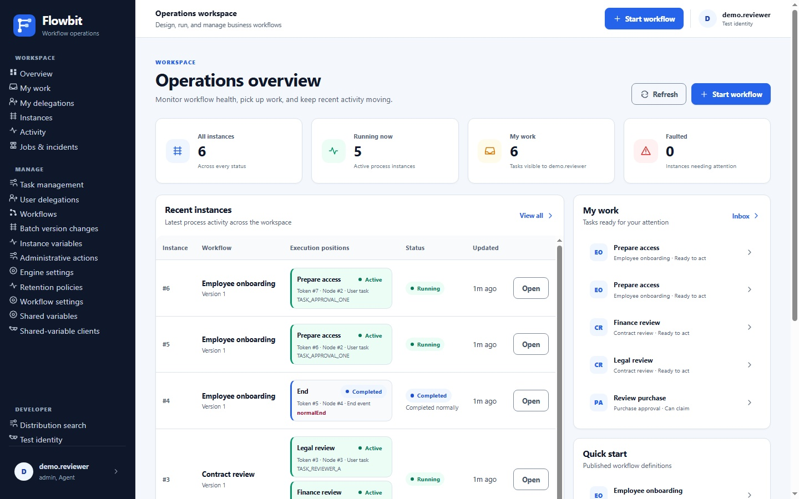

# Using Flowbit.Ui

[Documentation home](index.md) · [Local setup](getting-started.md) · [API reference](api-guide.md)

Flowbit.Ui is the browser interface for importing workflow definitions, starting instances, completing human work, and inspecting runtime activity. This guide takes you through an approval using the UI, then explains the management and operations screens in the current checkout.

Flowbit.Ui embeds the same [Flowbit editor](../flowbit-editor.html) used for standalone authoring. It can create workflows, load an exact stored version, and save an unpublished version through Flowbit.Api. Local JSON import/export also remains available.

Both applications use the connected F mark and blue [Flowbit identity](branding.md). The editor supports light and dark themes; Flowbit.Ui uses a light workspace with navy navigation. On narrow screens, the Flowbit home link remains visible beside the navigation button.

*Operations overview with sample data. Your dashboard depends on the current identity, permissions, and database contents.*

## Contents

- [Before you begin](#before-you-begin)
- [Sign in with OpenID Connect](#sign-in-with-openid-connect)
- [Set your development identity](#set-your-development-identity)
- [Complete your first approval](#complete-your-first-approval)
- [Find your way around](#find-your-way-around)
- [Times and time zones](#times-and-time-zones)
- [Design workflows in the UI](#design-workflows-in-the-ui)
- [Manage workflow versions](#manage-workflow-versions)
- [Use My work and task forms](#use-my-work-and-task-forms)
- [Inspect instances and activity](#inspect-instances-and-activity)
- [Use instance administrative actions](#use-instance-administrative-actions)
- [Manage assignments and roles](#manage-assignments-and-roles)
- [Delegate work](#delegate-work)
- [Monitor jobs and incidents](#monitor-jobs-and-incidents)
- [Use administrative batches](#use-administrative-batches)
- [Manage settings and shared variables](#manage-settings-and-shared-variables)
- [Manage retention](#manage-retention)
- [Lifecycle webhooks](#lifecycle-webhooks)
- [Troubleshooting](#troubleshooting)

## Before you begin

Follow [Getting started](getting-started.md#prerequisites) to create an isolated PostgreSQL database, start the API, and [start Flowbit.Ui](getting-started.md#obtain-a-development-bearer-token). Both PowerShell and Bash commands are provided there. You can stop before the HTTP walkthrough and continue on this page instead.

With that DevelopmentToken setup, open [Flowbit.Ui](http://127.0.0.1:15152). The UI's server-side API address is `WorkflowApi:BaseUrl`; its development JWT issuer, audience, and key must match the API configuration. Opening the UI alone does not start the API or database. For provider sign-in, use the separate [OIDC setup](openid-connect.md).

The first approval requires **API + database + UI**. Run the [Worker](getting-started.md#when-to-run-the-worker) for timers, async tasks, durable conditional wakes, administrative batches, and retention cleanup. The UI itself does not execute queued jobs.

**Development identity boundary:** Test identity is shared by the entire UI process. Another visitor changing it changes the identity used by that process's API requests. It is enabled only when both the environment is Development and `Authentication:Mode=DevelopmentToken`; this mode is rejected on deployed non-Development hosts. It is a trusted testing utility, not a user directory.

## Sign in with OpenID Connect

When configured for OpenIdConnect, use **Sign in** to continue to the deployment's identity provider. The provider returns you to the UI after authentication. Test identity and `/token` are unavailable in this mode. The UI calls the API using your own server-held access token; another user's login does not replace it.

Use **Sign out** to end the local session and initiate provider logout where supported. Sign-in and sign-out perform a full browser navigation. The session has an absolute eight-hour limit by default; API tokens refresh server-side when permitted by the provider. A UI restart loses all sessions and requires sign-in again. Other tabs revalidate their session periodically and on subsequent API token requests.

The API remains authoritative for your workflow identity, roles, and actions. A successful provider login does not grant administration or task access. If authentication expires while working, sign in again and inspect the current workflow/task state before resubmitting an action; commands and AI streams are not automatically replayed. Export or save local editor work before deliberately navigating away. See [session behavior](openid-connect.md#session-behavior-and-operations) for deployment limits and the local Keycloak users.

All modes use the API's default actor order: `Username`, the .NET `ClaimTypes.Name` URI, then `sub`/mapped `NameIdentifier`. Explicit identity overrides remain supported. The local Keycloak realm maps the login username to `Username`; its separate `name` profile claim is a display name. After upgrading an older realm/host, sign out and sign in again to obtain the new claim.

To view your own current access token, open `/_info` on the UI origin
(for the local Keycloak setup, `https://localhost:7019/_info`). It displays JSON
with your username, roles, Bearer access token, and expiry. Sign-in is required;
see [token diagnostics](openid-connect.md#view-your-current-access-token) for
refresh and error behavior. The response contains a credential, so do not share it.

## Sign in with local users

In `Authentication:Mode=Local`, **Sign in** opens Flowbit's username/password form. Each browser has its own session. The exact `Username` JWT claim identifies your workflow actor. Use **Change password** to update your password; doing so ends all local sessions. `/_info` shows your own current API access token.

Passwords are required but have no length or character-composition policy. This applies when adding a user, resetting a password and changing your own password. Password confirmation must match when changing your own password.

Administrators matching `Users.RequiredRole` (default `admin`) use **Users** to add/edit accounts, assign roles and repeated claims, activate/deactivate users, and reset passwords. Usernames are fixed after creation. **User attributes** defines typed fields, required validation and optional JWT claim mapping. Required fields apply when creating or editing profiles; older incomplete profiles may still log in. Deactivation/reset ends local sessions while existing access tokens remain valid until expiry. See [Local authentication](local-authentication.md) for permissions, limits and setup.

## Set your development identity

1. Open **Test identity** in the sidebar (`/token`).
2. Enter `docs.reviewer` in **User**.
3. Enter `admin, Requester, Reviewer` in **Roles**.
4. Leave custom claims empty for this tutorial. The default expiry is 60 minutes.
5. Click **Generate and apply**. Confirm the **Current identity** shows your username and roles.

The UI now attaches the bearer token to its API requests. You do not need to copy **Raw JWT** or call HTTP endpoints to follow this guide. **Apply pasted token** accepts an existing compatible development token; **Clear identity** removes the process's current token. Generate or apply another token when it expires. For the OIDC walkthrough, sign in as `alice` instead and skip these token-generation steps.

Custom claim values are strings. **Add claim** lets you supply a name/value pair, but workflow expressions can access it only if the API also allowlists that name in `WorkflowContext:AllowedClaims`. Follow the [configuration guide](deployment.md#configuration) when an example needs claims or integration settings.

The tutorial combines roles so one development identity can import and publish, start, and review:

| Role | Purpose in this example |
| --- | --- |
| `admin` | Definition administration on a freshly initialized database. The configured `Workflow.RequiredRole` may differ elsewhere. |
| `Requester` | Allows the example's manual start event. |
| `Reviewer` | Allows its review task and approval action. |

`admin` does not automatically grant the workflow's other roles. Sidebar visibility also does not establish permission: each API operation enforces its own checks. The bundled **Workflows** and start screens read definitions through the workflow-administration API, so navigating them also requires definition access in addition to start-event roles.

## Complete your first approval

Use [Roles, Claim, and Bypass](../examples/user-tasks/01-roles-claim-and-bypass.json), already present in your repository. Its [catalog entry](../examples/README.md#user-tasks) explains the alternative supervisor path.

### 1. Import the definition

1. Choose **Workflows** in the sidebar.
2. In **Import editor JSON**, use **Workflow definition file** to select `examples/user-tasks/01-roles-claim-and-bypass.json` from your local checkout.
3. Confirm the displayed file name; expand **Preview JSON** if you want to inspect it.
4. Clear **Publish on import** so you can perform publication separately. It is checked by default.
5. Click **Import definition**.

The file-size limit is **2 MiB**. Select the exported workflow document itself, not the API request envelope containing `definition` and `publish`. The file name, the preview, and the import button become available once the file has been read. Selecting another file removes the previous one first, so the button only ever imports the file last selected, and you cannot select a file while an import is running. A successful import adds the family **User Task Example 01 - Roles, Claim, and Bypass** under **Definitions**. Invalid definitions display an error instead of becoming runnable work.

### 2. Publish the version

Expand the workflow family and click **Publish** on the imported version. Its badge changes to **Published**, and **Start** becomes available. The **Default** badge is separate from publication; a newly created family can have an unpublished default until you publish it.

For later imports, you may leave **Publish on import** checked and use **Import and publish** to combine these steps. Durable definitions additionally require the API's configured publication gate; the gate does not check that a Worker is actually running.

### 3. Start an instance

1. Click **Start** on the published version you want to run.
2. Confirm the workflow name and version at the top of the form.
3. This example selects **Submit Restricted Request**. Enter `REQ-DEMO-001` in **requestReference**.
4. Click **Start instance**.

The UI opens **Instance #…**, initially at **Claimed Review**, with status **Running**. Note the returned instance number so you can find this exact run later. A new click that successfully starts again creates another instance; this example does not configure a transport retry key or business-key uniqueness.

When a workflow has several permitted manual starts, choose **Start event** explicitly. Message and timer starts are triggered by their respective mechanisms and are not ordinary user-start choices. A configured idempotent start also displays **Transport retry key**; keep the same key for the same logical retry and reconcile the returned conflict rather than creating another request.

### 4. Find and claim the task

1. Choose **My work** in the sidebar.
2. Find **Claimed Review** for the instance you just started. Its readiness should be **Can claim**.
3. Click **Open task**.
4. In **Task summary**, click **Claim task**.

**Claimed by** now shows `docs.reviewer`. The **Approve after claim** card appears under **Available actions**. Before claiming, **No actions available** is expected for this tutorial identity.

Use the work item's **Open task** link even when the instance and task numbers happen to match. A workflow instance can have several tasks; the authored node ID, instance ID, and task ID are different identifiers. The UI's links keep them associated correctly.

### 5. Approve and verify completion

1. In **Approve after claim**, enter `Reviewed and approved` in **reviewNote**.
2. Click that card's **Take action** button.
3. The completed workflow returns you to its instance detail. Confirm **Completed** and the **Approved** end position.
4. Open **Variables** and verify `requestReference` and `reviewNote` contain your values.
5. Open **History** and inspect the start and approval transitions, selected flow, and actor. The submitted note is visible in **Variables** with its source flow and actor.

Both example inputs require at least three characters after trimming. The supervisor-only **Escalate without claim** action does not appear for a `Reviewer`; it requires `Supervisor` and its own `escalationNote` input. You have completed the normal approval route entirely through the UI after import.

## Find your way around

Paths below are relative to the UI origin, not API endpoints. Most data screens have a **Refresh**, **Apply filters**, or search button; use it after changing identity or after another actor/Worker changes state.

| Sidebar entry | UI path | Use it for |
| --- | --- | --- |
| **Overview** | `/` | Instance totals, lifecycle distribution, recent instances, My work, and published quick starts available to the current identity. |
| **My work** | `/inbox` | Personal worklist and task actions. |
| **My delegations** | `/delegations` | Grants given by you and offers made to you. |
| **Instances** | `/instances` | Search workflow runs and open instance details. |
| **Activity** | `/activity` | Search committed node visits across workflow versions. |
| **Jobs & incidents** | `/operations` | Durable queue metrics, failures, and retry operations. |
| **Task management** | `/task-management` | Assign waiting work and manage captured task/action roles. |
| **User delegations** | `/delegation-management` | Administer delegation grants and family acceptance policies. |
| **Workflows** | `/workflows` | Create, edit, import, publish, download, and manage definition versions, and download the portable AI skill. |
| **Workflow editor** | `/workflows/new` | Create a workflow using the shared visual editor. |
| **Batch version changes** | `/instance-version-changes` | Prepare compatible version switches for multiple instances. |
| **Instance variables** | `/instance-variable-updates` | Prepare administrative raw-JSON variable updates. |
| **Administrative actions** | `/administrative-actions` | Prepare explicit overrides of waiting task or timer-boundary positions. |
| **Engine settings** | `/engine-settings` | Deployment-wide engine setting records. |
| **AI models** | `/ai-models` | Models, endpoints, and write-only keys the editor's AI assistant can use. |
| **Business calendars** | `/business-calendars` | Working days, hours, holidays, and time zones that timer durations and task due dates can count in. |
| **Retention policies** | `/retention` | Preview and configure cleanup policies and inspect runs. |
| **Webhooks** | `/webhooks` | Lifecycle webhook subscriptions, signing secrets, test events, and delivery recovery. |
| **Workflow settings** | `/workflow-settings` | JSON settings consumed by workflow expressions/templates. |
| **Shared variables** | `/shared-variables` | Shared catalog contracts, current values, revisions, and lifecycle. |
| **Shared-variable clients** | `/shared-variable-clients` | Machine-client scopes, credentials, rotation, and revocation. |
| **Distribution search** | `/task-distribution` | Development-only search using workflow distribution credentials. |
| **Test identity** | `/token` | Configure the UI process's development identity; DevelopmentToken mode only. |

Overview totals and lists reflect the API's visibility rules; a restricted panel can report an authorization error while another panel works. Treat **My work** as the personal inbox rather than interpreting every displayed instance as actionable by you.

## Times and time zones

Flowbit.Ui shows every time in your browser's time zone and reads every date and time you enter in that zone, whatever zone the UI server runs in. The page learns the zone your browser reports, such as `Europe/Berlin`, once it has connected. Until then, or when the UI server does not recognize the reported zone, times are in UTC and each one ends with `UTC`. Hover over a time in a table or summary to see the exact instant, in UTC.

- Date and time fields say which zone they use: **Activity** names it above its time filters, and the **Webhooks** delivery filters and the **Shared-variable clients** expiry name it in their labels, for example **From (Europe/Berlin)**. Flowbit sends the UTC instant that the entered time names in that zone.
- A time that a daylight-saving change skips, such as 02:30 on the night clocks go forward, is refused with a message. A time that occurs twice when clocks go back means its first occurrence.
- Delegation windows are the exception: **My delegations** and **User delegations** enter and show them in UTC, as their labels say.
- A business calendar's **Preview** reads its start in the calendar's own time zone, and typed `datetime` workflow inputs are sent with your browser's offset; see [Business calendars](#business-calendars) and [Enter typed values](#enter-typed-values).
- The editor's cron schedule preview takes its reference in UTC and shows each run in the schedule's own zone and in UTC, not in your browser's zone; see [Cron schedules](#cron-schedules).
- Dates and times use the UI server's regional format, such as month/day order, not your browser's.

## Design workflows in the UI

### AI workflow assistant

Open **AI assistant** in the editor to describe a new workflow or request changes to the current one. Choose a model under **AI model**; the list shows the models a settings administrator configured on [AI models](#ai-models), and the first one is selected by default. You never enter a provider key: the API uses the key stored for the selected model, and the panel receives only model names. If the list is empty, the panel says that no AI models are available and links to the AI models page. Your messages, reviewed document text, and the current workflow are sent to the selected model's provider. The conversation lives only in the open assistant panel; closing it, leaving the editor, resetting it, or changing the selected test identity clears it.

Optionally expand **Include shared-variable metadata**, load or search active catalog keys, and select the contracts the workflow may use. This requires your existing shared-variable read permission. Only selected contracts and descriptions are included with your message; catalog values are excluded. A changed selection is sent with your next message.

Optionally expand **Include call targets** and select **Load workflows** to choose up to 20 workflow families this workflow may call. Only each family's published-default start inputs and declared results are sent to the model, never values or instance data, so it can write correct mappings rather than guess them.

**Attach a BRD or SRS PDF** accepts text, scanned, and mixed PDFs. Extraction runs locally on the API host, with English, Arabic, or both OCR languages. Expand each extracted page to review or correct its text before sending. **Retry with OCR** forces OCR on the selected document; **Remove** removes its source text. Limits are 20 MiB, 100 pages, and 200,000 extracted characters by default. Scans, tables, diagrams, and handwriting can produce incomplete text; correct the extraction before relying on it. Each page is sent to the model once per conversation.

While the assistant works, the progress area shows what it read, saved or checked since its previous model call, **Waiting for the model** with the seconds spent on the current call, the elapsed time, the model calls used of the run's limit, any validation follow-ups, and the size of the workflow it has saved. The assistant reads Flowbit's guides and examples itself, writes the workflow, and checks it; Flowbit checks the result and returns errors to the model at most twice. A run lasts up to 30 minutes and 40 model calls by default and keeps the selected model.

A run can stop: you select **Cancel**, the connection drops, the provider fails or throttles, a response reaches the output limit, or the run reaches its time or call limit. The progress area then explains why and offers **Continue**, which resumes from the last completed model call with the conversation, the assistant's files and the selected model unchanged. The timer and call counter restart for the new run. Continue is unavailable once the diagram has changed; send a message instead, and the assistant works from the current diagram. Nothing is retried automatically.

When the run finishes, the assistant's reply appears in the conversation:

- **Proposal**: a validated workflow. Review the open questions and assumptions the assistant recorded, the validation and readiness results, and the workflow JSON, then select **Apply to editor**. Application is one undoable editor change; it retains the existing workflow family and saved baseline.
- **Answer**: the assistant replied without changing the workflow.
- **Still invalid**: the remaining problems are listed. Send a message, for example to ask for a fix; the assistant keeps the workflow it wrote.

Answer open questions or request changes by sending another message. The assistant keeps the whole conversation, including what it read and wrote, also after **Apply**. If you edit or apply the diagram before your next message, the assistant is told that its workflow now contains the current diagram. Editing the diagram while generation is pending makes the proposal stale, so request a fresh proposal instead of overwriting later edits. Save or cancel pending script-dialog edits before capturing or applying a proposal.

The conversation lives only in this open Blazor Server panel circuit. It is cleared when you select **New conversation**, close or reset the assistant, choose another model, change identity, leave the editor, or lose the circuit; page reload and server restart do not restore it. No workflow is saved by the assistant.

Generation and application do not save, publish, or run workflows. **Save new version** retains its existing unpublished-version behavior. Structurally valid proposals may still have catalog or publication blockers and need operational setup. See [AI authoring and portable skill](ai-authoring.md) and [AI deployment settings](deployment.md#ai-authoring-and-local-ocr).

At the end of the panel, **Use with another AI agent** offers **Download Flowbit AI skill**; the same section also appears on [Workflows](#manage-workflow-versions). It downloads `flowbit-authoring.zip`: the guides and examples the assistant reads, plus the workflow schema and authoring procedure, packaged as a skill for Claude Code, Cursor, Codex, or OpenCode, which use their own model. The download needs no configured model, works while a run is in progress, and leaves the conversation and its notices unchanged; a failed download is reported below the button. Extract the whole folder as described in [Use the same skill in another agent](ai-authoring.md#use-the-same-skill-in-another-agent), and download it again after Flowbit is upgraded.

After an administrator changes the selected model's endpoint, provider model name or reasoning effort, the next message reports that the settings changed; start a new conversation. If the model was deleted, the panel reloads the model list, starts over, and keeps your unsent message. Replacing only a model's key keeps open conversations.

DevelopmentToken mode retains its process-wide test identity. OpenIdConnect mode uses isolated per-login server sessions. Separate assistant panels keep separate model selections and conversations; routine access-token refresh preserves panel state, while session or actor/role changes clear the conversation.

### Visual editing and saving

Choose **Create workflow** on Workflows, or **Workflow editor** in the sidebar, to start an empty document with a fresh editable workflow key. To change an existing definition, expand its family and choose **Edit** on the exact version. The editor fills the workspace beside the normal navigation. Its compact toolbar contains File/Edit/View, the workflow name, version and save status, and **Save new version**. The version's tooltip identifies the source name/key; its workflow key in the inspector is read-only because changes stay in that family.

Use the editor's normal canvas, inspector, variables, and File menu. The inspector keeps warnings, empty states, and status lines visible and puts explanations behind an info icon beside a field's label or a section heading. The icon opens the help below the field, and open help stays open as you select other items. Many fields show a real example as a placeholder, and their help lists examples you can insert: choosing one replaces the field's value, and Undo restores it. Each start-event and action variable has a **Form** section for the label, help text, and fixed options that forms show; options are available for a single text or number value, and a type change converts option values where possible. A user task has **Due date** and **Priority** fields: a due date is a duration such as `P2D`, a date-time with an offset, or an NCalc expression, and a priority is an NCalc expression that gives a whole number. Each field reports a value that can never be used, such as `'P2X'`, as you type, and the save reports it too; see [due date and priority](node-reference.md#due-date-and-priority). The **Due date calendar** field, and a timer's **Business calendar** field shown for a duration, name a [business calendar](#business-calendars) so the duration counts working days and hours; type the calendar's exact name. They report a duration with weeks or fractional days, or a calendar on a fixed date-time, as you type. The server checks that the calendar exists when you save. A timer's **Schedule** chooses an absolute date/time, a duration after activation, a repeating cycle, or, on a timer start, a [**Cron schedule**](#cron-schedules). On a timer catch or boundary, **Value** then offers **Fixed value**, with the date/time and duration controls, or **Expression**, a text field for an NCalc [expression schedule](node-reference.md#expression-schedules) such as `${contractEnd}` or `if(urgent, 'PT4H', 'P2D')`. The choice only selects the control: switching keeps the text, and a reloaded document opens each timer in the mode its text needs. The expression field reports, as you type, a value that looks fixed but is not valid, a `${...}` inside text, a shared variable, a bracketed `sys.*`, `config.*`, or `setting.*` name, a bracketed name with spaces inside the brackets, such as `[ slaDuration ]`, or an NCalc built-in function in a casing NCalc does not resolve, such as `If` for `if`; only the server checks NCalc syntax and that each variable is declared, when you save. A conditional event's **Condition (NCalc)** field reports such padded names and casings too. The standalone editor never sees the server, so an exported expression is not proven valid. A `datetime` input that an expression reads needs an explicit offset. **Save new version** validates the same JSON as **File → Save JSON**, then creates an **unpublished** immutable version. Editing a stored version uses the existing new-version API; creating or importing locally uses the existing create API. A create request using an existing key appends a version to that family. After success, the toolbar and URL identify the saved version. Publish it separately from Workflows. Existing instances continue using their selected version.

A REST service task lists its error boundaries under **Error boundaries**, each with what it catches and where it goes. **+ Add error boundary event** stays available up to eight, or one on a script task. The first boundary catches all failures. A later one starts with an empty HTTP matcher, which blocks saving until you add a status or range. Select a boundary and use **Failures caught** to choose **Catch all failures** or **Match HTTP status**, then fill **Exact statuses** and **Status ranges**. A host can have only one catch-all, so the second is refused with a message. The boundary's flow label shows what it catches, such as `409` or `400–499`, with the full list in its tooltip. A lone catch-all shows no label, and an unusable matcher shows `Invalid match`. On the keyboard, removing a boundary from the list moves focus to the row that took its place, the row before it, or **+ Add error boundary event**, and opening one moves focus to its heading.

The host warns when no boundary catches all failures, because timeouts, network failures, and unmatched statuses are then not caught. This does not block saving. Imported matcher data that cannot be used also blocks saving and stays visible: a node that is not a boundary offers **Remove errorMatch**, and a boundary on a script task offers **Catch all failures**. A service task with HTTP matchers cannot become a script task until the matchers are removed. See [HTTP status matching](node-reference.md#http-status-matching). An unmatched failure on an async task reaches [Jobs and incidents](#monitor-jobs-and-incidents) in the usual way.

Set a node's **Type** to **Call Activity** to call another workflow family; it draws as a task with a thick border. Its inspector has:

- **Workflow key**: the exact key of the family to call. The server checks the target when you publish and again when each child starts, so the editor accepts a key it cannot see, and it works without a network connection.
- **Version**: always **Published default**. The version each visit uses is shown on instance detail, not saved in the workflow.
- **Inputs** and **Results**: typed mapping rows with **Delete mapping** and **+ Add mapping**. Source names suggest what this workflow declares or produces, and results suggest its process variables; the called workflow's names are typed. **Required** fails the call when a value is missing or null. Rows have no order, because a batch is written together.
- **Error boundary**: one catch-all. Without it, a child that faults or is cancelled faults this workflow, and any other failure opens an incident while this workflow keeps waiting.

A call needs a running Worker, and its inputs and results are copies. Changing **Type** to a call clears the settings a call does not support, on the node and its outgoing flow, and keeps one outgoing flow. Changing **Type** away from a call clears its settings, on the node and its outgoing flow, and removes its error boundary; undo restores them. Selecting a node never changes it, so an imported call keeps any option a call does not support, such as async, job, multi-instance, or task settings, and shows a warning with **Remove these options**. Its outgoing flow does the same for a condition, roles, or variables. A value of the wrong type stays too, such as `requiresClaim: 0` or `completionPriority: 1.5`, and the save message names it. All of these block saving until you act, as does a second outgoing flow until you delete it. If `variables` on a call or its outgoing flow is not a list, the import stops with a message and your current document stays. An imported `callOnly` that is not true or false, or one on any node except a start event, also blocks saving and offers **Remove this value**.

A plain start event has a **Call only** checkbox for fragments that rely on checks made in the parent. It hides the start from people and API callers, and is valid only on the default start with no roles and no idempotency. Changing the workflow's default start keeps the old start's flag and blocks saving until you clear it.

Hosted saves are limited to **2 MiB of UTF-8 JSON**. Larger local imports remain editable and can be exported to a file. API load/save requires the configured definition-administration permission (`Workflow.RequiredRole`, default `admin`); validation and authorization errors leave the diagram open. If a connection fails after submission, check Workflows before retrying because the API may already have created a version.

**Unsaved changes** includes diagram and property edits and uncommitted JavaScript-dialog text. Use **Save & Close** in that dialog before saving the workflow. Leaving, reloading, New, or local import warns before discarding changes. New/local import clears the stored-version association and starts a new unsaved document; the existing key in imported JSON is editable. Downloading JSON does not mark the hosted document saved to the API. Edits made while an API save is running remain unsaved after that save completes. Undoing back to the last API-saved state clears the unsaved indicator.

The editor mounts directly into the page using the same template, CSS, and JavaScript as the standalone editor. Its light appearance matches the app; the standalone page retains its theme toggle. Editor shortcuts apply while focus is inside the editor, and modal keyboard navigation stays in the active dialog. Blazor performs API operations using its server-side client; the editor does not receive its bearer token. DevelopmentToken's process-wide test identity and OIDC's per-login sessions retain their respective boundaries. If an OIDC session expires while the editor is open, local JSON export remains available while hosted saves and AI actions are disabled. Signing in navigates away and warns about unsaved work. The standalone editor runs without the runtime when its complete asset folder is present.

### Cron schedules

On a **Timer Start Event (scheduled)**, choose **Schedule → Cron schedule** to start instances each time a five-field [cron expression](node-reference.md#cron-schedules) matches in a named time zone. The choice replaces the timer's previous schedule in one step that **Undo** restores; changing the node to another timer type removes the cron schedule and its zone, keeping any other schedule.

- **Cron expression** takes the five fields minute, hour, day of month, month, and day of week, such as `0 8 * * 1-5` for weekdays at 08:00 or `0 17 L * *` for each month's last day at 17:00. It reports a problem as you type, with the server's wording, such as `timer.cron day-of-week value 7 is not allowed; write Sunday as 0.` Its help explains the fields, daylight saving, and that started instances see `sys.now` and `sys.today` in UTC.
- When both day fields are restricted, a note under the field says that a date must match both: `0 8 13 * 5` runs only on Friday the 13th. A crontab line would run when either matches.
- **Time zone** takes an IANA zone written with its exact casing, such as `Europe/London`, or `Etc/UTC` for UTC; there is no default. In Flowbit.Ui the field suggests the zones the server knows, but accepts any text, because a Windows server's list can be incomplete. A note appears when your browser does not recognize the zone; it is only a hint, never blocks saving, and does not judge casing. The server checks the zone when you save.
- **Preview next 5** asks the server for the next five runs, as the Worker would calculate them. **Preview after (UTC, optional)** takes an instant such as `2026-11-08T12:00:00Z`; leave it blank for the server's current time. The table lists each run's local time in the schedule's zone, with its day and numeric offset, and its UTC time, never your own zone, so a repeated daylight-saving hour shows both offsets. While the server calculates, the button keeps keyboard focus and ignores further presses. Changing the expression, zone, or reference clears the result, and an answer that arrives after you change the schedule, select another node, or replace the document is discarded. The preview reports an invalid schedule with the server's message, an unavailable server, and lost permission, and never changes your schedule or marks the workflow unsaved. It reserves nothing and cannot promise when the Worker runs.
- An imported expression or zone that is not text, such as the list `["Etc/UTC"]`, appears as written with the message saving gives, such as `timer.timeZone must be a string.`, until you type over it, and is never sent for a preview.
- A timer catch or boundary has no cron option. An imported catch or boundary that names `cron` or `timeZone`, or a timer start with a `timeZone` but no cron or a `calendar` beside cron, shows the settings its schedule cannot use with **Remove these settings**; until you remove them, saving reports them.
- An imported node that is not a timer event but has a `timer`, such as a plain start event with a cron schedule, keeps it. Its inspector shows the timer with **Remove this timer**, and saving reports it as the server does. Changing the node to a timer start uses that schedule; a catch or boundary uses it without cron and its zone.

The standalone editor offers the same fields and expression checks, and says that previewing runs and checking the zone need Flowbit.Ui. A published default's next scheduled start appears on **Jobs & incidents** as its family's `timerStart` job.

## Manage workflow versions

Expand a family in **Workflows** to see its version rows. Importing another document with the same authored workflow key creates a new immutable version; running instances retain their existing version until an explicit compatible switch. A file that cannot be read shows the cause and its JSON path, such as `Unknown property 'httpStatusRangez'. Path: $.flowNodes[4].errorMatch.httpStatusRangez`, and one that breaks a definition rule shows that rule's message.

Below **Import editor JSON**, **Use with another AI agent** offers **Download Flowbit AI skill**, the portable authoring package for Claude Code, Cursor, Codex, or OpenCode described under [AI workflow assistant](#ai-workflow-assistant). Import the JSON such an agent returns here, clearing **Publish on import** so you can review the version first, or open it with **File → Load JSON** in the editor. A failed download is reported below the button.

| Action | Effect |
| --- | --- |
| **Publish** / **Unpublish** | Controls whether a version can start new instances. It does not cancel existing runs. The default version cannot be unpublished; select another published default first. |
| **Set default** | Makes that published version the family default for starts by workflow key, relevant system entry mechanisms, and calls from other workflows. A confirmation first lists the workflows that call this family and whether each stays compatible. The row's **Start** link still selects that exact version. |
| **Start** | Opens the manual start form for the selected published version. |
| **Edit** | Opens that exact version in the visual editor. **Save new version** creates an unpublished successor with the same workflow key. |
| **Download JSON** | Downloads the stored definition. Open it in the standalone editor, or use **File → Load JSON** in the UI editor. |
| **Delete** | Requests deletion of that version. Runtime or retained audit references can block it; deletion is not a way to detach existing instances. Deleting the default, which a family's first version is even as a draft, first shows the same caller list, with the version that would replace it, a warning when none would remain, or what blocks the deletion. |

The caller confirmation reflects the current state, and the command checks its own rules again when you confirm, so compatibility warnings do not stop you. A start page for a workflow whose only start is call-only explains that a call activity has to start it.

Timer-start schedules, cron schedules included, follow the published default version: making another version the default retires the schedule, and making a version the default again starts it afresh from that moment. A default's next scheduled start appears on **Jobs & incidents** as its family's `timerStart` job. Before changing defaults for those workflows, read [timer semantics](bpmn-support.md#timers) and [upgrade guidance](deployment.md#upgrade-and-compatibility-rules).

## Use My work and task forms

Use **Show filters** to narrow the inbox by instance, workflow, node, due date, priority, or variable data; click **Apply filters**. **Sort results** supports up to three fields and **Apply sorting**. **Previous** and **Next** move through the server's pages. Optional variable enrichment shows latest values, not an audit snapshot.

The **Due** column shows when a task is due, in your browser's time zone like other times; hover over it for the exact value. An **Overdue** badge marks a task whose due time has passed, and a **Due soon** badge one that is due within the window an administrator sets in the `UserTasks.DueSoonThreshold` engine setting, one day by default. The task's priority appears under the date; higher numbers are more urgent. A dash means the task has no due date. Sort by **Due date** to see the soonest first and by **Priority** descending to see the most urgent first; tasks without a value come last either way. The **Due** filter selects overdue, due-soon, upcoming, or unscheduled work, and **Minimum priority** and **Maximum priority** limit the priority range. The due date and priority are set when the task is created and do not change afterward. The **My work** list on **Overview** shows the same badges, and task detail lists **Due** and **Priority** when the task has them.

Readiness labels help distinguish **Ready to act**, **Can claim**, and **View only**. **View only** can be a legitimate result when no action currently satisfies all conditions. On task detail, **Claim task** establishes claim ownership; **Unclaim** releases it when permitted. **View instance** opens the surrounding process.

Choose an action from the cards the server returns. Each card has its own inputs and **Take action** button. After a successful action, an instance still running returns you to the inbox; a terminal instance opens its detail. If another actor, timer, or event moves the task first, refresh before trying again.

### Enter typed values

Start forms, task action cards, instance-detail actions and interrupt actions, and the instance **Administrative actions** panel choose a control for each value from its declared type. Each field shows its label followed by the variable name and type, or only the variable name and type when the workflow sets no label, and an asterisk for required values. Authored help text appears under the label, and **Leave blank to use the default.** appears when an optional value has a default.

| Type | Control and entry |
| --- | --- |
| `string` | A text box. Enter text without JSON quotes, for example `Reviewed and approved`. |
| `string` or `number` with fixed options | A list with **Choose a value** and the options the workflow defines. Only those values can be chosen. |
| `number` | A number box. Use plain decimal notation with a period, for example `1250.50`; exponents and thousands separators are not accepted. Turning the mouse wheel over the box moves focus out of it and scrolls the page; it never changes the number. |
| `boolean` | A list with **True** and **False**. |
| `date` | A date picker. |
| `datetime` | A date-time picker in your browser's time zone. Below it, **Sent as** shows the exact value: your local date and time with your browser's UTC offset for that moment, such as `2026-09-10T10:30:00+03:00`, or `Z` when the offset is zero. A time skipped when clocks go forward is rejected. A time that occurs twice when clocks go back uses its first occurrence, with the summer-time offset. |
| Typed array | A text area. Enter `["alice","bob"]`, `[10,20]`, or `[true,false]`; non-JSON types also accept comma-separated scalar values. Use a JSON string array when a value contains a comma. |
| `json` / `json[]` | A text area. Enter valid JSON, for example `{"approved":true}` or `[{"amount":10}]`. |

Blank fields are omitted from the submission; they do not mean “write null.” When the browser cannot read an entry, such as a date or date-time left partly filled or a number like `12-`, the field shows an error as you type or when you leave it, and the form refuses to submit until you correct or clear it. The server applies defaults, required-input checks, and authored validation. Fixed options limit only what the form offers: the server accepts any value of the declared type from other clients unless the workflow's validation rejects it. Administrative **Raw JSON value** fields have different rules: even a string must be quoted there.

### Concurrent and multi-instance work

Parallel branches can create several work items for one instance. Multi-instance user tasks can create many child items beneath one parent execution. Open the exact task from **My work**, check its assignment/item context, and submit that child's action.

An early quorum, an interrupt, or another actor may cancel unfinished work. With one-per-actor voting, several actors can initially see the same representative item; the first completion wins. A successful child action also does not necessarily complete the parent execution. Inspect **Execution positions**, **Multi-instance results**, and any available parent interrupt controls on instance detail. Engine-only aggregate/default flows are not ordinary action buttons. See [multi-instance semantics](bpmn-support.md#human-work-and-multi-instance-tasks).

## Inspect instances and activity

Use **Instances** to filter runs, then open a result. On instance detail:

Section links scroll within the instance detail and update the URL fragment
while preserving `/instances/{id}` and any query string. Reloading after using
a section link therefore stays on the same instance.

An action you take on this page, such as claiming or taking a flow, reloads the instance and everything else on the page, including its calls and **Administrative actions**. For changes made elsewhere, use **Refresh**. The page refreshes itself only while a multi-instance task, a message, a call, or several active positions are pending.

- **Execution positions** shows the active or terminal tokens and links to their human work. Do not infer the whole process from one node name.
- **Diagram** draws the instance's workflow version and marks where the instance is now. See [Read the instance diagram](#read-the-instance-diagram).
- **Administrative actions** lists active human-task positions and their authored direct actions when the API grants workflow-administrator permission. See [the override procedure](#use-instance-administrative-actions).
- **Variables** shows the latest displayed values and their attribution; **History** shows transition times, node/flow references, actors, and available event details.
- **History** describes claim, release, recovery, delegation, and inherited-claim events. Expand **Actor claims** under an actor to inspect the captured claim names and values, including repeated values. Delegated events also identify the represented owner.
- **Call activities** appears on a parent or child. See [Follow call activities](#follow-call-activities).
- **Gateway scopes**, **Complex states**, **Multi-instance results**, **Version changes**, **Variable updates**, and **Shared variables** appear when applicable.
- **Change version** is available for authorized running-instance administration. Choose a compatible published target, enter a reason, preview, and inspect blockers/warnings before confirming.
- **Reactivate instance** is a guarded recovery operation for eligible completed/cancelled instances. Preview the target and blockers first. Pruned instance history permanently blocks reactivation. A target whose expression timer boundary cannot be scheduled from the current variables is not offered, and a warning names a timer boundary that is already due, because it interrupts or fires for the reactivated task as soon as the Worker runs.
- **Cancel instance** uses the workflow's cancellation permissions. It cancels remaining runtime work; it cannot undo an already completed external HTTP effect.

Personal task visibility and instance administration are different access scopes. In particular, the current instance-detail API is authenticated but does not apply the personal task-visibility predicate. See the [API authorization boundary](api-guide.md#http-conventions-and-authentication) when designing a production interface.

For a committed visit to a node, use **Activity** (**Node activity**). Combine lifecycle status, **Advanced filters**, and sorting, then open a result. The detail separates timing, actors, task/token correlations, submitted results, committed failures, and **Execution-local variable changes**. Those changes are attributed writes, not a complete execution-time snapshot. Date filters use inclusive **From** and exclusive **To** bounds in your browser's time zone, which the page names above them; variable filters search the owning instance's latest data. Read access comes from workflow `taskAssignmentRoles` or `NodeExecution.RequiredRole` (default `admin`) and grants no task mutation authority.

Under **Actors, roles, and claims**, expand **Starting actor claims** or **Completing actor claims** to inspect the separate snapshots. Claim and unclaim events leave these visit snapshots unchanged. **Not recorded** means a snapshot is unavailable, including older data or disabled capture; **No selected claims present** means capture was enabled but none of the selected names were in that actor's token. These messages also appear in instance history. Claim values are displayed as text. Capture is configured by an operator through [selected-claim audit](deployment.md#selected-claim-audit), and retained snapshots may disappear with their owning history or activity records.

### Follow call activities

A child instance shows **Called by** in its summary. Its **Call activities** section links its parent and root instances and shows the parent call and depth. A parent lists its calls with paging, newest first; repeated visits to a node are separate rows. These links grant no task permissions, and opening a child applies its normal checks.

| State | Meaning |
| --- | --- |
| **Blocked** | Stopped before admission, by its inputs, depth, or the tree's open-call limit. It holds no capacity and has no child. Fix the cause, then retry its incident on **Jobs & incidents**. |
| **Queued** | Admitted and waiting for a Worker to start the child. With an incident, the child could not be started; retrying reuses its slot. |
| **Running** | The child is running. A note about open incidents means a job inside the child needs attention, which is not a fault: the call keeps waiting. |
| **Result ready** | The child finished and a Worker is delivering its result. With an incident, delivery failed, and retrying never runs the child again. |
| **Completed** | The child completed and its results were delivered. |
| **Failed** | The failure was delivered through the error boundary, or this workflow faulted at the call. The stable code and description are shown. |
| **Cancelled** | This workflow abandoned the call. A child still shown as running is being stopped by a background job. |

Each row shows the target family and, once chosen, the exact version. An instance below a cancelled call, at any depth, shows a warning that its cancellation is in progress: its tasks stay visible, actions on them are refused, and it finishes when Workers have run the cancellation, one level per job. The page refreshes itself while a call is unsettled, and an action taken on the page shows any call it entered at once, including one that failed on entry and took its error path.

### Read the instance diagram

The **Diagram** section draws the exact workflow version the instance runs, read-only, with the editor's shapes. It opens with current or final positions. Turn on **Show recorded history** to add reached nodes and traversal counts:

| Marker | Meaning |
| --- | --- |
| Green ring | An active position. Its tooltip and the details panel say what it waits for: user work, a message, a timer, a condition, background processing, other branches at a gateway, or a call activity. |
| Badge such as `2/5` | Multi-instance progress: completed work items out of the total. |
| Badge such as `×2` | Several tokens wait at the same node. When they are several multi-instance executions, the tooltip adds up their progress. |
| Blue ring | The finished instance ended here, at a normal or terminate end event. |
| Red ring | The instance faulted here, or this work was cancelled with the instance or by a terminate or error end event. |
| Dashed grey ring | A node reached in recorded history, without a current/final position. Arrival evidence does not establish successful execution. |
| Teal flow stroke and count | A recorded sequence-flow traversal. Loops increase the count; the tooltip gives its exact value. Automatic dashes, error styling, labels, and arrowheads remain visible. |

The ring surrounds the node; the node's own outline keeps the color of its type. Current/final markers and progress badges retain their meaning when history is enabled. They describe the latest run, including after reactivation and [retention](#manage-retention). Recorded history covers **all retained runs of the current exact version**, including earlier visits. Other versions and called-child instances are not combined into this diagram.

History uses the same access as instance detail: an ordinary reviewer can see the path even without node-activity permission. Execution lists and links remain role restricted. A successful execution recheck that finds no available records clears cached historical execution links too, including a response still loading; it leaves the history summary visible. The summary uses retained node activity, so it can show a path whose rows the separate **History** table no longer lists after workflow-history retention.

The history notice distinguishes complete, partial, and uncertain coverage. It explains deployment-cutover gaps, actual node-activity pruning, uncertain legacy retention, unmappable/conflicting records, and the possibility of an unrecorded entry from an async-after node or multi-instance task into another multi-instance task. Such an entry can end before child work items exist. An ordinary source's exit still records that arrival. Missing markers never prove a route was not taken, and retained records after pruning can be scattered throughout the path.

Open the collapsible **Recorded history** list beside the canvas (below it on narrow screens) for reached-node names, types, and incoming/outgoing totals. Its buttons provide keyboard access to historical-only nodes; selection brings the node into view without changing zoom. Canvas Tab stops remain limited to current/final positions. The selected node separately lists **Current/final positions**, **Recorded flows**, and **Recorded executions**. Executions load 50 at a time, newest first, with an exact total available to your identity. These are execution records, including individual multi-instance children, rather than a count of logical activations. Paging never replaces the current-position links. Keyboard focus stays on the paging control while results load and when reaching the first or last page.

The choice stays on this instance page across ordinary refreshes and actions. It resets on navigation, identity change, or when instance detail is missing or access to it is denied. Existing eligible five-second polls skip the summary when the instance revision is unchanged; there is no additional timer.

A failed or stale history request clears its history decorations and offers **Retry recorded history**. Successfully loaded current positions and task actions remain usable. If refreshing the instance or its related data fails while history is enabled, the history panel shows an error and a retry control; that retry reloads instance detail before requesting a matching summary and keeps the toggle enabled. Errors loading recorded executions offer a separate retry. Empty retained history is a successful result with its own coverage notice.

If instance detail returns `404`, the page clears the previous instance and
diagram and says **The workflow instance no longer exists.** Check the address
or return to the instance list. Authentication or permission failures (`401` or
`403`) also clear protected instance data, with advice to check the current
identity. A `401` or `403` during **Retry recorded history** shows this same
unavailable state. **Retry instance** reloads an unavailable instance; other loading
failures are not presented as a missing instance.

On a version switch, open visits move to the current definition while completed exits keep their earlier definition. A waiting node can therefore be reached on the new version without its old incoming flow being shown. An open target entry moves when its visit is rebound, but the displayed source definition determines whether it counts. Async-after and multi-instance sources use target entries; ordinary sources use their own exits. Changing a completed source between those categories can therefore add or omit its pre-switch incoming count. Earlier versions are never reconstructed. See the [history API](api-guide.md#get-apiinstancesiddiagram-history) for the counting contract.

To inspect a node, click it, or press Tab to reach a marked node and then Enter. The details panel lists each position at that node with its status and these links:

- **Child instance** opens the instance a waiting call started.
- **Open task** opens the user task. The task page still applies your task visibility.
- **Node execution** opens the visit in Activity. It appears only for executions your roles can read: `NodeExecution.RequiredRole` (default `admin`) or the version's `taskAssignmentRoles`. Visits that ended before Flowbit recorded node executions, or that [retention](#manage-retention) removed, have no link. A position queued for background processing after its task finished links the visit it follows.
- A multi-instance node lists up to five of its work items, finished ones included.

Press Escape or **Clear** to clear the selection. Drag to move the diagram, and use the zoom buttons or hold Ctrl (Meta on macOS) while scrolling to zoom; the plain mouse wheel scrolls the page. **Fit** shows the whole workflow. The diagram opens on the whole workflow, or on current/final positions when the whole workflow would be too small to read. When those positions are too far apart to read together, it opens on the leftmost; drag to reach the others. Historical nodes do not affect the initial fit. Toggle, count, paging, and ordinary refresh updates preserve pan and zoom. On a touch screen, drag inside the diagram to move it and outside it to scroll the page. The diagram has no editing, search, or authoring trace tools; change a workflow from **Workflows**.

## Use instance administrative actions

On `/instances/{id}`, the **Administrative actions** section uses `Workflow.RequiredRole` (default `admin`). The API grants access from its current setting; changing the development identity or receiving `401`/`403` clears administrative data and controls. A custom setting is a comma-separated, case-insensitive role list and replaces the default. Ordinary **My work**, task actions, claims, assignments, and parent interrupts still require their own authored permissions.

Changing identity clears the previous instance, its diagram and history selection,
execution links, calls, personal actions, and version/reactivation controls before
loading data for the new identity. **Show recorded history** resets off. Responses
still in flight for the previous identity cannot restore that data.

1. Find the exact task or multi-instance execution, its token, and affected-task count. Parallel positions appear independently. **Refresh tasks**, **Previous**, and **Next** retrieve current positions.
2. Choose the action button, which shows its destination and flow ID. Enter its typed inputs and optional **Reason (optional)**; reasons are limited to 1,000 Unicode characters. Required inputs must be provided.
3. For a multi-instance parent, choose **Multi-instance operation**: **Force parent** cancels unfinished children without creating votes and takes the selected action once; **Complete unfinished children** applies that action and its inputs to every remaining active/pending child, then advances the parent once. Both preserve completed-child history. No operation is preselected.
4. Click **Review action**, inspect the source, destination, affected count, and mode, then **Confirm administrative action**. Duplicate submissions are disabled while execution is in progress. **Edit** returns to the form.
5. After success, the instance's tasks, execution positions, variables, and history refresh. **View audit batch** opens the completed one-item audit. A stale-state conflict refreshes the page state and requires selecting an action again; it is never automatically resubmitted.

The override ignores task/action roles, assignment, claims, inbox visibility, and the selected flow's condition. Declared input validation and downstream routing still apply. It creates new history and may invoke downstream services again; it does not reverse completed effects. Engine-only/default flows are unavailable. Timer-boundary overrides remain on the [administrative batch screen](#use-administrative-batches).

The override executes immediately through the API and database; it creates no administrative Worker jobs. A workflow that reaches an authored asynchronous step still needs the Worker for that continuation. See [instance administrative HTTP contracts](api-guide.md#instance-administrative-actions).

For [10-admin-action.json](../examples/basics/10-admin-action.json), a normal task actor needs `User` at `approval1` and `Manager` at `approval2`; `back`/`cancel` also require the flow's `admin` role. An admin-only actor therefore has no ordinary inbox task at those nodes. With the default administrator setting, the separate section offers **approval/cancel** at `approval1` and **approval/back/cancel** at `approval2`. Each authored `cancel` action reaches the normal end event; it is different from **Cancel instance**.

## Manage assignments and roles

**Task management** is for authorized managers. Click **Show filters** in **Task filters**, set scope, and click **Apply filters**. Management visibility differs from the personal inbox. The **Due** column shows each task's due date, badges, and priority as in **My work**; this page does not sort or filter by them.

For assignment, choose **Assign** or **Reassign**, enter **New actor ID**, optionally add a reason, and click **Save assignment**. **Unassign** releases ownership. The actor ID must match the user's canonical authenticated identity; Flowbit does not confirm that the username exists in your identity provider or has the roles needed to act. Assignment requires the workflow's `taskAssignmentRoles` permission and applies to active work.

**Edit roles** requires the separate `taskRoleManagementRoles` permission. Enter one role per line for **Task roles** and each action, or deliberately select **Allow any role**, then **Save roles**. Editing an MI task replaces the active/pending execution's policy together; completed-item history remains unchanged. Existing claims and assignments are preserved. A stale policy edit reloads current state for review.

Changing a variable that originally supplied task roles does not retroactively change waiting work. Management edits replace the captured policy. Neither assignment management nor role management automatically grants permission to perform the task's actions.

## Delegate work

In **My delegations**, use **Given by me** to enter **Delegate user**, comma-separated **Workflow keys**, **Valid from (UTC)**, **Valid until (UTC)**, and an optional reason, then **Create delegation**. Unlike other times in the UI, delegation windows are entered and listed in UTC. **Offered to me** lets a delegate **Accept** or **Reject** a pending offer when acceptance is required. Use **Revoke** for an eligible outgoing grant.

A delegate acts under their own identity and roles. Delegation allows eligible access to represented work; it does not transfer assignment/claim ownership or erase the actual actor from audit records.

**User delegations** is the administrative view, gated by `Delegation.AdminRoles` (default `admin`). **Create for users** names both users. In **Workflow acceptance policy**, load a workflow key, set **Delegate must accept new grants**, and **Save policy**. The policy affects new grants; an absent policy does not require acceptance. See [delegation contracts](api-guide.md#delegation) for eligibility and time-window rules.

## Monitor jobs and incidents

Open **Jobs & incidents** with `WorkflowJobs.RequiredRole` (default `admin`). Inspect **Runnable jobs**, **Queue lag**, **Active leases**, and **Open incidents**, then filter the job/incident lists. Use **Refresh** to retrieve current state; the page does not continuously poll.

For an open incident, inspect the error and related instance, correct the underlying configuration or business issue, then use **Retry** if appropriate. Retry queues durable work; keep a compatible Worker running and refresh until you see its outcome. **Retry** and **Cancel instance** execute directly from this page, without an additional confirmation dialog. Cancellation still needs the workflow's independent cancellation permission.

An incident on a call's result or cancellation also shows **Acts on instance #N**, because the instance that sent that message may already have ended. Its button reads **Cancel instance #N** and cancels the instance named there: the parent for a result that cannot be delivered, or the child for a cancellation that cannot finish. The incident then closes on its own, because nothing is left to deliver or stop. It also closes if something else cancels that parent or ends that child.

Do not retry by taking the original completed user action again. External service calls can have occurred before an incident or connection failure, so use the documented [recovery and at-least-once execution guidance](deployment.md#monitoring-and-recovery).

A waiting timer's resolved due time appears here as the timer job's **Due** time, and on **Administrative actions** for a boundary on a user task; instance detail shows the wait without its due time. An expression timer keeps the due time it was given when it activated, so correcting a variable later does not move it. To act on a wrong due time, an administrator can take a user task's timer boundary at once or move the task on with a direct action; otherwise the timer can only wait, or its instance can be cancelled. See [correcting a schedule](developer-guide.md#expression-timers).

The Worker's health/metrics endpoints are separate from this UI and the API. An empty operations screen or a published definition is not proof of Worker readiness; see [Worker operational endpoints](deployment.md#operational-endpoints).

## Use administrative batches

These screens prepare and execute persisted batches through the Worker. The normal sequence is: choose scope → search → select items or all matching results → prepare → refresh → inspect eligibility/issues → confirm → refresh results. **Recent batches → Open** revisits the saved request and item results. Cancelling unstarted work does not undo items that already completed.

| Screen | Procedure and permission |
| --- | --- |
| **Batch version changes** | Select a family, exact source version, and different published target in that family. Supply a reason; **Prepare compatibility asynchronously**. Review warnings/blockers before confirming eligible instances. Requires `Workflow.RequiredRole` (default `admin`). |
| **Instance variables** | Select running instances, enter variable **Name** and **Raw JSON value** rows, then **Freeze and prepare asynchronously**. Review and confirm eligible instances. Requires `Workflow.RequiredRole`. These are administrative raw writes, not normal task-form validation; they can wake conditional events. |
| **Administrative actions** | Requires `Workflow.RequiredRole` and a nonblank actor. Select the family, **Exact immutable version**, and **Waiting user-task node**. Search positions; choose **Task actions** or **Timer boundary actions**, then **Prepare batch asynchronously**. Review affected positions/tasks before confirming. MI choices include **Force parent** and **Complete all unfinished children**. Timer overrides accept no submitted variables. |

All administrative-action discovery, audit, and mutation APIs enforce the current workflow-administrator permission. The batch screen clears restricted data and reports access denial when authorization fails. Changing the development identity clears the previous selection and reloads permitted workflows; late responses from the previous identity cannot clear the new identity's selections or re-enable controls while its requests are pending. Queued preparation/execution also rechecks the setting against stored preparer/confirmer roles per item: unauthorized preparation is **ineligible**, and execution is **skipped** with `authentication_changed`. Completed items and committed asynchronous continuations remain intact. See [administrative action contracts](api-guide.md#administrative-action-batches) and [deployment changes](deployment.md#upgrade-and-compatibility-rules).

The open **Administrative actions** batch refreshes every three seconds while preparing, queued, running, or cancelled with unfinished cleanup. Each completed refresh updates the visible status, counters, item results, and recent history without another click. Ready and terminal batches stop polling; use **Refresh** to check them again. Permission loss during a poll clears the restricted display, and navigating away stops polling.

Cancellation can wait for an already-running action to release its database transaction. A long-running synchronous action can cause the cancellation request to time out; refresh the batch before retrying. Completed actions are preserved, and cancellation does not interrupt an action already in progress.

## Manage settings and shared variables

### Engine and workflow settings

Both screens require `Settings.RequiredRole` (default `admin`). **Engine settings** uses plain-text values: **Add setting**, enter namespace/key/value and optional description, then **Create setting**. **Edit → Save changes** updates a value. Engine-setting writes require a valid authenticated actor. Each row shows the creator and last updater beside its timestamps; “—” means historical attribution is unknown. See the [built-in engine settings reference](engine-settings.md) for each recognized key, its exact spelling, format, defaults, and change timing. **Workflow settings** uses **JSON value**: numbers, booleans, arrays, objects, and quoted strings are accepted. Workflow settings supply workflow expression context; engine settings control deployment-wide engine behavior. Neither is per-instance data.

Namespace/key or namespace/name identifies the record and is not editable after creation. On a stale update use **Reload latest** before retrying. `Authentication.UserIdentityClaim` changes require restarting API replicas; changing permission settings can change your access on the next request. Follow [configuration](deployment.md#configuration) for host-level values such as connection strings, signing keys, and claim allowlists; these are not all editable engine settings. The `AiAuthoring.Models` engine setting, which holds the AI models and their keys, is not listed here and cannot be created, edited or deleted here; manage it on **AI models**.

`Webhooks.CaptureEnabled` appears in Engine settings with a Boolean selector. Choose **Enabled** or **Disabled** and save; the row has no Delete action. Disabling capture skips future lifecycle events permanently, while Worker delivery remains a separate host setting. The [capture reference](engine-settings.md#webhookscaptureenabled) explains activation and audit behavior.

### AI models

**AI models** (`/ai-models`) requires `Settings.RequiredRole`. It lists the models the editor's [AI assistant](#ai-workflow-assistant) offers, in order; the first is marked **Assistant default**. Each row shows the name, the provider's model name, the endpoint, the reasoning effort, and **Key stored**, never the key.

Choose **Add model** and enter:

- **Name**: what authors see in the assistant, unique ignoring letter case.
- **Model**: the provider's model name sent with every request, for example `glm-5.3-flash`.
- **Endpoint URL**: the base URL of an OpenAI-compatible API, for example `https://opencode.ai/zen/v1/`, without `chat/completions`. HTTPS is required, except plain HTTP on a loopback address such as `http://127.0.0.1:11434/v1/`.
- **Reasoning effort**: **Not sent**, **Low**, **Medium**, or **High**.
- **API key**: at least 16 characters. For an endpoint without keys, enter a unique placeholder of at least 16 characters.

Select **Add model** in the form to save. The key field is cleared and the key is never shown again. **Edit → Save changes** updates a model; leave **New API key** blank to keep the stored key. Changing the endpoint, model, or reasoning effort makes open assistant conversations start over. **Delete** asks for confirmation and removes the model and its key. When another administrator changed the model first, use **Reload latest**. The models are stored in the `AiAuthoring.Models` engine setting; see [AI model catalog](deployment.md#ai-model-catalog).

### Business calendars

**Business calendars** (`/business-calendars`) requires `Settings.RequiredRole`. Each row shows the calendar's name and description, its time zone, a summary of the working week such as **Mon–Fri 09:00–17:00** or **Sun–Thu 07:30–15:30** (days with the same hours are grouped, also across the end of the week), the number of holidays, and when it last changed. A timer's `calendar` and a user task's `dueDateCalendar` name a calendar so that their durations count working time; see [working-time durations](node-reference.md#working-time-durations).

Choose **Add calendar** and enter:

- **Name**: letters, digits, `.`, `_`, and `-`, unique ignoring letter case. Workflows name it exactly, and it cannot change later.
- **Time zone**: an IANA name such as `Europe/London`, written exactly; the field suggests the zones the server knows.
- **Working hours**: one line per weekday, such as `09:00-12:30, 13:30-17:30`. A blank day has no working hours. The form starts with Monday to Friday, 09:00 to 17:00, in `Etc/UTC`.
- **Holidays**: **Add holiday**, then a date, an optional name, and optional working hours. Without hours the day is closed; with hours, for example `09:00-13:00`, only those count.

**Preview** computes a due time for the calendar in the form, before you save it: enter a start in the calendar's time zone and a duration such as `P3D`, then select **Compute due time**. The result shows the due time in the calendar's time zone and in UTC, including across a daylight-saving change.

Select **Add calendar** in the form to save. **Edit → Save changes** replaces the calendar's content; timers and work items that start afterward use it, and due times already saved do not move. When another administrator changed the calendar first, use **Reload latest**; if the latest version cannot be loaded, the form keeps your changes so you can try again. **Delete** asks for confirmation. It is refused while a published workflow, a running instance, or an open job uses the calendar, and the page shows which of these apply.

### Shared-variable catalog

**Shared variables** requires `SharedVariables.RequiredRole` (default `admin`). **Add variable** defines the key, type, **Array**, **Nullable**, validation, description, and optional **Set initial value**. Its type contract is immutable after creation.

Use **Update → Save value revision** to write a value, **History** to inspect revisions, and **Load current revision** when a concurrency conflict occurs. **Archive** can be blocked by published definitions, running instances, or other active references; use **Reactivate** to restore an archived entry.

JSON value fields require quoted strings. To initialize explicit nullable null in this checkout, leave **Set initial value** off when creating, then **Update** the value to JSON `null`. Creating with an initial `null` is rejected by the current API. Shared values are deployment-wide and can affect several workflows; inspect usage before changes.

### Shared-variable clients and distribution search

**Shared-variable clients** uses the same shared-variable administrator permission. **Add client**, choose its ID, display name, scopes, and optional expiry (in your browser's time zone), then **Create and reveal secret**. Store the one-time secret using **Copy header template** and acknowledge **I saved it**. **Edit**, **Rotate**, and **Revoke** manage the lifecycle. Rotation offers a previous-secret grace period; choosing zero invalidates it immediately.

These credentials authenticate shared-variable APIs, not the UI identity or message/distribution APIs. **Distribution search** is a Development-only diagnostic page using a workflow family's **Workflow key**, **Client ID**, and **Client secret**; **Search tasks** inspects eligible distribution work. Assign work through **Task management** or the distribution API. See [machine authentication](deployment.md#machine-integrations).

## Manage retention

**Retention policies** requires `Settings.RequiredRole`. Choose **Edit policy**, then **Keep forever** or **Delete after a period**, with **Whole days** between 1 and 36,500. **Preview proposed policy** estimates eligible/protected records; it neither saves the policy nor deletes data. **Save policy** changes what subsequent cleanup runs use.

Saved policies apply to automatic Worker cleanup. **Run cleanup now** queues a run using those saved policies; it still requires the Worker. Inspect current/last runs and **Worker last seen**, and refresh for progress. Deleted history cannot be recovered through the UI, and pruning an instance's history permanently blocks reactivation. Follow [retention and backup guidance](deployment.md#retention-and-backup) before enabling deletion.

**Settled webhook deliveries** and **Lifecycle events** clean up [webhook](#lifecycle-webhooks) records only. Deliveries age from when they succeed or are discarded; pending, retrying, and failed ones stay until they settle or you discard them. Events go only after every delivery for them is gone. Neither affects workflow history or reactivation.

## Lifecycle webhooks

**Webhooks** (`/webhooks`) requires `Settings.RequiredRole`. A subscription sends committed lifecycle events, such as task assignments or completed instances, to an HTTPS receiver, signed according to Standard Webhooks. Receivers deduplicate by the `webhook-id` header: delivery is at least once and unordered. The [developer guide](developer-guide.md#lifecycle-webhooks) lists the events and how receivers verify them.

Without that role, or when the API asks you to sign in again, the page and each delivery's detail show only that message. **Refresh** tries again, for example after the role is granted.

If the page shows **Lifecycle capture is off**, follow its **Engine settings** link and edit `Webhooks.CaptureEnabled` to enable capture. While it is off, subscriptions match nothing; test events still work. Deliveries also need a Worker with delivery enabled; see [deployment](deployment.md#lifecycle-webhooks).

### Create, test, and activate

1. Choose **Add subscription**. Enter a **Name**, the receiver's **Endpoint URL** (HTTPS on port 443 unless the operator allowlists it; a query string may carry a receiver token), the **Events**, an optional **Workflow family** (an exact workflow key; empty means every family), and **Maximum concurrent requests** (1–16).
2. Choose **Create paused and reveal secret**. The **Save this signing secret now** panel shows the secret once. Use **Copy secret** (if the browser refuses, the panel says so: select the secret and copy it yourself), store it in the receiver's secret manager, then choose **I saved it**. The secret is kept only in the open page: leaving the page, reloading, signing out, or losing permission clears it, and no screen or API returns it again. Other errors leave it on screen, including a refresh that fails right after the secret appears.
3. Choose **Send test event**. A test is delivered even while the subscription is paused; one test can be outstanding at a time. Check its result under **Deliveries**.
4. Choose **Resume** to activate the subscription. It matches only events committed from now on.

**Edit** changes the name, description, concurrency, URL, events, or family. A new URL, event set, or family applies only to events captured afterward; queued and failed deliveries keep the destination captured with their event. If someone else saved the subscription first, your changes stay in the form; **Load current revision** replaces them with the saved subscription. **Details** lists every destination revision and how many outstanding deliveries still target it; **Discard outstanding** settles the work of an old destination you have decommissioned. Its confirmation counts that destination's pending, scheduled, and failed deliveries when you choose it; deliveries being sent are skipped.

### Pause, rotate, and archive

- **Pause** stops matching new events and holds captured work. Resuming never backfills events committed while paused. Flowbit pauses a subscription itself when the receiver answers `410 Gone` (**Paused: receiver gone (410)**) or keeps failing for 72 hours (**Paused: receiver unavailable for 72 hours**); fix the receiver, then **Resume**.
- **Rotate secret** creates a new key and shows its secret once. During the **Overlap** (default 3,600 seconds, at most 86,400; 0 for none) requests carry signatures from both keys, so receivers can switch without rejecting events. **Revoke previous key** ends the overlap early. A second rotation during an overlap is refused until you revoke the previous key. When a rotation is refused because the subscription changed, the form takes its current revision, so you can rotate again.
- **Archive** is irreversible. Outstanding deliveries are discarded and the keys retire; the row shows **Discarding outstanding work…** until that finishes. Archived subscriptions stay visible but cannot be edited, tested, paused, or resumed, and their deliveries offer no Retry or Discard, because the Worker settles them.

Pause, archive, and revocation cannot recall a request that is already on its way. A `2xx` from the receiver proves that it accepted the request, not that it finished its own work.

### Recover deliveries

The **Deliveries** filters select by subscription, state, event type, failure code, instance id, workflow family, and event time (**From** inclusive, **To** exclusive, in the browser time zone their labels name). If the API rejects a filter, for example an unknown failure code, the page says so under the filters and the list keeps its previous results. Each row shows the attempts used in its current generation (at most 12 within 72 hours of its first send), the last result, and the next attempt time. Select an event to open its detail: the event body, indented for reading with every character as stored, and under **Exact signed body** the exact text receivers verify; the captured destination; the retry window; and every attempt with its HTTP status and the keys that signed it.

A subscription's **Receiver health** counts timeouts, network errors, and retryable statuses in a row. After five, or at once when the receiver sends `Retry-After`, it shows **Backing off until …** and then **Probing one request at a time** until a request succeeds. **Latest request failed** means the last request failed without starting backoff, for example a `4xx` answer or a destination the network policy denied.

- **Retry** queues a failed delivery in a new generation with the same event id, body, and destination. It appears only when the API would accept it: the subscription must be active, or paused for a test delivery, and must have a current signing key.
- **Discard** settles a pending, scheduled, or failed delivery so it is never sent. A delivery being sent cannot be discarded.
- With one subscription selected, **Retry failed…** and **Discard queued and failed…** act on every matching delivery, at most 1,000 per click, oldest first. They use every filter except **State**: retry takes failed deliveries, and discard takes pending, scheduled, and failed ones. They stay with the selected subscription while you page through the subscription list. The confirmation states how many match. Repeat the action while the result reports that more match.

Each action reports its result, and the page then refreshes. If someone else changed the subscription or delivery first, the page reports the conflict, shows the current state, and does not resend your request. If the API cannot be reached, the page says so and keeps what it last showed. While a request runs, the page's buttons are disabled, and a second click sends nothing.

## Troubleshooting

| Symptom | Next step |
| --- | --- |
| UI opens but data fails to load | Confirm API/database startup and the UI's `WorkflowApi:BaseUrl`. Read the page's error message. |
| Authentication error / `401` | In OpenIdConnect mode, sign in again; an operator should check the provider, audience, and actor claim. In DevelopmentToken mode, generate or apply a nonexpired token and confirm matching API/UI issuer, audience, and signing key. |
| Workflow list or Start page denied | Check definition-administration permission as well as the selected event's start roles. |
| Import fails | Select a valid exported Flowbit JSON document under 2 MiB, inspect the validation error, and check prerequisites in the example catalog. |
| No start choices | The identity lacks an accepted manual-start role, or the workflow uses system-only message/timer starts or a call-only start. |
| Empty My work | Confirm the current username/roles, filters, assignments, and stored-state visibility conditions. An administrator can still lack task roles. |
| No available actions | Claim if needed; inspect assignment/ownership and conditions. Refresh after another actor/event changes work. |
| `404` / `409` after opening work | The resource can be hidden or stale. Reopen from the current inbox rather than reusing old action state. |
| Required or typed input rejected | Use the format shown above and the action's required values. Blank omits an input; administrative JSON fields require valid JSON. |
| Timer, retry, or batch does not progress | Check the Worker, correct database/configuration, due times, queue, and incidents. The UI does not run durable jobs. |
| A call stays **Blocked**, **Queued**, or **Result ready**, or a cancelled parent's child keeps running | A Worker creates children, delivers results, and finishes cancellations. Check the Worker and **Jobs & incidents**, then see [Follow call activities](#follow-call-activities). |
| Actions on a task return `409` and the page says the instance is being cancelled | A call above this instance was cancelled. The task stays visible until a Worker finishes stopping the instance; no action can succeed. |
| An action fails with `... timer.timeDuration cannot be scheduled: ...` | A timer expression the action reached could not be scheduled from the instance's data. Correct the named variable, for example on **Instance variables**, and repeat the action; a `datetime` value needs an explicit offset. |
| Times end with `UTC`, or a field says times use UTC | The page has not learned your browser's time zone yet, or the UI server does not recognize it. Reload the page; if it persists, an operator checks the UI host's time-zone data as described in [deployment](deployment.md#deployment-layout). See [Times and time zones](#times-and-time-zones). |
| Archive, deletion, version change, or reactivation blocked | Read the reported references/compatibility blockers; these operations have different eligibility rules. |
| AI assistant shows no models, or a key/quota error | A settings administrator adds or fixes the model on **AI models**. If models are configured but still not offered, check that `WorkflowAi:Enabled` is not `false`. |
| Creating, rotating, testing, or resuming a webhook fails with "key protection" | The webhook key-ring certificate is missing or unusable on the API. An operator fixes it as described in [deployment](deployment.md#lifecycle-webhooks); Flowbit never generates replacement secrets. |
| Webhook deliveries stay **Pending** | Check that lifecycle capture is on, that a Worker runs with `Webhooks:DeliveryEnabled=true`, and that the subscription is active and not backing off. |

[Documentation home](index.md) · [Developer guide](developer-guide.md) · [API reference](api-guide.md) · [Deployment](deployment.md)
